# Trainer

<div align="center">


**A long-term coding & learning coach living in your VS Code sidebar.**

**It plans, drills, verifies, and remembers across sessions — and refuses to write your production code for you.**

**// Output ≠ Growth // Verify + Recall = Growth**

English · [简体中文](README_zh-CN.md) · [Español](README_es-ES.md) · [Français](README_fr-FR.md) · [Deutsch](README_de-DE.md) · [日本語](README_ja-JP.md) · [한국어](README_ko-KR.md) · [Português](README_pt-BR.md)

[](https://github.com/AI-yyf/trainer/blob/main/extension/package.json)
[](LICENSE)
[](#installation)
[](#quality-gates)
[](#i18n--eight-languages)

[Why Trainer](#why-trainer-exists) ·
[Installation](#installation) ·
[Three Steps](#three-steps-no-fourth) ·
[Mechanics](#core-mechanics) ·
[Two Destinations](#two-destinations--one-conversation) ·
[Remote-SSH](#remote-ssh-companion) ·
[Comparison](#comparison) ·
[5-Min Demo](#five-minute-demo) ·
[Design](#why-it-feels-different) ·
[Architecture](#architecture) ·
[Safety](#safety-model) ·
[Quality](#quality-gates) ·
[Acknowledgements](#acknowledgements) ·
[🎭 The Cast](docs/CAST.md)

</div>

---

## Why Trainer Exists

> Developers don't get stuck because there aren't enough tutorials.
> They get stuck because nothing closes the learning loop.

An LLM chat evaporates the moment it ends; videos are passive; the concept you half-understood on Tuesday is gone by Friday.

Worse: **vibe coding** — three months of letting an AI write code while you understand none of it.

Bookmarks pile up while output stays flat. Repos grow while your head empties.

**Trainer solves this from inside the editor.**

It is not a chat wrapper — it is a coach with memory, a curriculum, and an exam policy:

- It **plans** your learning in stages and tracks where you actually stand — not where you feel you stand
- It **trains** you with flashcards, theory drills, and inline scenario exercises grounded in your real project
- It **verifies** mastery against your actual code — talking about FastAPI counts for nothing until your current file proves it
- It **remembers** you across sessions, projects, and weeks, scheduling reviews on the **FSRS** forgetting curve
- It **never writes production code for you** — you write, it teaches, **you grow together**

**And the discipline travels beyond code.** The same "verify first" loop covers close reading, concept lectures, and literature/language study via dedicated verifier packs and capability dimensions rather than disguised code checks.

<div align="center">

| vibe coding · today's default | Trainer · how it should be |
|:---:|:---:|
| `def ship(code):` <br> `    ai.write(code)` <br> `# did you understand it?` <br> `    return forget(code)` | `def ship(code):` <br> `    you.write(code)` <br> `    ai.verify(code)` <br> `    you.recall(code)` <br> `    return grown(code)` |
| output = forgetting | output + memory + recall = growth |

</div>

---

## Installation

**From prebuilt VSIX (three CI-verified desktop platforms):**

Grab the `.vsix` matching your OS and architecture (`darwin-arm64` / `linux-x64` / `win32-x64`) from [Releases](https://github.com/AI-yyf/trainer/releases/latest).

```bash
code --install-extension trainer-extension-1.6.4-<platform>-<arch>.vsix --force
```

Or via VS Code: Extensions view → `···` → *Install from VSIX...* → reload window.  
Detailed installation and packaging instructions live in [`extension/README.install.md`](extension/README.install.md).

**From source:**

```bash
git clone https://github.com/AI-yyf/trainer.git
cd trainer && npm ci
cd server && uv sync --frozen --extra dev --python 3.12 && cd ..
npm run build
```

Open this repository in VS Code and press `F5` (Extension Development Host), or package a local VSIX with `npm run package:vsix`.

**Requirements:** VS Code `≥ 1.96` · Python `3.12` (when building from source; packaged `.vsix` bundles a self-contained frozen sidecar) · macOS (`arm64`) / Linux (`x64`) / Windows (`x64`).

---

## Three Steps, No Fourth

Cold start requires **zero upfront setup wall**: open Trainer and you land directly in Chat. When you connect a model or save durable materials:

1. Open **Settings → Connection** (gear icon at top-right)
2. Pick a declared protocol (`OpenAI Chat`, `OpenAI Responses`, `Anthropic Messages`, `Gemini`, or `Azure OpenAI`), enter your **Service root URL**, **API Key** (stored strictly in OS Keychain via VS Code `SecretStorage`), and **Model**
3. If local proxy environment variables (`HTTP_PROXY` / `HTTPS_PROXY`) trigger `502` or timeouts, switch **Network proxy** to **Ignore system proxy (Direct)**, then click **Test Connection**

Trainer pulls the model list, probes real streaming + tool-calling + reasoning capabilities, and reports failures honestly (`invalid_key_or_permission`, `network`, or empty-stream rejection — never a fake ready badge).

<p align="center">
  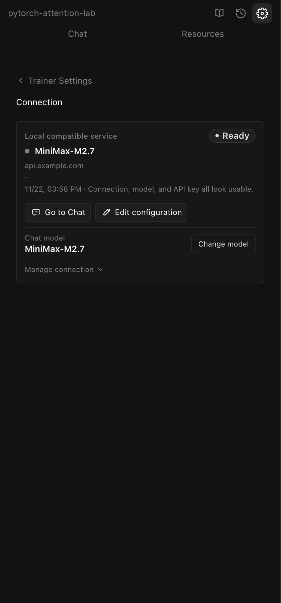
  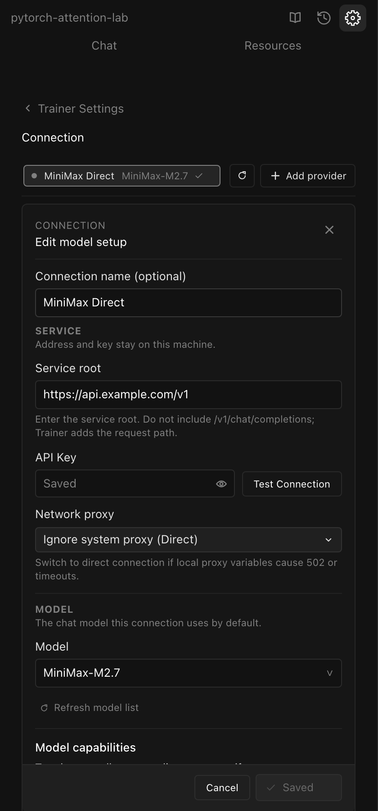
</p>

---

## Core Mechanics

### ① Verification Gates — you write the code, the code proves it

A training card never advances until verification runs against your real code; there is no manual "mark as done" button.

<p align="center"></p>

- **Local isolated sandbox** (`server/app/evaluator/service.py` — `EvaluatorService`): copies target files into a temporary directory, runs checks without polluting your repository with `.pytest_cache` or scratch artifacts, and scores each `acceptance_criteria` + `expected_symbols` item individually
- **VS Code Testing API attestation** (`extension/src/testing/`): real test pass/fail results attest directly to `/training/verification/attest` — unknown or interrupted runs never fabricate a pass
- **Remote-SSH read/verify proxy**: verifies files on remote hosts without moving API keys or your Trainer library off your local machine

### ② Long-Term Memory + Single Unified `<LibraryRoot>`

Everything Trainer knows about you, every resource you collect, and every lecture note it saves lives inside **one unified `<LibraryRoot>` directory** you choose — keeping your coding repositories 100% clean (`git status` zero pollution).

<p align="center"></p>

```text
<LibraryRoot>/
├── Trainer Library/          # Your browsable resources & auto-saved Markdown lecture notes
│   ├── Lecture Notes/        # Generated via `save_lecture_note` (readable directly in Finder/Explorer)
│   └── Papers/               # Imported PDFs, extracted web pages, and reference sheets
└── .trainer/
    └── runtime/              # SQLite (`trainer.sqlite3`), Qdrant semantic index, checkpoints & logs
```

- **Two-tier memory**: structured SQLite state + semantic retrieval (`Qdrant` with local fallback) scheduled by **`py-fsrs`** forgetting curves (`server/app/memory/review_scheduler.py`)
- **Live-flow review suppression**: due reviews pause while an active implementation thread is in flight so your focus is never hijacked
- **Cross-workspace fail-closed mastery**: succeeding in one project never silently inflates global mastery; transferable skill promotion requires multi-workspace evidence (`server/app/memory/transfer_skills.py`)

### ③ RethinkFun State-Flow Training Loop — fast coding, deep lectures, honest recall

Trainer's state-flow teaching philosophy is directly inspired by the technical educator and creator **[RethinkFun](https://rethink.fun)** ("intuitive first principles before formalism, step-by-step state transitions without textbook hand-waving, and tying runnable code straight back to understanding"). Training lives inside the conversation rather than behind detached management CRUD tables:

<p align="center"></p>

- **Three calibrated pedagogy lanes** (`server/app/pedagogy/` + `server/app/llm/`):
  - **Fast implementation guidance**: anchors on concrete symbols/failing checks without lecturing unnecessarily
  - **Deep concept lectures (`save_lecture_note`)**: derives equations and runtime state step-by-step with zero textbook filler ("obviously / trivially"), pairs minimal runnable code with theory, and automatically saves clean `.md` notes into `<LibraryRoot>/Trainer Library/`
  - **Grounded status & reasoning review (`inspect_learning_truth`)**: answers plan/mastery queries directly from server-verified facts without leaking internal UUIDs or JSON keys — and stays honest when zero evidence exists
- **5-phase handoff state machine** (`LEARN → TRY → VERIFY → REFLECT → RETURN` in `server/app/training/handoff.py`) backed by allowlisted verification sources only

### ④ You Write, Coach Guides

The coach inspects open files, diagnostics, and project structure on your behalf — while production edits stay strictly in your hands (`extension/src/` and `server/app/workspace/authority.py` enforce read-only source boundaries).

<p align="center"></p>

- Adaptive pacing (`AffectService` in `server/app/affect/service.py`) detects repeated errors or frustration and shifts into concise rescue mode automatically
- Single-step concrete guidance anchored in actual entry points instead of vague "explore the codebase" replies

### ⑤ Grounding & Explanation Quality

Replies are continuously checked against conversation context and code facts so coaching stays truthful:

- Deterministic reply continuity & recovery guards (`server/app/llm/coaching_recovery.py`, `coaching_replies.py`) catch empty streams, broken payloads, language drift, and provider errors cleanly
- Non-gating 5-dimension explanation quality scorer monitors learner-anchoring, symbol grounding, no-solution-dumping discipline, and causal clarity without faking teaching metrics

---

## Two Destinations + One Conversation

> Stable, calm architecture: **Chat** and **Resources** in the top bar; **Learning Drawer**, **Session History**, and **Settings** in the header utility trio; **one persistent Composer** across every surface.

| Surface | Role | What Lives Here |
|---|---|---|
| **Chat** (`coach`) | Primary workspace | Streaming RethinkFun teaching replies, saved `.md` lecture note badges, per-message actions, collapsible **FocusedPractice** inline cards (zero second textarea), 1-line top Learning Strip, `$` skill palette |
| **Resources** (`resources`) | Library & reader | Unified `<LibraryRoot>` folder tree (`Trainer Library/` & project links), quick local filter, rendered VS Code Markdown preview with bundled images/math, PDF/DOCX/URL ingest, recoverable Trash |
| **Learning Drawer** (`plan` / `training` / `progress` aliases) | Read-only memory sheet | Modal drawer floating above Chat (Composer stays mounted underneath) with three calm cards: **Current goal**, **Due practice**, and **Mastery** (one **4-segment capability bar**, zero percentages) |
| **Settings** (`settings`) | Configuration hub | 5-protocol Connection + **Proxy Direct Bypass**, Coach style + `$` Skills, **Workspace `<LibraryRoot>`** + Remote Companion, Language & Telemetry opt-in |

*(All six internal compatibility routes — `coach`, `plan`, `resources`, `training`, `progress`, `settings` — remain valid for deep links, commands, and session restore.)*

<p align="center">
  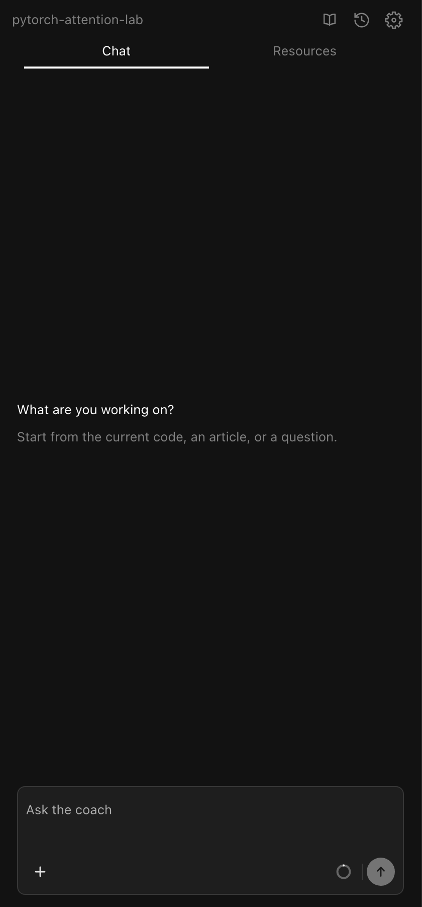
  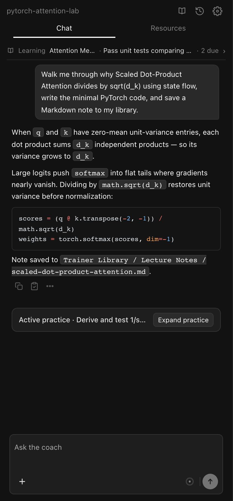
  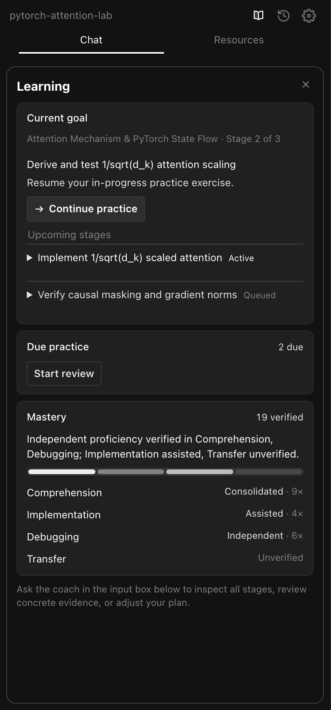
</p>
<p align="center">
  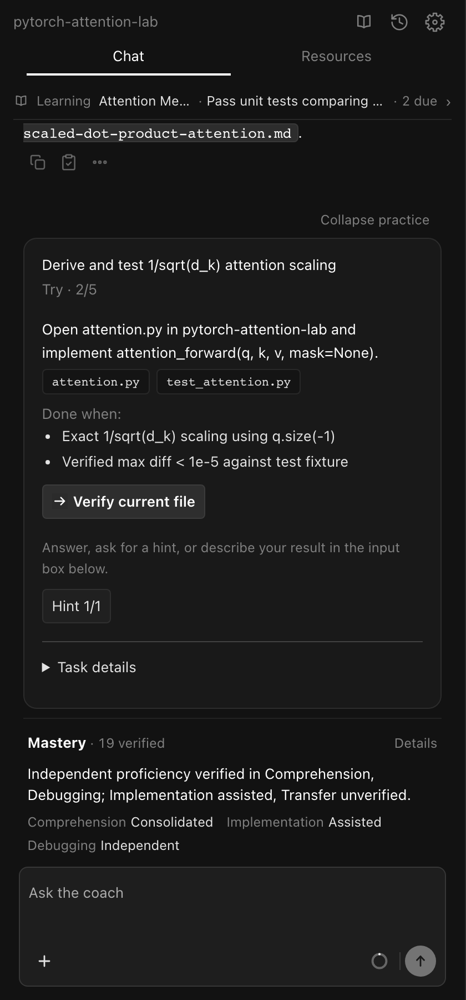
  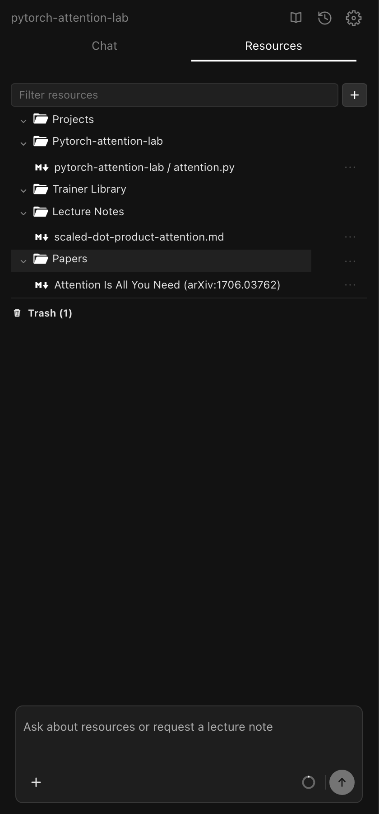
  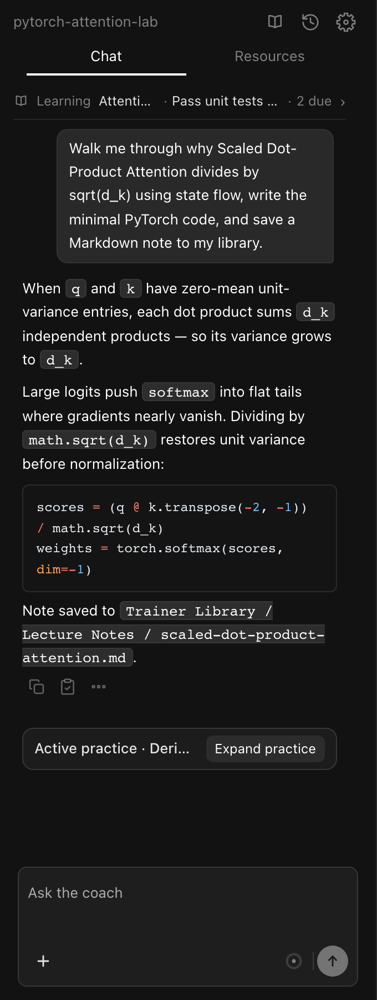
</p>

### Custom `$` Skills — create, share, install

Type `$` in the single Composer for instant access to built-in and custom skills. Manage skills in **Settings → Coach → Skills** — pure JSON (`{ trigger, title, prompt, keywords }`) with strict field bounds, zero `eval()`, and built-in trigger protection.

<p align="center">
  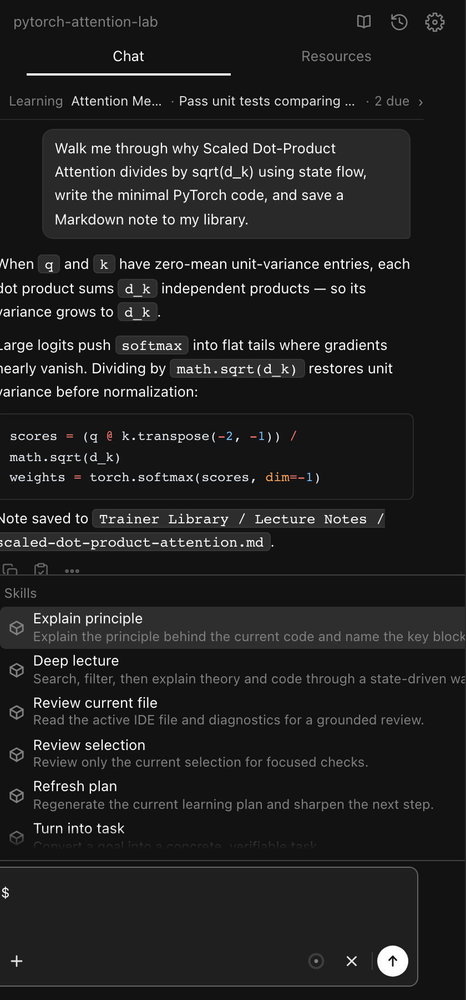
  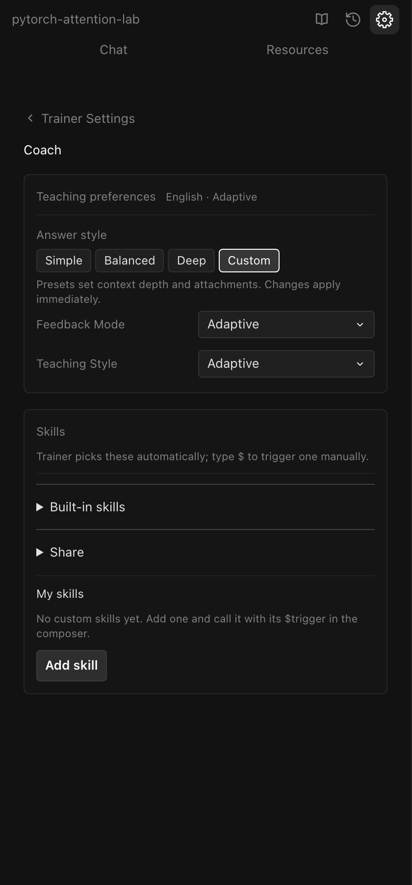
</p>

<p align="center"></p>

---

## Remote-SSH Companion

Trainer brings its full coaching and verification loop to remote Linux/SSH workspaces using a **Local Brain / Remote Hands** split:

- **UI extension + Python sidecar + API keys + `<LibraryRoot>`** always remain safely on your **local laptop/desktop**
- **`remote-extension/`** (`Trainer Workspace Companion`, `extensionKind: ["workspace"]`, bundled at `extension/bundled/remote/trainer-workspace-companion.vsix`) runs lightweight file inspection, symbol search, diagnostics reading, and command/test execution inside the remote host over VS Code's command bridge
- **Fail-closed remote write guard**: remote project directories remain strictly read-only for source writes; tests execute cleanly via `trainer.remote.verify` and attest verified evidence back locally

<p align="center">
  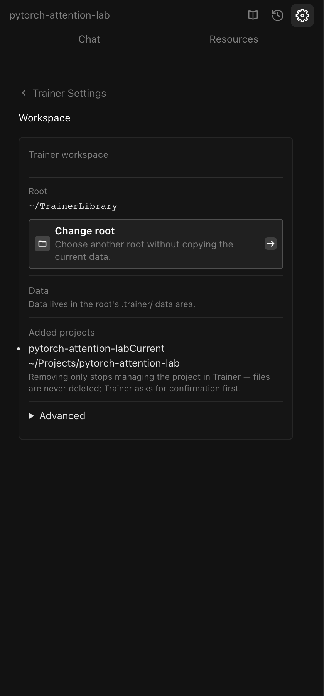
</p>

---

## Comparison

| Dimension | Vibe Coding Tools | Chat IDEs | Flashcard Apps | **Trainer** |
|---|---|---|---|---|
| Writes code for you | ✅ | ✅ | ❌ | ❌ (intentional boundary) |
| Verifies mastery against real code | ❌ | ❌ | ❌ | ✅ local sandbox + VS Code Testing + Remote-SSH |
| Persists across sessions & restarts | ⚠️ window context | ⚠️ summaries | ✅ | ✅ SQLite + Qdrant under `<LibraryRoot>` |
| Keeps your git repo untouched | ⚠️ mixes artifacts | ⚠️ | n/a | ✅ single `<LibraryRoot>`, zero repo writes |
| Spaced repetition on FSRS | ❌ | ❌ | ✅ | ✅ with live-flow review suppression |
| Workspace permission model | ❌ | ⚠️ basic trust | ❌ | ✅ 6-tier ladder + hard Remote-SSH write lock |
| Open automated test suite | closed | closed | closed | ✅ **4,288 unit/integration + 105 E2E cases** |
| Localization | ⚠️ | ⚠️ | ⚠️ | ✅ **8 languages** verified by CI completeness gate |

> Other tools help you produce code faster; **Trainer makes sure you actually own what you build.**

---

## Five-Minute Demo

1. **T+0:00 — Open Trainer**: Click the Trainer icon in the Activity Bar. You land straight in **Chat** — no forced configuration maze.
2. **T+0:30 — Connect Your Model**: Open **Settings → Connection**, pick your protocol + URL + model + Keychain API key (toggle **Ignore system proxy (Direct)** if behind local proxy vars), and run **Test Connection**.
3. **T+1:30 — Ask for Deep Principle or Code Help**: Ask *"Derive why Scaled Dot-Product Attention divides by sqrt(d_k) using state flow and save a Markdown note."* Trainer walks through every state change and writes the note directly into `<LibraryRoot>/Trainer Library/`.
4. **T+2:30 — Open Inline Practice**: Turn a concept or file gap into an inline **FocusedPractice** card inside Chat. No second editor box appears — you iterate directly in your code and reply in the single Composer.
5. **T+4:00 — Verify & Lock FSRS Schedule**: Click **Verify current file** (or run tests via VS Code Testing / Remote-SSH). Passing verification advances mastery across **Comprehension / Implementation / Debugging / Transfer** and schedules the next FSRS review.
6. **T+5:00 — Open Learning Drawer**: Click the top-right book icon to see your **Current goal**, **Due practice**, and unified **4-segment Mastery bar** in one glance.

---

## Why It Feels Different

### Honest Failure & Proxy Resilience
- Unknown API gateways are never silently guessed as OpenAI-compatible
- **Direct Proxy Bypass (`ignoreSystemProxy`)** lets requests bypass broken local `HTTP_PROXY` / `HTTPS_PROXY` environment variables per connection profile
- Empty streams, auth failures, and malformed tool calls surface actionable recovery states instead of spinner loops

### Endpoint Speed Test & Reasoning Controls
- Race candidate API base URLs in parallel (with warm-up exclusion) and adopt the fastest healthy endpoint in one click
- Thinking intensity adapts per verified model capability rather than blindly sending unsupported wire parameters

<p align="center"></p>

### Full-Power Unified Library
- Drag in PDFs (`PyMuPDF`), web pages (`Trafilatura`), DOCX (`mammoth` / `MarkItDown`), or auto-save coach Markdown lecture notes into `<LibraryRoot>/Trainer Library/`
- Instant local filter, VS Code rendered Markdown preview with images and KaTeX math, recoverable Trash (`move to trash`), and one-click **"Ask about this resource"** grounding

<p align="center"></p>

### Browser Quick Capture & Side Panel (`browser-extension/`)
- Chrome/Edge MV3 extension with **zero manual pairing codes** — auto-discovers the local Trainer sidecar (`127.0.0.1`)
- Capture web pages, arXiv/PDFs, GitHub repos (`README` or `with docs/`), or selected text directly into `<LibraryRoot>/Trainer Library/` or Composer draft, complete with offline FIFO delivery queues and a full-conversation Browser Side Panel in all 8 languages

<p align="center">
  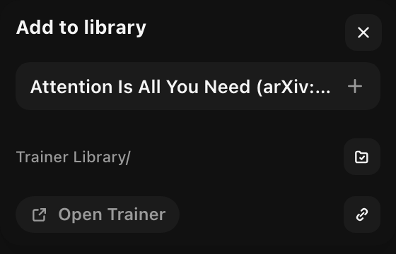
</p>

### MCP Integration (`docs/mcp.md`)
- Minimal opt-in stdio **Model Context Protocol** client (`TRAINER_MCP_SERVERS`) exposing external tools (e.g., GitHub / Gitee MCP servers) inside the ReAct agent loop (`mcp_<server>_<tool>`), governed by the same fail-closed 6-tier workspace authority ladder — see [`docs/mcp.md`](docs/mcp.md)

---

## Architecture

### System Topology

```text
┌─────────────────────────────────────────────────────────────────────────┐
│                             VS Code Window                              │
│  ┌──────────────────────────────┐    ┌────────────────────────────────┐ │
│  │  Trainer Sidebar (UI Host)   │    │  Remote-SSH Workspace (Remote) │ │
│  │  React 19 + Zustand (8 i18n) │    │  remote-extension (Companion)  │ │
│  │  Chat / Resources + Drawer   │◄──►│  Read / Search / Diagnostics / │ │
│  └──────────────┬───────────────┘    │  Verified Test Execution Only  │ │
│                 │                    └────────────────────────────────┘ │
│  ┌──────────────▼───────────────┐                                       │
│  │  Extension Host (TypeScript) │  • SecretStorage (OS Keychain Keys)   │
│  │  CommandRegistry · Workspace │  • Testing API → Verification Attest  │
│  │  Gateway · Sidecar Manager   │  • Browser Extension MV3 Bridge       │
│  └──────────────┬───────────────┘                                       │
│                 │ http://127.0.0.1 + SSE stream                         │
│  ┌──────────────▼───────────────┐    ┌────────────────────────────────┐ │
│  │  FastAPI Sidecar (Python)    │───►│  Single Unified <LibraryRoot>  │ │
│  │  • ReAct Loop + MCP Client   │    │  • Trainer Library/ (Notes/PDF)│ │
│  │  • RethinkFun Pedagogy       │    │  • .trainer/runtime/           │ │
│  │  • 5-Protocol + Proxy Bypass │    │    trainer.sqlite3 · Qdrant ·  │ │
│  │  • FSRS Scheduler + Memory   │    │    Checkpoints · Audit Ledger  │ │
│  │  • 6-Tier Workspace Authority│    │  (Zero User Repo Writes)       │ │
│  └──────────────────────────────┘    └────────────────────────────────┘ │
└─────────────────────────────────────────────────────────────────────────┘
```

### Directory Layout

| Directory | Contents | Measured Size |
|---|---|---|
| `extension/src/` | VS Code Extension Host: commands, SecretStorage providers, WorkspaceGateway, SidecarProcessManager | `79` TS files (~`53,286` lines) |
| `extension/webview/src/` | React workbench: Two Destinations, Learning Drawer, Single Composer, Shiki/KaTeX/Mermaid, 8 locales | `233` TS/TSX + `53` CSS files (~`120,507` lines) |
| `extension/tests/` | Node test suite (`node:test`): host, webview governance, i18n, browser-capture, security | `324` files · **`2,470` tests** |
| `server/app/` | FastAPI sidecar: agent loop, RethinkFun pedagogy, memory/FSRS, ingest, evaluator, authority | `234` Python files (~`178,520` lines) |
| `server/tests/` | Backend `pytest` suite covering API routes, pedagogy, memory, provider transport, authority | `301` files · **`4,300` collected tests** |
| `shared/src/` | Shared deterministic TypeScript governance & protocol modules reused across Host, Webview & Tests | `77` files (~`30,414` lines · `523` exports) |
| `remote-extension/src/` | Remote-SSH Companion (`extensionKind: ["workspace"]`) for remote file & verification ops | `2` TS files (`746` lines) |
| `browser-extension/` | Chrome/Edge MV3 Capture popup, offline queues, context menus, and Side Panel client | `9` files (`7,245` lines) |
| `extension/bundled/` | Frozen PyInstaller sidecar runtime & bundled `trainer-workspace-companion.vsix` | ~`270 MB` |

### Canonical Snapshot Contract (`WorkbenchSnapshot`)

All primary state-carrying HTTP routes return the canonical **`WorkbenchSnapshot`** (`33` top-level fields in `server/app/core/models.py`) synchronized incrementally via `snapshot_revision` across `extension/src/`, `shared/src/`, and the React store.

---

## Safety Model

- **API keys stay in OS Keychain / VS Code `SecretStorage`** — never written into workspaces, `<LibraryRoot>`, snapshots, or logs (`npm run verify:credentials` scans every tracked file)
- **VS Code Workspace Trust enforced fail-closed** — untrusted windows block inspection and remote verification actions
- **6-tier Workspace Authority ladder** (`server/app/workspace/authority.py`): strictly read-only by default on user coding repos; Remote-SSH workspaces lock out structural writes unconditionally
- **Unified `<LibraryRoot>` + Recoverable Trash**: deletions move resources cleanly into recoverable trash rather than unrecoverable raw deletion; user coding repos receive **zero** Trainer dotfiles or caches
- **Pure-JSON Skill Sharing**: `$` skills undergo schema/length validation with zero dynamic code execution
- **Telemetry strictly opt-in and off by default**: exports only coarse local event counts when explicitly enabled — never source code, file paths, or prompts

---

## Quality Gates

> Every figure below reflects verified workspace checks on `main` (`v1.6.4`):

| Gate | Scope & Verified Result | Command |
|---|---|---|
| **Server Tests (`pytest`)** | **91 files · 2,828 tests** | `npm run test:server` |
| **Extension & Shared (`node:test`)** | **161 files · 1,460 tests** (`1,460` passed, `0` skipped, `0` failed) | `npm run test:extension` |
| **Static Analysis & Types** | `ruff check` (`0` errors) · `pyright` (`0` errors, over `server/app` **and** `server/tests`) · CSS + `tsc -b` (`0` errors) | `npm run check && npm run verify:server-pyright` |
| **UI Geometry Matrix** | Single composer sovereignty, 2-destination shell, overflow checks (`340/420/460px`, dark/light, zh/en) | `npm run verify:ui-geometry` |
| **i18n Completeness Gate** | **194** `appUiCopy` + **196** `settingsText` + **273** `hostCommandCopy` call sites across **8 languages** (`0` missing / `0` leaks) | `npm run verify:i18n` |
| **Copy Vocabulary & Secrets** | **53** UI copy files clean (`0` internal jargon violations) · **5,296** repo files clean (`0` plaintext credentials) | `npm run verify:copy-vocabulary && npm run verify:credentials` |
| **Playwright E2E & Remote-SSH** | **6** Playwright spec files (`105` test cases, all passing locally) · Real-Sidecar Experience Matrix and Ubuntu Remote-SSH L2 (`20/20`) last verified 2026-11-22 | `npm run test:experience-matrix` · `npm run test:remote-ssh-e2e` |
| **CI Release Targets** | **3 native targets**: `win32-x64`, `darwin-arm64`, `linux-x64` (Windows/Linux ARM64 not yet CI-verified) | `.github/workflows/release.yml` |

*(Note: Manual human pedagogy sign-off `T-0028` remains tracked in [`docs/TRIAL-1.5.0-RC.md`](docs/TRIAL-1.5.0-RC.md) and `.trainer-convergence/acceptance-matrix.json` as human-gated.)*

---

## i18n · Eight Languages

Full UI copy, settings, host commands, browser capture extension, and README documentation live in parallel across **8 languages**:

`zh-CN` (简体中文) · `en-US` (English) · `es-ES` (Español) · `fr-FR` (Français) · `de-DE` (Deutsch) · `ja-JP` (日本語) · `ko-KR` (한국어) · `pt-BR` (Português)

Verified cleanly by `npm run verify:i18n` with automated locale leak and missing-key guards (`extension/webview/src/lib/i18n/copy.ts`).

---

## Acknowledgements

- **Runtime & HTTP**: [FastAPI](https://github.com/fastapi/fastapi) · [Uvicorn](https://github.com/encode/uvicorn) · [Pydantic](https://github.com/pydantic/pydantic) · [httpx](https://github.com/encode/httpx) · [openai-python](https://github.com/openai/openai-python)
- **Memory, Spaced Repetition & Ingestion**: [py-fsrs](https://github.com/open-spaced-repetition/py-fsrs) · [qdrant-client](https://github.com/qdrant/qdrant-client) · [PyMuPDF](https://github.com/pymupdf/PyMuPDF) · [Trafilatura](https://github.com/adbar/trafilatura) · [MarkItDown](https://github.com/microsoft/markitdown)
- **Frontend & Rendering**: [React](https://github.com/facebook/react) · [Vite](https://github.com/vitejs/vite) · [Zustand](https://github.com/pmndrs/zustand) · [Zod](https://github.com/colinhacks/zod) · [react-markdown](https://github.com/remarkjs/react-markdown) · [KaTeX](https://github.com/KaTeX/KaTeX) · [Shiki](https://github.com/shikijs/shiki) · [Mermaid](https://github.com/mermaid-js/mermaid) · [@tanstack/react-table](https://github.com/TanStack/table) · [PDF.js](https://mozilla.github.io/pdf.js/) · [mammoth](https://github.com/mwilliamson/mammoth.js) · [docx-preview](https://github.com/VolodymyrBaydalka/docx-preview)
- **Testing & Packaging**: [pytest](https://github.com/pytest-dev/pytest) · [Hypothesis](https://github.com/HypothesisWorks/hypothesis) · [ruff](https://github.com/astral-sh/ruff) · [pyright](https://github.com/microsoft/pyright) · [TypeScript](https://github.com/microsoft/TypeScript) · [Playwright](https://github.com/microsoft/playwright) · [PyInstaller](https://github.com/pyinstaller/pyinstaller)
- **Pedagogy & Methodological Inspiration**: Teaching methodology inspired by creator & AI educator **[RethinkFun](https://rethink.fun)** (state-flow intuition before formulas) · [py-fsrs](https://github.com/open-spaced-repetition/py-fsrs) / [fsrs4anki](https://github.com/open-spaced-repetition/fsrs4anki)
- **Visual Assets**: Generated with **[GPT Image](https://github.com/AI-yyf/trainer/tree/main/assets)** (`assets/MASCOT.md` · `assets/BANNER_PROMPT.md` · `assets/FEATURE_PROMPTS.md`)

---

## License

[MIT](LICENSE)

---

## Citing Trainer

```bibtex
@software{trainer2026,
  title  = {Trainer: A Long-Term Coding Coach Living in Your Editor},
  author = {AI-yyf and contributors},
  year   = {2026},
  url    = {https://github.com/AI-yyf/trainer},
  note   = {v1.6.4}
}
```

---

<div align="center">

**// Train Your AI · Grow With Your AI**

`v1.6.4` · Made with coffee, FSRS, RethinkFun state-flow pedagogy, 4,393 automated tests, and a coach that refuses to write your code for you.

</div>
