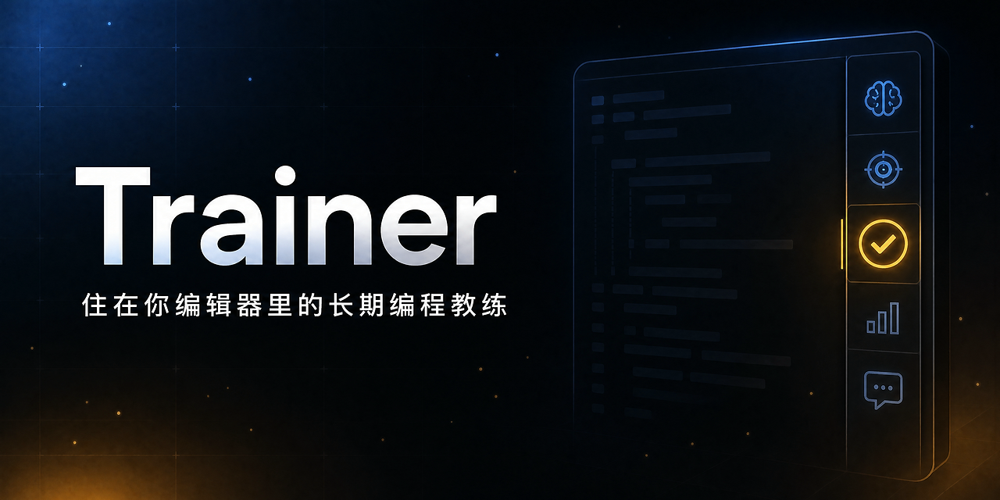
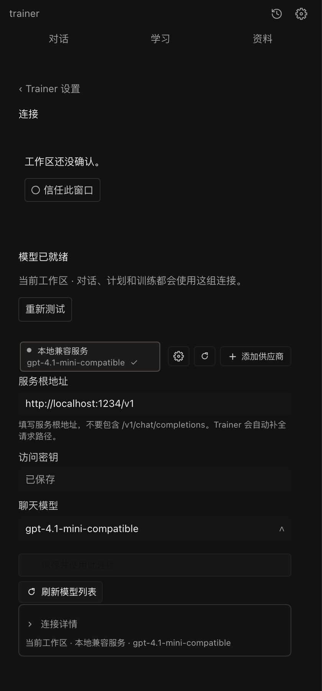
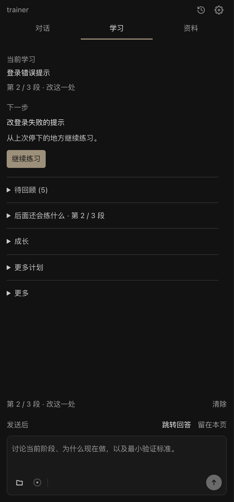
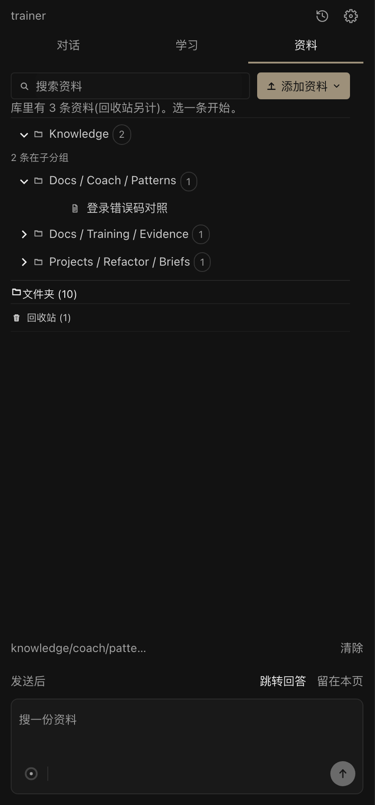
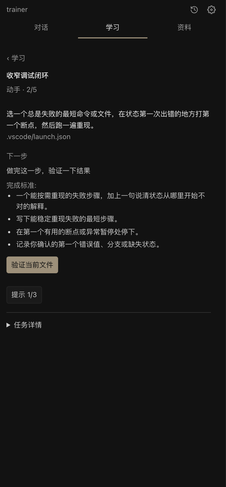
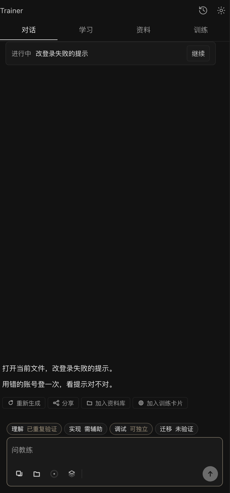
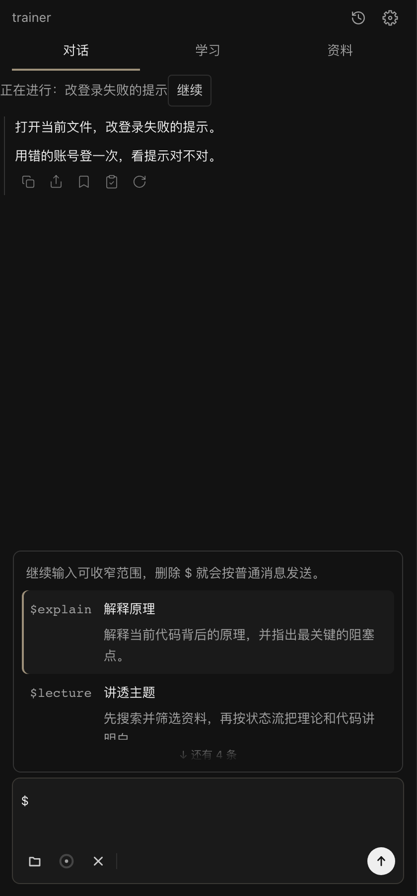
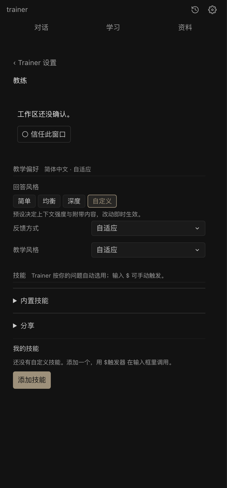
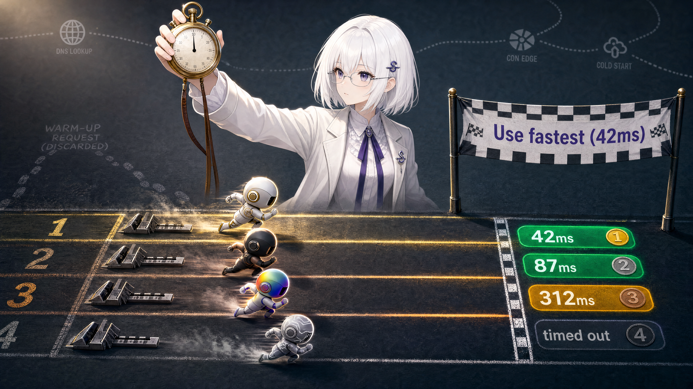

# Trainer

<div align="center">



**A long-term technology coach that starts with coding, living in your VS Code sidebar.**

**It plans, drills, verifies, and remembers everything about you — but never writes your code.**

**// Output ≠ Growth // Verify + Review = Growth**

English · [简体中文](README_zh-CN.md) · [Español](README_es-ES.md) · [Français](README_fr-FR.md) · [Deutsch](README_de-DE.md) · [日本語](README_ja-JP.md) · [한국어](README_ko-KR.md) · [Português](README_pt-BR.md)

[](https://github.com/AI-yyf/trainer/blob/main/extension/package.json)
[](LICENSE)
[](#install)
[](#quality-gates)
[](#i18n--eight-languages)

[Why](#why-trainer-exists) ·
[Install](#install) ·
[Setup](#three-steps-no-fourth) ·
[Mechanics](#core-mechanics) ·
[Three Destinations](#three-destinations) ·
[Comparison](#compare) ·
[5-Min Demo](#five-minute-demo) ·
[Design](#why-it-feels-different) ·
[Architecture](#architecture) ·
[Safety](#safety-model) ·
[Quality](#quality-gates) ·
[Acknowledgements](#acknowledgements) ·
[🎭 The Cast](docs/CAST.md)

</div>

---

## Why Trainer Exists

> Developers don't stall for lack of tutorials.
> They stall because nothing closes the learning loop.

A chat with an LLM evaporates the moment it ends; videos are passive; the concept you almost understood on Tuesday is gone by Friday.

Worse: **vibe coding** — letting AI write code for three months while you understand none of it.

Bookmarks pile up while output stays flat. Repos grow while your mind empties.

**Trainer solves this from inside the editor.**

It's not a chat shell — it's a coach with memory, a curriculum, and an exam policy:

- It **plans** your learning into stages and tracks where you actually are — not where you feel you are
- It **trains** you with flash cards, theory drills, and scenario experiments
- It **verifies** mastery against your real code — talking about FastAPI counts for nothing until the current file proves it
- It **remembers** you across sessions, projects, and weeks, scheduling reviews on the FSRS forgetting curve
- It **never writes production code for you** — you write, it teaches, **you grow together**

**And the discipline travels beyond code.** The same verify-first loop now covers literature and language learning: close reading with ¶-anchored annotation, imitation writing anchored back to the source, theory-concept cards — each subject taught through its own verifier pack and progress dimensions, not code checks in disguise.

<div align="center">

| vibe coding · today's norm | Trainer · how it should be |
|:---:|:---:|
| `def ship(code):` <br> `    ai.write(code)` <br> `# did you understand it?` <br> `    return forget(code)` | `def ship(code):` <br> `    you.write(code)` <br> `    ai.verify(code)` <br> `    you.recall(code)` <br> `    return grown(code)` |
| output = forgetting | output + memory + review = growth |

</div>

---

## Install

**From VSIX (prebuilt, three platforms):**

Grab the `.vsix` for your platform (`darwin-arm64` / `linux-x64` / `win32-x64`) from the [latest published release](https://github.com/AI-yyf/trainer/releases/latest).

VS Code Extensions panel → `···` → *Install from VSIX* → reload window.

**From source:**

```bash
git clone https://github.com/AI-yyf/trainer.git
cd trainer && npm install
cd server && python3 -m venv .venv && source .venv/bin/activate
pip install -e ".[dev]"
cd .. && npm run build
```

Open this repo in VS Code and press F5 (Extension Development Host), or install the packaged VSIX.

**Requirements:** VS Code ≥ 1.96 · Python ≥ 3.12 (source build) · macOS / Linux / Windows

---

## Three Steps, No Fourth

1. Open the Trainer sidebar → Settings
2. Paste your relay connection info (the full JSON block copied from a relay dashboard is parsed automatically — endpoint and key are split out for you) → paste your API key
3. Hit **Save & Connect**

Trainer pulls the live model list, picks a default model, and verifies the streaming path in one pass.

A bad key reports `invalid_key_or_permission` — not a vague spinner.

<p align="center">
  
</p>

---

## Core Mechanics

### ① Verification Gates — you write the code, the code proves it

A training card cannot advance to "implemented" until verification runs against your actual file; a manual "mark done" button is deliberately absent.

The fastest way to fake learning is checking every box. Trainer refuses.

<p align="center"></p>

**How:**
- Server `EvaluatorService` **copies** the current file into a `tempfile.TemporaryDirectory`, runs ruff + pyright + pytest, tears down the tempdir
- Tools **never** run in the learner&apos;s project — no `.pytest_cache` pollution
- Every check reports per-criterion Matched/Missing detail against an explicit `acceptance_criteria` + `expected_symbols` list
- Code: `server/app/evaluator/service.py:198-312`

### ② Long-Term Memory — FSRS forgetting-curve scheduling

Mastery, weak spots, and due reviews live in SQLite with Qdrant semantic retrieval.

Reviews surface on the FSRS forgetting curve — they show up right before you&apos;d forget, and stay quiet while you still remember.

<p align="center"></p>

**How:**
- Two-layer memory: structured (`StructuredMemoryService`, ~480 records) + semantic (Qdrant + sentence-transformer offline fallback)
- **`_should_delay_live_thread_reviews()`** — reviews are actively suppressed while an idea-implementation flow is live, so train of thought is never interrupted
- **Transferable skills fail closed across workspaces**: success in one project never becomes global mastery; promotion requires passing in ≥2 workspaces
- Key code: `server/app/memory/service.py:1357-1597` · `transfer_skills.py:81-113` · `review_scheduler.py:522-544`

### ③ The Training Loop — appears when due, advances when verified

Flash cards, theory drills, and scenario experiments queue in the Training view: reviews appear when due, cards advance when verified, and any knowledge gap in a conversation converts into a training card with one click.

<p align="center"></p>

**How:**
- **5-phase state machine** `LEARN → TRY → VERIFY → REFLECT → RETURN`, every transition logged to `phase_history`
- **Trusted verification source whitelist**: `automated_test` / `evaluator` / `ide_current_file` / `server_evaluator` / `test_runner` / `verification_service` — a "manual claim" can never advance a card
- **Body-level idempotent persistence**: a resent delivery replays through the reliability ledger instead of double-recording; an interrupted sidecar restart expires orphaned saves honestly — `connection_lost ≠ task_failed`
- The card UI&apos;s `onSkip` / `onRate` handlers are **`@deprecated Unused`** — the only progression path is `onCardStatusTransition`
- Key code: `server/app/training/handoff.py:40-47` · `server/app/training/reliability.py` · `extension/webview/src/components/training/TrainingCardPanel.tsx:78-85`

### ④ You Write, Coach Guides

The coach reads your files, checks diagnostics, and searches the workspace — but production code always comes from your hands.

`direct` answers immediately; `coach-first` makes you think first. **The cognitive load is yours, not its.**

<p align="center"></p>

**How:**
- `PedagogyService` emits a 12-field `ImplementationGuide` every turn — every field is a constraint on what the coach may ask next
- `ImplementationCoach._current_step` is anchored to "the first failing path" or "the first known entry point" — never "explore the codebase"
- Affect-driven tone: `AffectService` switches to `concise_rescue` mode after two consecutive failures
- Guided-mode prompts carry a distilled seven-rule RethinkFun style contract: state before solution, reasoning sentences sitting **beside the code they explain**, per-snippet callbacks to the concept each block realizes, full solution blocks off-limits (per-block ≤ ~10 lines), a one-line known/next closing, and no filler phrases
- Key code: `server/app/pedagogy/implementation_coach.py:140-186` · `affect/service.py:142-152` · `server/app/llm/prompts.py` (`_guided_mode_requirements`)

### ⑤ Grounding & Explanation Quality — every reply is measured, not trusted

Every coach turn flows through the `TeachingTurnFacts` contract and a 5-check grounding evaluation: fabricated code symbols, contradictory next steps, unanchored file pointers, missing verification hints — each one is caught before the reply ships, and a next step that isn&apos;t anchored reads as "confirm before acting", never as a fact. The downgrade marker renders exactly once per message — on the first surface that presents the next step — instead of trailing every text block.

On top of grounding, a **non-gating explanation-quality evaluation** scores five dimensions per reply: does it address the learner, is it in the learner&apos;s language, does it anchor the next step&apos;s symbols, does it avoid dumping full solutions in guided mode, does the reasoning sit next to the code it explains. Inputs that cannot decide a dimension return `unclear` — never a guess.

The 28-case dual-turn acceptance journey runs both evaluations against a real model. Latest run: **55 通过 / 1 次诚实回退** (post-calibration); the earlier round was **56/56** (pre-calibration) — both rounds are recorded honestly, and the latest run is the current fact. Per-dimension data (e.g. reasoning markers present in 20 of 38 code-referencing turns) is in [`docs/maturity/teaching-journeys-report.md`](docs/maturity/teaching-journeys-report.md) — the single source of truth for acceptance facts (machine-readable summary: [`docs/maturity/ACCEPTANCE_FACTS.md`](docs/maturity/ACCEPTANCE_FACTS.md)).

- Key code: `server/app/llm/turn_grounding.py` (governance) · `server/app/llm/explanation_quality.py` (quality) · `scripts/maturity/real_teaching_journeys_minimax.py` (acceptance harness)

---

## Three Destinations

> Chat, Learning and Resources are always visible. History and Settings are header utilities; training and growth live inside Learning.

| View | Role | One-liner |
|-----------|------|--------|
| **Coach** | Streaming chat | **Entry**: tool access + `$` skill palette + image attachments + answer modes |
| **Plan** | Learning plan | **Map**: stages, progress, evidence, plan freeze/unfreeze |
| **Resources** | Library | **Bookshelf**: FTS5 search + 3-tier sandbox preview + restorable trash |
| **Training (inside Learning)** | Focused activity | **Playground**: FSRS flash cards + theory drills + scenario experiments + verification gates |
| **Settings (header utility)** | Index → detail | **Console**: 59 commands + endpoint speed test + thinking intensity + workspace admission |

The full chat composer belongs to Chat. Learning and Resources carry structured context back through **Ask Coach**; focused practice owns its answer and reflection forms. The six existing routes and commands remain available. Learning contains the formal plan, FSRS review and four evidence-derived growth dimensions. Settings opens an index for Connection, Coach, Workspace and Preferences.

Learning and Resources each carry a surface control that opens the same view full width in an editor tab (`trainer.view.openInEditor` — same bundle, same governed commands) with a "back to sidebar" control in the panel. The sidebar header stays text-free — the redundant title is removed and re-asserted on every visibility change; identity lives in the in-webview session header.

<p align="center">
  
  
  
</p>

### Coach View (entry)

Streaming coach chat with tool access, `$` skill palette, image attachments, answer modes, context-usage ring, session history and share.

**A coach reply highlights one next step. Every delivered reply carries its shortcuts as icon buttons — no overflow menu, nothing hides behind "···":**

- **Copy reply as Markdown** / **share** — icon-only, each revealing its own name on hover or keyboard focus (CSS labels from the same eight-language table as `aria-label`, not native tooltips)
- **Save to library** (searchable + previewable)
- **Convert to verifiable training card** — per message, not per session

<p align="center"></p>

### Custom `$` Skills — create, share, install

Type `$` in Chat to open a searchable palette with six default entries. Manage custom skills in Settings → Coach → Skills: beyond built-ins, you can wrap your own prompts into skills with trigger words and keywords, share them with others, or install skills others share — **all through a pure data channel, no code execution**.

<p align="center">
  
  
</p>

<p align="center"></p>

**How:**
- Custom skills are pure-JSON imports — `{ _type, version, trigger, title, prompt, keywords }`; no `eval`, no `Function()`, no code path
- Hard caps: prompt ≤ 4000 chars, title ≤ 160, keywords ≤ 16, user skills ≤ 24
- Built-in triggers win collisions — a user-imported `$explain` cannot shadow the shipped one
- Key code: `shared/src/skillCatalog.ts:614-764`

---

## Compare

> Trainer isn&apos;t here to replace anyone — it fills a gap no one else owns.

| Dimension | vibe tools | chat IDEs | flashcard apps | **Trainer** |
|---|---|---|---|---|
| Writes code for you | ✅ | ✅ | ❌ | ❌ |
| Verifies your code | ❌ | ❌ | ❌ | ✅ against the current file |
| Remembers across sessions | ⚠️ context window | ⚠️ summaries | ✅ | ✅ SQLite + Qdrant |
| Spaced repetition on FSRS | ❌ | ❌ | ✅ | ✅ + live-flow suppression |
| Workspace permission tiers | ❌ | ⚠️ trust dialog | ❌ | ✅ 6 tiers + remote hard-lock |
| Card progression gated | ❌ | ❌ | ⚠️ manual checkboxes | ✅ enforced verified |
| Transferable skill promotion | ❌ | ❌ | ❌ | ✅ fail-closed across workspaces |
| Works beyond code (literature & languages) | ❌ | ❌ | ❌ | ✅ built-in literature/language verifier packs |
| i18n | ⚠️ | ⚠️ | ⚠️ | ✅ 600+ keys × 8 |
| Test suite | closed source | closed source | closed source | ✅ **5,804 cases** (open) |
| Refuses to write for you | ❌ | ❌ | n/a | ✅ a philosophical bottom line |

> One-liner: other tools make you write faster; Trainer makes you actually write.

---

## Five-Minute Demo

> Here&apos;s what your first five minutes actually look like.

### T+0:00 — Open the sidebar

Click the Trainer icon in the activity bar. The sidebar opens, defaulting to **Coach view**.

<p align="center">
  
</p>

### T+0:30 — Configure provider (first time only)

Settings → paste your relay JSON + API key → Save & Connect.

Trainer pulls the live model list, picks a default, verifies streaming. Bad key → tells you `invalid_key_or_permission`.

### T+1:30 — First conversation

Switch to Coach, type: `@current_file explain what this async/await is doing?`

Trainer streams a reply. **It does not rewrite your code.** It points at line 17: "this is fan-out"; line 23: "this is the barrier. To actually learn this, write a version that cancels one task mid-flight — I&apos;ll run verification with you."

### T+2:30 — One-click training card

Hover over the reply. Icon shortcuts — hover one to read its name: `Copy` / `Save to library` / **`Create training card`**.

Click `Create training card` → card generated → enters Training view → FSRS schedules it for 3 days from now.

### T+4:00 — Write yourself, get verified

You write code. Trainer **does not write it for you**.

Open Training → flip card → see pass criteria → write → click `Request verification` → Trainer runs ruff + pyright + pytest in a sandbox → reports pass or flags missing criterion.

### T+5:00 — The next day

Open VS Code tomorrow: Trainer auto-restores — last session, plan, card progress all there.

That card pulses on the FSRS rhythm disk — due today.

**You are no longer a vibe-coding developer.**

---

## Why It Feels Different

### Honest Failure

A bad key says `invalid_key_or_permission`; unreachable says `network`; a corrupted reply says "this reply wasn&apos;t read clearly, resend" — **broken output is never dressed up as an answer**.

Unknown gateways aren&apos;t silently assumed OpenAI-compatible.

**How:** error classifier (`provider_service.py:2823-2874`) + credential scrubbing (`provider_protocols.py:640-681`) + unknown-fingerprint probing (`provider_gateway.py:39-70`).

### Endpoint Speed Test

Provider endpoints race in parallel (**warm-up first to cancel cold-start penalty, then timed**).

Green under 500 ms, yellow under 1 s. One click adopts the fastest.

<p align="center"></p>

**How:** `Promise.all` + a discarded warm-up request per URL before the timed one (`providerWebviewCommands.ts:2275-2352`).

### Context-Usage Ring

A live context-usage ring sits atop the conversation — **you see compression coming before it happens**.

### Thinking Intensity

Gated on per-model evidence — declared capability **or** verified probe. Never blindly forwarded. The control adapts per model: a probe that explicitly observed rejection hides it; an unknown model shows it once a probe has assessed thinking, restoring your last strength choice; a declared or verified model always shows it — and the control never gates sending (`shared/src/providerThinking.ts`).

### Full-Power Library

<p align="center"></p>

Uploads indexed on arrival, FTS5 full-text search, **3-tier sandbox preview** (A rich / B converted / C metadata + native editor fallback), deletions go to restorable recycle bin.

**3-zone physical separation**: workspace / sandbox / trash. Never mixed.

Coach replies drop in with one click — **if you can search it back, you actually learned it**.

### Long-Horizon State

Plans freeze and unfreeze; sessions survive restarts; card progress lives in SQLite; reviews come due on the FSRS curve — **not on a to-do list**. On reload a persisted session id is re-verified with the server: a stale id resumes the workspace&apos;s latest thread instead of leaving a session that silently discards history (`extension/src/core/runtimeRehydration.ts`).

### Browser Quick Capture · 浏览器快速采集

Right-click any page, link or GitHub repository and send it straight to the Trainer library — the [`browser-extension/`](browser-extension/) extension is a **pure data channel**: it never injects scripts into pages and never uploads page content, it only hands the local sidecar a URL.

<!-- 截图占位：assets/screenshots/browser-capture.png（右键菜单 + 弹窗最近采集记录） -->

- **Three capture kinds**: page, PDF link, GitHub repo (README of the default branch).
- **Server-side fetch**: the sidecar performs the controlled, DNS-pinned fetch — web pages are extracted with trafilatura, PDFs run through the existing PDF ingest, repositories record the repo URL plus their README.
- **Local only**: `host_permissions` cover `http://127.0.0.1/*` and `http://localhost/*`; nothing else is reachable from the extension.

**Load it (unpacked):**

1. Open `chrome://extensions` (Edge: `edge://extensions`) and enable **Developer mode**.
2. Click **Load unpacked** and select the `browser-extension/` folder.
3. Keep Trainer running; right-click a page → **添加到 Trainer 资料库**.

**Download the zip instead:**

```bash
npm run package:browser-extension   # → dist/trainer-capture-extension.zip
```

Unzip it anywhere and load that folder as an unpacked extension. The extension popup stores the sidecar address (default `http://127.0.0.1:8765`), the target workspace ID, and — when the VS Code extension launched the sidecar — its per-launch access token.

### MCP Integration · MCP 接入

The coach agent can call external MCP servers (Gitee, GitHub, …) through a minimal stdio client — `initialize` / `tools/list` / `tools/call`, nothing more. **Off by default**: the sidecar only spawns servers explicitly listed in `TRAINER_MCP_SERVERS`, and every discovered tool joins the ReAct tool registry as `mcp_<server>_<tool>` under the same six-tier workspace authority gate (read-only tools pass; writes fail closed — an unrecognized verb counts as a write). Tokens ride the subprocess environment, never Trainer storage or logs, and `GET /mcp/status` reports each server as `ok` / `unavailable` / `unprobed` instead of failing silently.

Configuration examples for the official Gitee / GitHub servers, the full security boundary and tests: [`docs/mcp.md`](docs/mcp.md).

---

## Architecture

### System Topology

```
┌─────────────────────────────────────────────────────────────┐
│                    VS Code Window                            │
│  ┌───────────────────────────────────────────────────────┐  │
│  │   Trainer Sidebar                                     │  │
│  │   (React 19 + Zustand, 8-language i18n, 24 governance)│  │
│  │                                                       │  │
│  │   ─── postMessage ─── CommandRegistry ── 59 commands  │  │
│  │                                       │               │  │
│  └───────────────────────────────────────┼───────────────┘  │
│                                          │                   │
│                          ┌───────────────▼──────────────┐    │
│                          │  FastAPI sidecar (127.0.0.1)│    │
│                          │  PyInstaller --onedir frozen│    │
│                          │  (250 MB / 6 platform arch) │    │
│                          │                              │    │
│                          │  ├── ReAct agent loop        │    │
│                          │  │   (dual-channel stream)   │    │
│                          │  ├── TeachingTurnFacts       │    │
│                          │  │   grounding (5 checks)    │    │
│                          │  ├── Explanation quality     │    │
│                          │  │   (5 dims, non-gating)    │    │
│                          │  ├── Pedagogy (12-field guide)│   │
│                          │  ├── Affect (failures→rescue)│    │
│                          │  ├── Memory                  │    │
│                          │  │   SQLite + Qdrant semantic│    │
│                          │  ├── FSRS scheduler          │    │
│                          │  ├── Authority (6 tiers)     │    │
│                          │  ├── Provider (5 protocols)  │    │
│                          │  ├── Training handoff (5 ph.)│    │
│                          │  └── Resources (3 zones+FTS5)│    │
│                          │                              │    │
│                          │  ─── 24 shared pure fns ────│    │
│                          │      (host + webview + test)  │    │
│                          └──────────────────────────────┘    │
└─────────────────────────────────────────────────────────────┘
```

### Directory Layout

| Folder | Contents | Size |
|---|---|---|
| `extension/src/` | Host: commands, workspace trust, secret storage, sidecar lifecycle | ~30k lines TS |
| `extension/webview/` | React workbench: 3 destinations / 6 routes, store/selector views (mega views ≤ 25 props), single i18n home | ~87k lines TSX |
| `extension/tests/` | node:test suite (276 files / 2,179 cases) | 87,308 lines |
| `server/app/` | FastAPI brain: agent / pedagogy / memory / FSRS / training / grounding / explanation quality | ~138k lines Python |
| `server/tests/` | pytest suite (221 files / 3,625 cases) | 123,352 lines |
| `shared/src/` | **Shared pure functions + 24 governance modules** (host + webview + test) | ~3k lines TS |
| `browser-extension/` | MV3 browser capture: page / PDF / GitHub repo → local sidecar (pure data channel) | ~1.2k lines JS |
| `extension/bundled/` | Sidecar bundled into the VSIX (PyInstaller onedir) | ~250 MB |

### One Canonical Envelope

> All Trainer HTTP responses (except `/health`) return the **same** `WorkbenchSnapshot` (31 fields).

| Category | Sample fields | Producer |
|---|---|---|
| Session | `messages`, `coaching_state`, `learner_state` | `pedagogy/service.py` |
| Plan | `plan`, `global_plan`, `project_plan_link`, `current_task` | `planner/service.py` |
| Memory | `memory`, `selected_teaching_assets`, `next_review_due` | `memory/service.py` |
| Teaching | `teaching_decision`, `implementation_guide`, `project_ideas` | `pedagogy/*` |
| Affect | `affect_state`, `tone_decision` | `affect/service.py` |
| Training | `evaluation`, `review_queue_summary` | `training/*` |
| Meta | `context_id`, `sidecar_status`, `snapshot_revision`, `active_panel` | `api/runtime.py` |

**Why one envelope:**
- The webview renders **entirely from this one object** — 12 subsystems write their fields, hydrate once
- **CRDT-light incremental sync**: each snapshot has a `snapshot_revision`; `GET /snapshot?since_revision=N` only ships the full blob when N is stale, otherwise `{unchanged: true}`
- Key code: `server/app/core/models.py:2304-2336` · `server/app/api/routers.py:11648-11710`

### Shared Governance Modules

> Trainer&apos;s architectural backbone is **24 pure-function governance modules** — host, webview, and test all run the same deterministic logic.

| Module | Role |
|---|---|
| `planGovernance` · `masterPlanGovernance` | Plan editing, cross-project master plan |
| `trainingHandoffGovernance` · `trainingRecoveryGovernance` · `trainingReliabilityGovernance` | Card routing, recovery, reliability |
| `reviewQueueGovernance` · `reviewArtifactGovernance` | FSRS queue ordering, evidence review |
| `workspaceAuthority` · `workspaceRecoveryGovernance` | 6-tier permissions, recovery |
| `suggestedActionGovernance` · `conversationCandidateGovernance` | Suggested actions, conversation arbitration |
| `transferEvidenceGovernance` · `transferSkillGovernance` | Cross-project evidence, skill promotion |
| `coachOrientationGovernance` · `resourcesOrientationGovernance` | Coach/Resources view orientation |
| `settingsCapabilityGovernance` · `operationReliabilityGovernance` | Settings capability gating, operation reliability |
| `hostLastTestGovernance` · `providerModelPolicy` | Provider last-test, model policy |
| `sandboxNetworkCapabilityNarrative` · `projectLaneGovernance` | Sandbox capability narrative, project lanes |
| `previewAssets` · `materialRecommendationGovernance` | Preview asset tiers, material recommendations |

**Why:** the same `resolveSuggestedActionGovernance` runs in host, webview, and tests — **three-way consistent, no round-trips**.

---

## Safety Model

- API keys live in **VS Code SecretStorage** (OS-level encryption) — never in config files, never in git
- Workspace follows **native VS Code trust** — all writes are refused while untrusted
- **6-tier permission ladder**: INSPECT < ANNOTATE < REORGANIZE < GENERATE < APPLY < DESTRUCTIVE — read-only by default; write/delete/modify require escalating attestation
- **Remote workspaces are hard-locked below REORGANIZE** — even user grant cannot elevate
- **Delete goes to trash**: no `delete` op, only `move to <root>/.trash/<timestamp-uuid>/`
- Sandbox previews enforce strict **path governance** — out-of-bounds paths get a flat 422
- Skill sharing is a **pure-data import** — capped field lengths, built-ins win, **no code path exists**
- **Telemetry is opt-in and default-off**: nothing leaves the machine until you flip the switch in Settings; the export carries coarse local event counts only — no content, no paths, no identity (payload schema-guarded by `scripts/verify-telemetry-payload.mjs`; consent changes are audited in the local event ledger)
- **Training saves are idempotent by key**: a resent delivery replays through the reliability ledger instead of double-recording evidence; orphaned in-flight saves expire honestly at sidecar restart
- The webview never rewrites host copy — localization is the host&apos;s job (the heuristic rewrite layer was removed)

**Key code:** `server/app/workspace/authority.py:33-962` · `extension/src/provider/providerConfigStore.ts` · `shared/src/skillCatalog.ts:614-764`

---

## Quality Gates

> Trainer treats its own verification stack as a product.

| Gate | Coverage | Notes |
|---|---|---|
| **Server tests** (pytest) | **221 files / 3,625 cases / 123,352 lines** | incl. 6 Hypothesis property-based suites + grounding/quality/reliability suites |
| **Extension tests** (node:test) | **276 files / 2,179 cases / 87,308 lines** | source guards (copy tables pinned in `lib/i18n/segments`) + behavior tests |
| **Teaching-loop acceptance** | **32 dual-turn cases (28 code + 4 literature) × (5 grounding checks + 5 quality dims)** | real model (MiniMax via relay); latest post-calibration run **55 通过 / 1 次诚实回退** (earlier pre-calibration round 56/56 — both recorded). Real-model acceptance covers the 28 code cases; the 4 literature cases (2026-10-17) are fixture-verified locally and their real-model round is not yet sampled — recorded honestly, no claims. Harness: `scripts/maturity/real_teaching_journeys_minimax.py` |
| **E2E** | **11 specs / 4,335 lines** | real VS Code instance against a real model |
| **Experience matrix** | **200 scenarios × 2 layers** | preview fixture + real sidecar |
| **VSIX host driver** | **33 steps** | install → activate → stream → verify → assert real webview rendering |
| **Static analysis** | ruff + pyright + tsc | zero warnings (server pyright is a deterministic gate: `scripts/run-server-pyright.mjs`) |
| **Security scan** | plaintext-credential gate | `scripts/verify-no-plaintext-credentials.mjs`, exit-code gated |
| **UI geometry** | real-box assertions in the browser preview | `scripts/verify-ui-geometry.mjs` |
| **Protocol matrix** | **5 protocols** | OpenAI Chat / Responses / Anthropic / Gemini / OpenAI-Compatible |
| **i18n** | **8 languages × 600+ keys** | zh-CN / en-US / es-ES / fr-FR / de-DE / ja-JP / ko-KR / pt-BR |
| **bundled sidecar** | **6 platform binaries** | win32-x64 / win32-arm64 / darwin-x64 / darwin-arm64 / linux-x64 / linux-arm64 |

**The teaching-loop acceptance runs against a real model:**

> 32 heterogeneous dual-turn cases drive `/turn` end-to-end through the bundled sidecar: 28 code cases (real code errors / complex debugging / cross-language transfer / principle teaching / project adaptation / advanced users / long-horizon recovery) plus a 4-case literature block (close reading, imitation writing, theory-concept cards, passage comparison — objective ¶-anchor/verbatim-quote checkers, real-model round not yet sampled). Every turn is scored by the grounding evaluation (fabricated symbols, contradictory next steps) and five non-gating explanation-quality dimensions, then a fresh-eyes auditor checks the classifications against raw model output. Latest report: [`docs/maturity/teaching-journeys-report.md`](docs/maturity/teaching-journeys-report.md) (single source of truth) · machine-readable facts: [`docs/maturity/ACCEPTANCE_FACTS.md`](docs/maturity/ACCEPTANCE_FACTS.md) · full history in [`docs/maturity/`](docs/maturity/).

**The E2E suite runs in a real VS Code instance against a real model:**

> Activates the packaged extension → boots bundled sidecar → saves provider → streams full coach turn → generates and verifies a training card → asserts what the webview **actually rendered** → screenshots → reopens across workspaces and recovers history.

**Tests self-attest their limits:**
Each E2E scenario carries `evidence: { realSidecar, limitation }` — **the test declares what it does not prove.**

---

## i18n · Eight Languages

| Language | Code | Primary |
|---|---|---|
| 简体中文 | `zh-CN` | ✅ |
| English | `en-US` | ✅ |
| Español | `es-ES` | ✅ |
| Français | `fr-FR` | ✅ |
| Deutsch | `de-DE` | ✅ |
| 日本語 | `ja-JP` | ✅ |
| 한국어 | `ko-KR` | ✅ |
| Português | `pt-BR` | ✅ |

**Fallback chain:** user preference > VS Code `env.language` > `zh-CN` (default)

**6 surface-scoped overrides:** `resourceView` / `contextRail` / `trainingUi` / `orientationRail` / `composerAccessibility` / `leftoverHonesty` — translators only fill the surfaces they own, **not the full 600+ key table**.

**Single i18n home:** all copy lives under `extension/webview/src/lib/i18n/` — `copy.ts` (typed CopyKey system), `appUiCopy.ts` (zh-key template system), and 13 `segments/*.ts` per-domain tables. Components carry zero inline copy; source guards pin every table to its segment file.

Key code: `extension/webview/src/lib/i18n/`

---

## Acknowledgements

> Trainer stands on the shoulders of giants.

### 🏃 Runtime Core

| Project | Purpose | Why irreplaceable |
|---|---|---|
| [FastAPI](https://github.com/fastapi/fastapi) | Local sidecar framework | async + Pydantic + auto OpenAPI docs |
| [Uvicorn](https://github.com/encode/uvicorn) | ASGI server | HTTP/1.1 + WebSocket + high concurrency |
| [Pydantic](https://github.com/pydantic/pydantic) | Data validation & serialization | the 31-field WorkbenchSnapshot runs on it |
| [httpx](https://github.com/encode/httpx) | Async HTTP client | all sidecar ↔ LLM gateway protocol routing |

### 🤖 LLM Protocols

| Project | Purpose |
|---|---|
| [openai-python](https://github.com/openai/openai-python) | OpenAI / Anthropic / Gemini compatible client (5-protocol routing) |

### 🧠 Training & Memory

| Project | Purpose |
|---|---|
| [py-fsrs](https://github.com/open-spaced-repetition/py-fsrs) | FSRS forgetting-curve review scheduling · powers `TrainingCardState` |
| [qdrant-client](https://github.com/qdrant/qdrant-client) | Semantic memory vector retrieval (with sentence-transformer fallback) |
| [PyMuPDF](https://github.com/pymupdf/PyMuPDF) | PDF parsing (library Tier A preview) |
| [trafilatura](https://github.com/adbar/trafilatura) | Web content extraction (resource ingest) |
| [markitdown](https://github.com/microsoft/markitdown) | Document → Markdown conversion (library Tier B preview) |

### ⚛️ Frontend Core

| Project | Purpose |
|---|---|
| [React](https://github.com/facebook/react) | Sidebar workbench UI |
| [Vite](https://github.com/vitejs/vite) | Build tool + dev server |
| [Zustand](https://github.com/pmndrs/zustand) | Workbench state management |
| [Zod](https://github.com/colinhacks/zod) | Runtime type validation |

### 🎨 Rendering

| Project | Purpose |
|---|---|
| [react-markdown](https://github.com/remarkjs/react-markdown) | Markdown rendering |
| [remark-gfm](https://github.com/remarkjs/remark-gfm) | GFM extensions (tables, task lists) |
| [remark-math](https://github.com/remarkjs/remark-math) · [rehype-katex](https://github.com/remarkjs/rehype-katex) · [KaTeX](https://github.com/KaTeX/KaTeX) | Math rendering |
| [Shiki](https://github.com/shikijs/shiki) | Code highlighting (VS Code TextMate grammars) |
| [Mermaid](https://github.com/mermaid-js/mermaid) | Diagrams & flowcharts |
| [@tanstack/react-table](https://github.com/TanStack/table) | Library / training-queue tables |

### 📄 Preview

| Project | Purpose |
|---|---|
| [mammoth](https://github.com/mwilliamson/mammoth.js) · [docx-preview](https://github.com/VolodymyrBaydalka/docx-preview) | DOCX rich rendering (Tier A) |
| PDF.js (bundled) | PDF rich rendering (Tier A) |

### 🧪 Testing & Quality

| Project | Purpose |
|---|---|
| [pytest](https://github.com/pytest-dev/pytest) · [pytest-asyncio](https://github.com/pytest-dev/pytest-asyncio) | Server 159 files / 1,649 cases |
| [Hypothesis](https://github.com/HypothesisWorks/hypothesis) | Property testing (planner / evaluator / scheduler) |
| [ruff](https://github.com/astral-sh/ruff) | Python lint + format (E/F/I/B, py312, 100 cols) |
| [pyright](https://github.com/microsoft/pyright) | Python static type checking |
| [TypeScript](https://github.com/microsoft/TypeScript) | strict mode, zero warnings |
| [Playwright](https://github.com/microsoft/playwright) | E2E + 200-scenario experience matrix |

### 📦 Packaging & Distribution

| Project | Purpose |
|---|---|
| [PyInstaller](https://github.com/pyinstaller/pyinstaller) | Sidecar single-binary freeze (6 platforms, manifest sha256) |

### 💡 Methodology Inspiration

| Project | Inspiration |
|---|---|
| [open-spaced-repetition/fsrs4anki](https://github.com/open-spaced-repetition/fsrs4anki) | The original FSRS paper and reference implementation |
| [obra/superpowers](https://github.com/obra/superpowers) | "Mandatory workflows, not suggestions" coaching discipline |
| [HKUDS/CLI-Anything](https://github.com/HKUDS/CLI-Anything) | The "make all software agent-native" ambition |

### 🎨 Visual Assets

| Project | Purpose |
|---|---|
| [dora-image](https://github.com/AI-yyf/trainer/tree/main/assets) | Every image in this README (see `assets/MASCOT.md` / `BANNER_PROMPT.md` / `FEATURE_PROMPTS.md`) |
| DeepSeek official moe girl | chibi proportions / cel-shading tendency reference |
| Pieter Bruegel, *The Tower of Babel* | ensemble left-right camp composition reference |
| Rembrandt, *The Night Watch* | 7:1 chiaroscuro contrast reference |
| Studio Ghibli character design | big eyes with three-point highlights, restrained expressions |

---

## License

[MIT](LICENSE)

---

## Citing Trainer

If Trainer helped your workflow, feel free to cite it in your blog / paper / talk:

```bibtex
@software{trainer2026,
  title  = {Trainer: A Long-Term Coding Coach Living in Your Editor},
  author = {AI-yyf and contributors},
  year   = {2026},
  url    = {https://github.com/AI-yyf/trainer},
  note   = {v1.3.4}
}
```

---

<div align="center">

**// Train Your AI · Grow With Your AI**

`v1.3.4` · Made with coffee, FSRS, 24 pure functions, 5,804 tests, and a heart that refuses to write code for you.

</div>
