# Trainer

<div align="center">


**Ein langfristiger Coding- und Lern-Coach direkt in deiner VS-Code-Sidebar.**

**Er plant, trainiert, verifiziert und erinnert sich über Sitzungen hinweg — und weigert sich, deinen Produktionscode für dich zu schreiben.**

**// Output ≠ Wachstum // Verifizieren + Wiederholen = Wachstum**

[English](README.md) · [简体中文](README_zh-CN.md) · [Español](README_es-ES.md) · [Français](README_fr-FR.md) · Deutsch · [日本語](README_ja-JP.md) · [한국어](README_ko-KR.md) · [Português](README_pt-BR.md)

[](https://github.com/AI-yyf/trainer/blob/main/extension/package.json)
[](LICENSE)
[](#installation)
[](#qualitätsgates)
[](#i18n--acht-sprachen)

[Warum](#warum-es-trainer-gibt) ·
[Installation](#installation) ·
[Drei Schritte](#drei-schritte-kein-vierter) ·
[Mechaniken](#kernmechaniken) ·
[Zwei Ziele](#zwei-ziele--ein-gespräch) ·
[Remote-SSH](#remote-ssh-companion) ·
[Vergleich](#vergleich) ·
[5-Min-Demo](#fünf-minuten-demo) ·
[Design](#warum-es-sich-anders-anfühlt) ·
[Architektur](#architektur) ·
[Sicherheit](#sicherheitsmodell) ·
[Qualität](#qualitätsgates) ·
[Danksagungen](#danksagungen) ·
[🎭 Die Crew](docs/CAST.md)

</div>

---

## Warum es Trainer gibt

> Entwickler bleiben nicht hängen, weil es an Tutorials mangelt.
> Sie bleiben hängen, weil nichts die Lernschleife schließt.

Ein Chat mit einem LLM verdampft in dem Moment, in dem er endet; Videos sind passiv; das Konzept, das du am Dienstag halb verstanden hattest, ist am Freitag weg.

Schlimmer noch: **vibe coding** — drei Monate lang Code von der KI schreiben lassen, während du nichts davon verstehst.

**Trainer löst das direkt im Editor.**

Er ist kein Chat-Wrapper — er ist ein Coach mit Gedächtnis, Lehrplan und Prüfungsordnung:

- Er **plant** dein Lernen in Etappen und verfolgt, wo du wirklich stehst — nicht, wo du dich nur fühlst
- Er **trainiert** dich mit Lernkarten, Theorie-Drills und eingebetteten Übungen direkt an deinem echten Projekt
- Er **verifiziert** dein Können an deinem realen Code — über FastAPI reden zählt nichts, solange deine aktuelle Datei es nicht beweist
- Er **erinnert** sich über Sitzungen, Projekte und Wochen hinweg und plant Wiederholungen auf der **FSRS**-Vergessenskurve
- Er **schreibt niemals Produktionscode für dich** — du schreibst, er lehrt, **ihr wachst zusammen**

**Und diese Disziplin geht über Code hinaus.** Dieselbe „erst verifizieren“-Schleife trägt auch Close Reading, Prinzipien-Vorlesungen und geistes- oder sprachwissenschaftliches Lernen mit eigenen Verifier-Paketen und Fähigkeitsdimensionen.

<div align="center">

| vibe coding · der heutige Standard | Trainer · wie es sein sollte |
|:---:|:---:|
| `def ship(code):` <br> `    ai.write(code)` <br> `# hast du es verstanden?` <br> `    return forget(code)` | `def ship(code):` <br> `    you.write(code)` <br> `    ai.verify(code)` <br> `    you.recall(code)` <br> `    return grown(code)` |
| Output = Vergessen | Output + Gedächtnis + Wiederholung = Wachstum |

</div>

---

## Installation

**Per vorgebautem VSIX (drei CI-geprüfte Desktop-Plattformen):**

Lade die `.vsix` passend zu Betriebssystem und Architektur (`darwin-arm64` / `linux-x64` / `win32-x64`) aus den [Releases](https://github.com/AI-yyf/trainer/releases/latest):

```bash
code --install-extension trainer-extension-1.6.4-<platform>-<arch>.vsix --force
```

Oder im VS-Code-Extensions-Panel → `···` → *Aus VSIX installieren…* → Fenster neu laden. Hinweise zu Paketierung und Speicherpfaden stehen in [`extension/README.install.md`](extension/README.install.md).

**Aus dem Quellcode:**

```bash
git clone https://github.com/AI-yyf/trainer.git
cd trainer && npm ci
cd server && uv sync --frozen --extra dev --python 3.12 && cd ..
npm run build
```

Öffne das Repo in VS Code und drücke `F5` (Extension Development Host) oder baue lokal ein `.vsix` mit `npm run package:vsix`.

**Voraussetzungen:** VS Code `≥ 1.96` · Python `3.12` (für Quellcode-Builds; VSIX enthält den eigenständig gefrorenen Sidecar) · macOS (`arm64`) / Linux (`x64`) / Windows (`x64`).

---

## Drei Schritte, kein vierter

Kaltstart **ohne Konfigurationsmauer**: Öffne Trainer und lande direkt im Chat. Zum Verbinden eines Modells genügen drei Schritte:

1. Öffne **Einstellungen → Verbindung** (Zahnrad oben rechts)
2. Wähle das deklarierte Protokoll (`OpenAI Chat`, `OpenAI Responses`, `Anthropic Messages`, `Gemini` oder `Azure OpenAI`) und trage **Service-Stammaddress**, **API-Schlüssel** (ausschließlich im OS-Schlüsselbund über VS Code `SecretStorage`) und **Modell** ein
3. Falls lokale Proxy-Variablen (`HTTP_PROXY` / `HTTPS_PROXY`) `502` oder Timeouts auslösen, schalte **Netzwerk-Proxy** auf **System-Proxy ignorieren (Direkt)** und klicke auf **Verbindung testen**

Trainer lädt die Modellliste, prüft Streaming, Tool-Calling und Denkfähigkeit und meldet Fehler ehrlich (`invalid_key_or_permission`, `network` oder Abweisung leerer Streams).

<p align="center">
  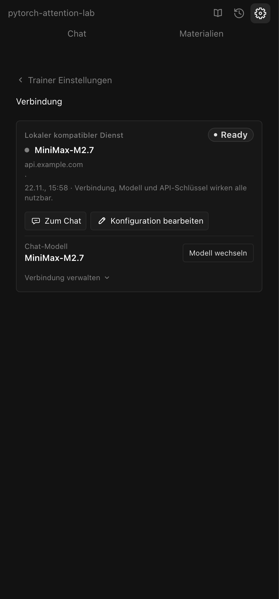
  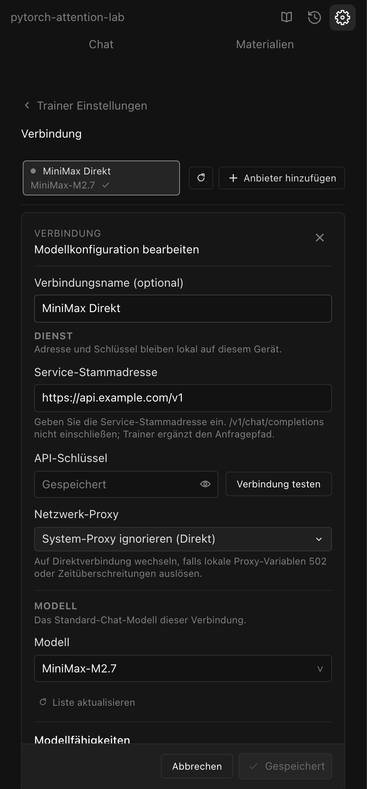
</p>

---

## Kernmechaniken

### ① Verifikationsgates — du schreibst den Code, der Code beweist es

Eine Trainingskarte rückt niemals weiter, bevor die Verifikation gegen deinen echten Code gelaufen ist; einen manuellen „als erledigt markieren“-Button gibt es absichtlich nicht.

<p align="center"></p>

- **Isolierte lokale Sandbox** (`server/app/evaluator/service.py` — `EvaluatorService`): kopiert Zieldateien in ein temporäres Verzeichnis, führt Prüfungen ohne `.pytest_cache`-Müll im Projekt aus und bewertet jedes Kriterium in `acceptance_criteria` + `expected_symbols`
- **VS Code Testing API Attestation** (`extension/src/testing/`): echte Test-Resultate testieren direkt an `/training/verification/attest` — unbekannte oder abgebrochene Läufe fälschen niemals ein Bestehen
- **Remote-SSH Lese-/Prüf-Proxy**: verifiziert Dateien auf Remote-Hosts, ohne API-Keys oder deine Bibliothek vom lokalen Rechner wegzubewegen

### ② Langzeitgedächtnis + Einheitliches `<LibraryRoot>`

Alle gelernten Signale, gesammelten Materialien und gespeicherten Vorlesungsnotizen liegen in **einem einzigen `<LibraryRoot>`-Verzeichnis** deiner Wahl — deine Code-Repositories bleiben zu 100 % sauber (`git status` ohne Fremddateien).

<p align="center"></p>

```text
<LibraryRoot>/
├── Trainer Library/          # Durchsuchbare Ressourcen & automatisch gespeicherte Markdown-Notizen
│   ├── Vorlesungsnotizen/    # Von `save_lecture_note` erzeugt (direkt im Finder/Explorer lesbar)
│   └── Papers/               # Importierte PDFs, Webseiten-Snapshots & Referenzblätter
└── .trainer/
    └── runtime/              # SQLite (`trainer.sqlite3`), Qdrant-Vektorindex, Checkpoints & Logs
```

- **Zweischichtiges Gedächtnis**: strukturierter SQLite-Zustand + semantischer Abruf (`Qdrant` mit lokalem Fallback) auf der **`py-fsrs`**-Vergessenskurve (`server/app/memory/review_scheduler.py`)
- **Unterdrückung im Live-Flow**: fällige Wiederholungen pausieren während aktiver Implementierungsstränge
- **Fail-closed über Workspaces**: Erfolg in einem einzelnen Projekt wird niemals global aufgebläht (`server/app/memory/transfer_skills.py`)

### ③ RethinkFun State-Flow Trainingsschleife

Die zustandsbasierte, intuitionsgeleitete Lehrmethode von Trainer ist direkt vom Tech-Blogger und KI-Pädagogen **[RethinkFun](https://rethink.fun)** inspiriert (Problemkontext zuerst, lückenlose Herleitung ohne „offensichtlich“-Füllwörter und direkte Rückbindung zwischen Code und Theorie). Das Training lebt unmittelbar in der Konversation statt hinter verstreuten Verwaltungs-Tabellen:

<p align="center"></p>

- **Drei kalibrierte Unterrichtspfade** (`server/app/pedagogy/` + `server/app/llm/`):
  - **Schnelle Umsetzungsführung**: orientiert an konkreten Symbolen und fehlgeschlagenen Checks ohne unnötiges Dozieren
  - **Tiefe Konzept-Vorlesungen (`save_lecture_note`)**: leitet Gleichungen und Zustandsübergänge Schritt für Schritt her, verbindet minimalen ausführbaren Code mit Theorie und speichert sauberes Markdown in `<LibraryRoot>/Trainer Library/`
  - **Geerdete Status- & Evidenzabfrage (`inspect_learning_truth`)**: beantwortet Fortschrittsfragen direkt aus verifizierten Server-Fakten ohne interne UUIDs oder JSON-Felder zu leaken
- **5-Phasen-Zustandsmaschine** (`LEARN → TRY → VERIFY → REFLECT → RETURN` in `server/app/training/handoff.py`)

### ④ Du schreibst, der Coach führt

Der Coach liest Dateien, Diagnostics und Workspace-Struktur für dich — produktive Edits bleiben immer in deinen Händen (`server/app/workspace/authority.py` erzwingt schreibgeschützte Quell-Boundaries).

<p align="center"></p>

- Adaptives Pacing (`AffectService` in `server/app/affect/service.py`) erkennt wiederholte Fehlschläge und wechselt automatisch in einen ruhigen, fokussierten Rettungsmodus

### ⑤ Grounding & Erklärungsqualität

- Deterministische Antwort-Kontinuitäts- und Recovery-Guards (`coaching_recovery.py`, `coaching_replies.py`) fangen leere Streams, fehlerhafte Tool-Antworten und Sprachdrift zuverlässig ab
- Nicht-blockierendes 5-Dimensionen-Qualitätsmonitoring beobachtet Kontextbindung, Symbolanker und das Verbot direkter Musterlösungen

---

## Zwei Ziele + Ein Gespräch

> Ruhige, feste Shell: **Chat** und **Materialien** in der Kopfzeile; **Lernen-Schublade**, **Sitzungsverlauf** und **Einstellungen** rechts oben; **ein einziges Eingabefeld (Single-Composer-Souveränität)** über alle Ansichten hinweg.

| Oberfläche | Rolle | Inhalt |
|---|---|---|
| **Chat** (`coach`) | Hauptarbeitsfläche | Streaming-Antworten im State-Flow, gespeicherte `.md`-Notiz-Badges, Nachrichtenaktionen, einklappbare **Inline-Übungskarten** (ohne zweites Textfeld), einzeiliger Lernstreifen, `$`-Skill-Palette |
| **Materialien** (`resources`) | Bibliothek & Reader | Einheitlicher `<LibraryRoot>`-Ordnerbaum, lokaler Schnellfilter, gerenderte VS-Code-Markdown-Vorschau mit Bildern & KaTeX/Shiki/Mermaid, PDF/DOCX/URL-Ingest, wiederherstellbarer Papierkorb |
| **Lernen-Schublade** (`plan` / `training` / `progress`) | Schreibgeschütztes Gedächtnis | Modales Panel über dem Chat (Entwurf bleibt erhalten) mit drei ruhigen Karten: **Aktuelles Ziel**, **Fällige Übung** und **Beherrschung** (ein **4-Segment-Kompetenzbalken**, ohne Prozente) |
| **Einstellungen** (`settings`) | Zentrale Konsole | 5-Protokoll-Verbindung + **Direkter Proxy-Bypass**, Coach-Stil & `$`-Skills, **Workspace `<LibraryRoot>`** + Remote Companion, 8 Sprachen & Telemetrie-Opt-in |

*(Alle sechs internen Kompatibilitätsrouten — `coach`, `plan`, `resources`, `training`, `progress`, `settings` — bleiben für Deep Links und Wiederherstellung gültig.)*

<p align="center">
  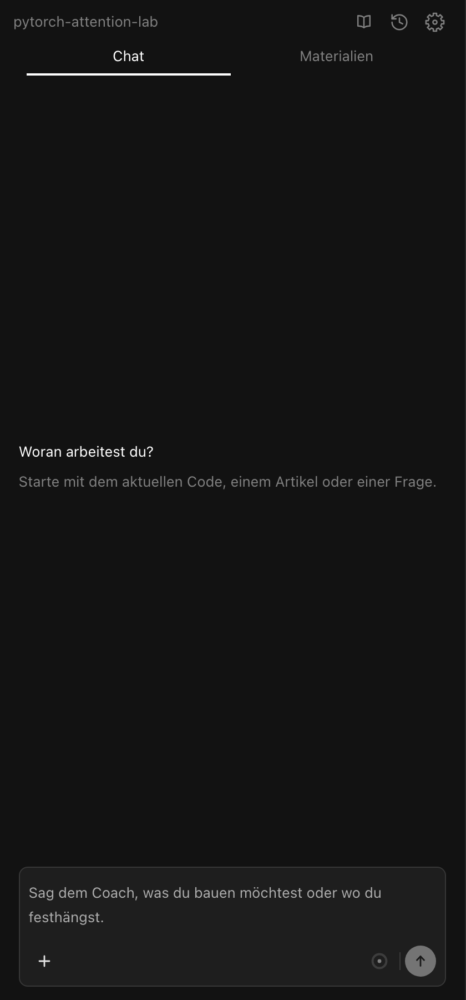
  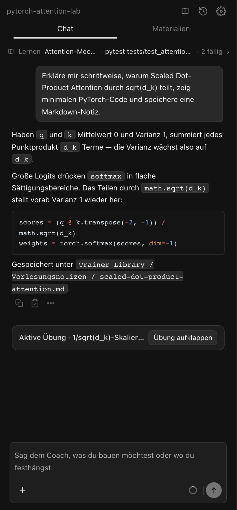
  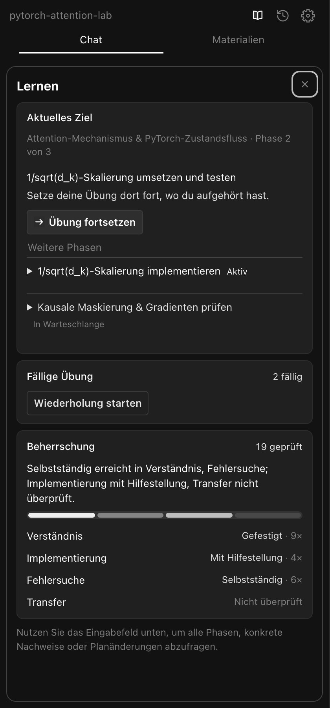
</p>
<p align="center">
  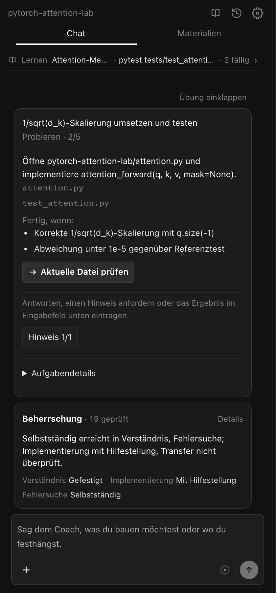
  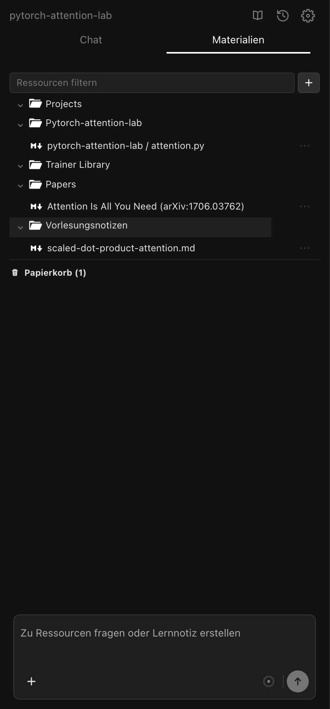
  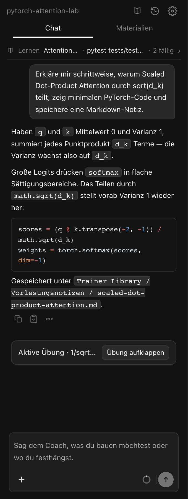
</p>

### Eigene `$`-Skills — erstellen, teilen, installieren

Tippe `$` im einzigen Eingabefeld für sofortigen Zugriff auf integrierte und eigene Prompt-Skills. Verwaltung unter **Einstellungen → Coach → Skills** — reine JSON-Daten ohne `eval()` und mit Schutz der Standard-Trigger.

<p align="center">
  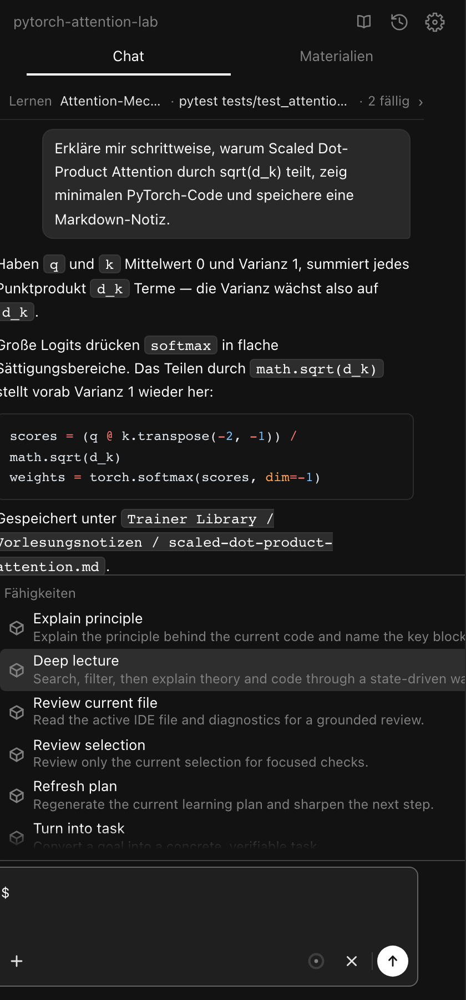
  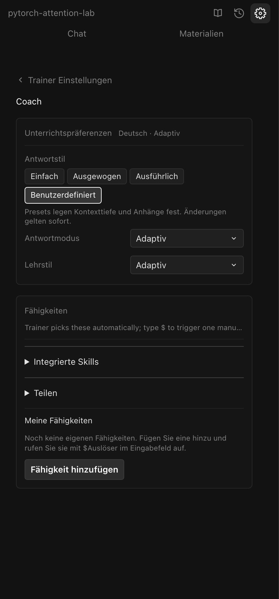
</p>

<p align="center"></p>

---

## Remote-SSH Companion

Für Remote-Linux/SSH-Workspaces trennt Trainer sauber zwischen **lokalem Gehirn und entfernten Händen**:

- **UI-Extension + Python-Sidecar + API-Keys + `<LibraryRoot>`** verbleiben stets lokal auf deinem Hauptrechner
- **`remote-extension/`** (`Trainer Workspace Companion`, gebündelt als `extension/bundled/remote/trainer-workspace-companion.vsix`) läuft auf dem Remote-Host für schreibgeschütztes Dateilesen, Symbolsuche, Diagnostics und gesteuerte Testausführung (`trainer.remote.verify`)
- **Harte Schreibsperre auf Remote-Quellcode**: Schreiboperationen auf dem Remote-Repo werden ausnahmslos abgewiesen

<p align="center">
  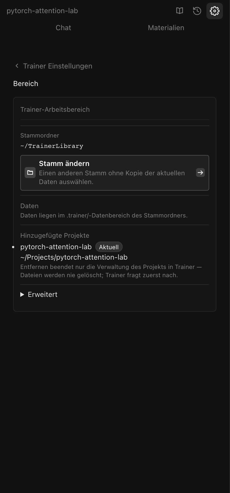
</p>

---

## Vergleich

| Dimension | Vibe-Tools | Chat-IDEs | Flashcard-Apps | **Trainer** |
|---|---|---|---|---|
| Schreibt Code für dich | ✅ | ✅ | ❌ | ❌ (bewusste Grenze) |
| Verifiziert an realem Code | ❌ | ❌ | ❌ | ✅ Sandbox + VS Code Testing + Remote-SSH |
| Langzeitgedächtnis | ⚠️ Kontextfenster | ⚠️ Kurz-Zusammenfassung | ✅ | ✅ SQLite + Qdrant unter `<LibraryRoot>` |
| Hält dein Git-Repo sauber | ⚠️ mischt Dateien | ⚠️ | n/v | ✅ ein `<LibraryRoot>`, null Repo-Schreibzugriffe |
| Spaced Repetition nach FSRS | ❌ | ❌ | ✅ | ✅ inkl. Live-Flow-Unterdrückung |
| Berechtigungsstufen | ❌ | ⚠️ Trust-Dialog | ❌ | ✅ 6 Stufen + Remote-Schreibsperre |
| Offene Testabdeckung | closed source | closed source | closed source | ✅ **4.182 Unit/Integration + 105 E2E-Specs** |
| i18n | ⚠️ | ⚠️ | ⚠️ | ✅ **8 Sprachen** mit CI-Vollständigkeitsgate |

> Andere Tools lassen dich Code schneller ausspucken; **Trainer sorgt dafür, dass du wirklich beherrschst, was du baust.**

---

## Fünf-Minuten-Demo

1. **T+0:00 — Trainer öffnen**: Sidebar-Icon klicken und ohne Konfigurationsmauer direkt in **Chat** starten.
2. **T+0:30 — Modell verbinden**: Unter **Einstellungen → Verbindung** Protokoll, URL, Modell und Keychain-API-Schlüssel eintragen (bei Bedarf **System-Proxy ignorieren (Direkt)** aktivieren) und **Verbindung testen** drücken.
3. **T+1:30 — Tiefe Erklärung anfordern**: Beispiel: *„Erkläre mir mit State-Flow, warum Scaled Dot-Product Attention durch sqrt(d_k) teilt, und speichere eine Markdown-Notiz.“* — die Notiz landet sauber in `<LibraryRoot>/Trainer Library/`.
4. **T+2:30 — Inline-Übung bearbeiten**: Klappe die eingebettete **FocusedPractice**-Karte aus und schreibe direkt in deinem Projekt — alle Rückfragen und Antworten laufen durch dasselbe Eingabefeld.
5. **T+4:00 — Verifizieren & FSRS aktualisieren**: Klick auf **Aktuelle Datei prüfen** (oder führe Tests über VS Code Testing / Remote-SSH aus). Bestehende Checks schalten **Verständnis / Implementierung / Fehlersuche / Transfer** weiter und terminieren FSRS.
6. **T+5:00 — Lernen-Schublade öffnen**: Ein Klick auf das Buch-Icon zeigt Aktuelles Ziel, Fällige Übungen und den 4-Segment-Balken auf einen Blick.

---

## Warum es sich anders anfühlt

### Ehrliches Scheitern & Proxy-Bypass
- Unbekannte Gateways werden nie blind als OpenAI-kompatibel vermutet
- **System-Proxy ignorieren (Direkt)** umgeht störende lokale `HTTP_PROXY` / `HTTPS_PROXY`-Variablen pro Verbindungsprofil
- Leere Streams, Auth-Fehler und abgebrochene Tool-Calls zeigen sofort klare Recovery-Hinweise statt Endlos-Spinner

### Endpoint-Speedtest & Thinking-Steuerung
- Mehrere Kandidaten-Endpoints treten parallel mit Warm-up-Bereinigung gegeneinander an
- Thinking-Intensität richtet sich streng nach verifizierten Modellfähigkeiten

<p align="center"></p>

### Einheitliche Bibliothek unter `<LibraryRoot>`
- Importiere PDFs (`PyMuPDF`), Webseiten (`Trafilatura`), DOCX (`mammoth` / `MarkItDown`) oder speichere Vorlesungsnotizen direkt in `<LibraryRoot>/Trainer Library/`
- Mit lokalem Filter, gerendertem Markdown inkl. KaTeX/Shiki/Mermaid, wiederherstellbarem Papierkorb und Ein-Klick-Kontextübergabe an den Chat

<p align="center"></p>

### Browser Quick Capture & Side Panel (`browser-extension/`)
- Chromium MV3-Erweiterung **ohne Pairing-Code** mit automatischer Sidecar-Erkennung (`127.0.0.1`)
- Webseiten, arXiv-PDFs, GitHub-Repos oder markierten Text direkt nach `<LibraryRoot>/Trainer Library/` oder als Entwurf in das Chat-Eingabefeld senden — inklusive Offline-Warteschlange und vollständigem Side-Panel-Chat in 8 Sprachen

<p align="center">
  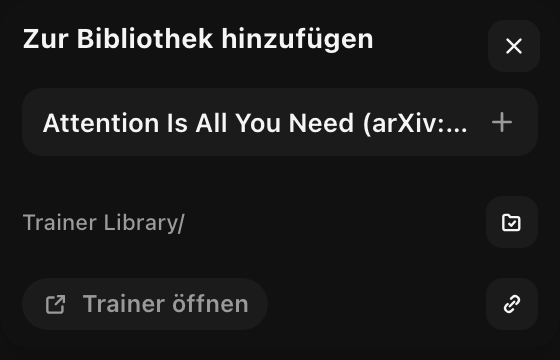
</p>

### MCP-Integration (`docs/mcp.md`)
- Optionaler stdio-**MCP-Client** (`TRAINER_MCP_SERVERS`) bindet externe MCP-Server (z. B. GitHub / Gitee) über die gemeinsame 6-stufige Fail-closed-Berechtigungsleiter in den ReAct-Loop ein — Details unter [`docs/mcp.md`](docs/mcp.md)

---

## Architektur

### Systemtopologie

```text
┌─────────────────────────────────────────────────────────────────────────┐
│                             VS Code Window                              │
│  ┌──────────────────────────────┐    ┌────────────────────────────────┐ │
│  │  Trainer-Sidebar (Lokal)     │    │  Remote-SSH Workspace (Remote) │ │
│  │  React 19 + Zustand (8 i18n) │    │  remote-extension (Companion)  │ │
│  │  Chat / Materialien + Drawer │◄──►│  Nur Lesen / Suche / Diagnose  │ │
│  └──────────────┬───────────────┘    │  & verifizierte Testausführung │ │
│                 │                    └────────────────────────────────┘ │
│  ┌──────────────▼───────────────┐                                       │
│  │  Extension Host (TypeScript) │  • SecretStorage (OS-Schlüsselbund)   │
│  │  CommandRegistry · Workspace │  • Testing API → Verification Attest  │
│  │  Gateway · Sidecar Manager   │  • Browser-Extension MV3 Brücke       │
│  └──────────────┬───────────────┘                                       │
│                 │ http://127.0.0.1 + SSE Stream                         │
│  ┌──────────────▼───────────────┐    ┌────────────────────────────────┐ │
│  │  FastAPI Sidecar (Python)    │───►│  Einheitliches <LibraryRoot>   │ │
│  │  • ReAct Loop + MCP Client   │    │  • Trainer Library/ (Notizen)  │ │
│  │  • RethinkFun State-Flow     │    │  • .trainer/runtime/           │ │
│  │  • 5 Protokolle + Proxy-Byp. │    │    trainer.sqlite3 · Qdrant ·  │ │
│  │  • FSRS Scheduler + Memory   │    │    Checkpoints · Audit-Ledger  │ │
│  │  • 6-Stufen Authority Guard  │    │  (Null Schreibzugriff im Repo) │ │
│  └──────────────────────────────┘    └────────────────────────────────┘ │
└─────────────────────────────────────────────────────────────────────────┘
```

### Verzeichnisstruktur

| Ordner | Inhalt | Gemessene Größe |
|---|---|---|
| `extension/src/` | VS Code Host: Commands, SecretStorage, WorkspaceGateway, SidecarProcessManager | `79` TS-Dateien (~`53.286` Zeilen) |
| `extension/webview/src/` | React-Workbench: 2 Ziele, Drawer, Single-Composer, Shiki/KaTeX/Mermaid, 8 Sprachen | `233` TS/TSX + `53` CSS (~`120.507` Zeilen) |
| `extension/tests/` | `node:test`-Suite: Host, Governance, i18n, Browser-Capture, Security | `161` Dateien · **`1.460` Tests** |
| `server/app/` | FastAPI-Sidecar: Agent Loop, RethinkFun-Pädagogik, Memory/FSRS, Ingest, Evaluator | `234` Python-Dateien (~`178.520` Zeilen) |
| `server/tests/` | Backend-`pytest`-Suite für API, Pädagogik, Memory, Protokolle & Authority | `84` Dateien · **`2.746` gesammelte Tests** |
| `shared/src/` | Geteilte deterministische Governance-Module für Host, Webview & Tests | `77` Module (~`30.414` Zeilen · `523` Exporte) |
| `remote-extension/src/` | Remote-SSH Companion (`extensionKind: ["workspace"]`) | `2` TS-Dateien (`746` Zeilen) |
| `browser-extension/` | Chromium MV3 Popup, Offline-Queues, Kontextmenüs & Side Panel | `9` Dateien (`7.245` Zeilen) |
| `extension/bundled/` | Gefrorener PyInstaller-Sidecar & `trainer-workspace-companion.vsix` | ~`270 MB` |

### Kanonischer Snapshot-Vertrag (`WorkbenchSnapshot`)

Alle zustandsführenden Haupt-HTTP-Routen liefern ein einheitliches **`WorkbenchSnapshot`** (`33` Top-Level-Felder in `server/app/core/models.py`), inkrementell synchronisiert über `snapshot_revision`.

---

## Sicherheitsmodell

- **API-Keys ausschließlich in OS Keychain / VS Code `SecretStorage`** — nie in Workspaces, `<LibraryRoot>`, Snapshots oder Logs (`npm run verify:credentials`)
- **VS Code Workspace Trust wird fail-closed durchgesetzt** — nicht vertraute Fenster blockieren Inspektion und Verifikation
- **6-stufige Workspace-Authority-Leiter** (`server/app/workspace/authority.py`): Nutzer-Repositories bleiben standardmäßig read-only; Remote-Workspaces sperren Schreibzugriffe vollständig
- **Wiederherstellbarer Papierkorb + `<LibraryRoot>`**: Löschungen verschieben sicher in den Papierkorb statt endgültig zu vernichten
- **Reines JSON-Skill-Sharing**: strikte Schema- und Längenlimits ohne dynamische Code-Ausführung
- **Telemetrie Opt-in (standardmäßig aus)**: überträgt ausschließlich grobe lokale Zähler — niemals Code, Pfade oder Inhalte

---

## Qualitätsgates

> Jede Kennzahl spiegelt reale Verifikationsläufe auf `main` (`v1.6.4`) wider:

| Gate | Umfang & Verifiziertes Ergebnis | Befehl |
|---|---|---|
| **Server-Tests (`pytest`)** | **84 Dateien · 2.746 Tests** (inkl. Subtests) | `npm run test:server` |
| **Extension & Shared (`node:test`)** | **161 Dateien · 1.460 Tests** (`1.460` bestanden, `0` Plattform-Skip, `0` Fehler) | `npm run test:extension` |
| **Statische Analyse & Typen** | `ruff check` (`0` Fehler) · `pyright` (`0` Fehler) · CSS + `tsc -b` (`0` Fehler) | `npm run check && npm run verify:server-pyright` |
| **UI-Geometrie-Gate** | Single-Composer-Souveränität, 2-Ziele-Shell, Overflow-Checks (`340/420/460px`, dark/light, zh/en) | `npm run verify:ui-geometry` |
| **i18n-Vollständigkeitsgate** | **194** `appUiCopy` + **196** `settingsText` + **273** `hostCommandCopy` über **8 Sprachen** (`0` Lücken) | `npm run verify:i18n` |
| **Vokabular & Secrets** | **53** UI-Copy-Dateien sauber · **4.753** Repo-Dateien ohne Klartext-Credentials | `npm run verify:copy-vocabulary && npm run verify:credentials` |
| **Playwright E2E & Remote-SSH** | **6** Playwright-Specs (`105` Tests) + Real-Sidecar Matrix + Ubuntu Remote-SSH L2 (`20/20`) | `npm run test:experience-matrix` · `npm run test:remote-ssh-e2e` |
| **CI-Release-Ziele** | **3 Desktop-Ziele**: `win32-x64`, `darwin-arm64`, `linux-x64` | `.github/workflows/release.yml` |

*(Hinweis: Die manuelle pädagogische Abnahme `T-0028` bleibt in [`docs/TRIAL-1.5.0-RC.md`](docs/TRIAL-1.5.0-RC.md) als manuelles Gate geführt.)*

---

## i18n · Acht Sprachen

Oberfläche, Einstellungen, Host-Meldungen, Browser-Erweiterung und READMEs erscheinen parallel in **8 Sprachen**:

`zh-CN` · `en-US` · `es-ES` · `fr-FR` · `de-DE` · `ja-JP` · `ko-KR` · `pt-BR`

Automatisch abgesichert über `npm run verify:i18n` (`extension/webview/src/lib/i18n/copy.ts`).

---

## Danksagungen

- **Runtime & HTTP**: [FastAPI](https://github.com/fastapi/fastapi) · [Uvicorn](https://github.com/encode/uvicorn) · [Pydantic](https://github.com/pydantic/pydantic) · [httpx](https://github.com/encode/httpx) · [openai-python](https://github.com/openai/openai-python)
- **Gedächtnis, FSRS & Parsing**: [py-fsrs](https://github.com/open-spaced-repetition/py-fsrs) · [qdrant-client](https://github.com/qdrant/qdrant-client) · [PyMuPDF](https://github.com/pymupdf/PyMuPDF) · [Trafilatura](https://github.com/adbar/trafilatura) · [MarkItDown](https://github.com/microsoft/markitdown)
- **Frontend & Rendering**: [React](https://github.com/facebook/react) · [Vite](https://github.com/vitejs/vite) · [Zustand](https://github.com/pmndrs/zustand) · [Zod](https://github.com/colinhacks/zod) · [react-markdown](https://github.com/remarkjs/react-markdown) · [KaTeX](https://github.com/KaTeX/KaTeX) · [Shiki](https://github.com/shikijs/shiki) · [Mermaid](https://github.com/mermaid-js/mermaid) · [@tanstack/react-table](https://github.com/TanStack/table) · [PDF.js](https://mozilla.github.io/pdf.js/) · [mammoth](https://github.com/mwilliamson/mammoth.js) · [docx-preview](https://github.com/VolodymyrBaydalka/docx-preview)
- **Testing & Paketierung**: [pytest](https://github.com/pytest-dev/pytest) · [Hypothesis](https://github.com/HypothesisWorks/hypothesis) · [ruff](https://github.com/astral-sh/ruff) · [pyright](https://github.com/microsoft/pyright) · [TypeScript](https://github.com/microsoft/TypeScript) · [Playwright](https://github.com/microsoft/playwright) · [PyInstaller](https://github.com/pyinstaller/pyinstaller)
- **Pädagogische Inspiration**: Lehrmethodik inspiriert vom Tech-Creator **[RethinkFun](https://rethink.fun)** (State-Flow-Intuition vor bloßen Formeln) · [fsrs4anki](https://github.com/open-spaced-repetition/fsrs4anki)
- **Visuelle Assets**: Generiert mit **[GPT Image](https://github.com/AI-yyf/trainer/tree/main/assets)** (`assets/MASCOT.md` · `assets/BANNER_PROMPT.md` · `assets/FEATURE_PROMPTS.md`)

---

## Lizenz

[MIT](LICENSE)

---

## Trainer zitieren

```bibtex
@software{trainer2026,
  title  = {Trainer: A Long-Term Coding Coach Living in Your Editor},
  author = {AI-yyf and contributors},
  year   = {2026},
  url    = {https://github.com/AI-yyf/trainer},
  note   = {v1.6.4}
}
```

---

<div align="center">

**// Trainiere deine KI · Wachse mit deiner KI**

`v1.6.4` · Gemacht mit Kaffee, FSRS, RethinkFun State-Flow-Pädagogik, 4.287 automatisierten Tests und einem Coach, der sich weigert, für dich Code zu schreiben.

</div>
