# Trainer

<div align="center">


**Un coach técnico y de programación a largo plazo que vive en la barra lateral de VS Code.**

**Planifica, entrena, verifica y recuerda entre sesiones — y se niega a escribir tu código de producción por ti.**

**// Output ≠ Crecimiento // Verificar + Repasar = Crecimiento**

[English](README.md) · [简体中文](README_zh-CN.md) · Español · [Français](README_fr-FR.md) · [Deutsch](README_de-DE.md) · [日本語](README_ja-JP.md) · [한국어](README_ko-KR.md) · [Português](README_pt-BR.md)

[](https://github.com/AI-yyf/trainer/blob/main/extension/package.json)
[](LICENSE)
[](#instalación)
[](#compuertas-de-calidad)
[](#i18n--ocho-idiomas)

[Por qué](#por-qué-existe-trainer) ·
[Instalación](#instalación) ·
[Tres pasos](#tres-pasos-sin-cuarto) ·
[Mecánicas](#mecánicas-centrales) ·
[Dos destinos](#dos-destinos--una-conversación) ·
[Remote-SSH](#remote-ssh-companion) ·
[Comparativa](#comparativa) ·
[Demo de 5 min](#demo-de-cinco-minutos) ·
[Diseño](#por-qué-se-siente-distinto) ·
[Arquitectura](#arquitectura) ·
[Seguridad](#modelo-de-seguridad) ·
[Calidad](#compuertas-de-calidad) ·
[Agradecimientos](#agradecimientos) ·
[🎭 El reparto](docs/CAST.md)

</div>

---

## Por qué existe Trainer

> Los desarrolladores no se atascan por falta de tutoriales.
> Se atascan porque nada cierra el bucle de aprendizaje.

Una charla con un LLM se evapora al cerrarse; los vídeos son pasivos; el concepto que medio entendiste el martes desaparece el viernes.

Peor aún: **vibe coding** — pasar meses dejando que la IA escriba el código sin entender realmente cómo funciona.

**Trainer resuelve esto desde dentro del editor.**

No es una carcasa de chat: es un coach con memoria persistente, plan de etapas y disciplina de verificación:

- **Planifica** tu aprendizaje por etapas y sigue dónde estás de verdad — no dónde crees estar
- Te **entrena** con tarjetas, ejercicios de teoría y prácticas integradas sobre tu proyecto real
- **Verifica** el dominio frente a tu código real — hablar de FastAPI no basta hasta que el archivo actual lo demuestre
- Te **recuerda** entre sesiones, proyectos y semanas, programando repasos en la curva de olvido **FSRS**
- **Nunca escribe código de producción por ti** — tú escribes, él enseña y **crecéis juntos**

**Y esta disciplina va más allá del código.** El mismo bucle de «verificar primero» cubre lectura profunda, demostraciones teóricas y humanidades o idiomas con sus propios verificadores y dimensiones de dominio.

<div align="center">

| vibe coding · la norma actual | Trainer · cómo debería ser |
|:---:|:---:|
| `def ship(code):` <br> `    ai.write(code)` <br> `# ¿lo entendiste?` <br> `    return forget(code)` | `def ship(code):` <br> `    you.write(code)` <br> `    ai.verify(code)` <br> `    you.recall(code)` <br> `    return grown(code)` |
| output = olvido | output + memoria + repaso = crecimiento |

</div>

---

## Instalación

**Desde VSIX precompilado (tres plataformas verificadas por CI):**

Descarga el `.vsix` correspondiente a tu sistema y arquitectura (`darwin-arm64` / `linux-x64` / `win32-x64`) en [Releases](https://github.com/AI-yyf/trainer/releases/latest):

```bash
code --install-extension trainer-extension-1.4.5-<platform>-<arch>.vsix --force
```

O en el panel de Extensiones de VS Code → `···` → *Instalar desde VSIX…* → recarga la ventana. Consulta más detalles en [`extension/README.install.md`](extension/README.install.md).

**Desde el código fuente:**

```bash
git clone https://github.com/AI-yyf/trainer.git
cd trainer && npm ci
cd server && uv sync --frozen --extra dev --python 3.12 && cd ..
npm run build
```

Abre el repositorio en VS Code y pulsa `F5` (Extension Development Host) o empaqueta el VSIX con `npm run package:vsix`.

**Requisitos:** VS Code `≥ 1.96` · Python `3.12` (solo compilación desde fuente; el `.vsix` incluye el sidecar congelado) · macOS (`arm64`) / Linux (`x64`) / Windows (`x64`).

---

## Tres pasos, sin cuarto

Arranque en frío **sin muro de configuración**: al abrir Trainer entras directo en el Chat. Para conectar tu modelo:

1. Abre **Ajustes → Conexión** (icono de engranaje arriba a la derecha)
2. Elige un protocolo declarado (`OpenAI Chat`, `OpenAI Responses`, `Anthropic Messages`, `Gemini` o `Azure OpenAI`) e introduce la **raíz del servicio**, tu **API Key** (almacenada exclusivamente en el llavero del SO mediante `SecretStorage`) y el **Modelo**
3. Si las variables de proxy locales (`HTTP_PROXY` / `HTTPS_PROXY`) causan errores `502` o timeouts, cambia **Proxy de red** a **Ignorar proxy del sistema (Directo)** y pulsa **Probar conexión**

Trainer obtiene los modelos en vivo, verifica streaming, llamadas a herramientas y capacidad de razonamiento, e informa fallos con honestidad (`invalid_key_or_permission`, `network` o rechazo de stream vacío).

<p align="center">
  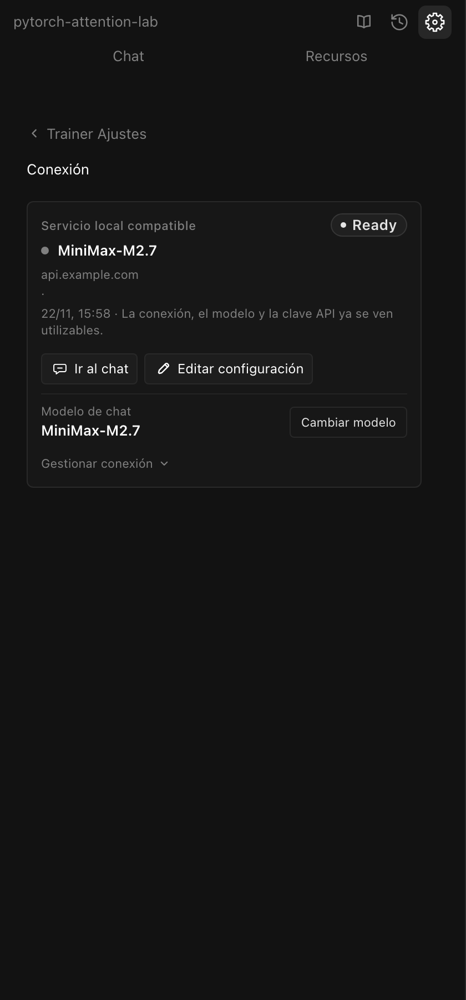
  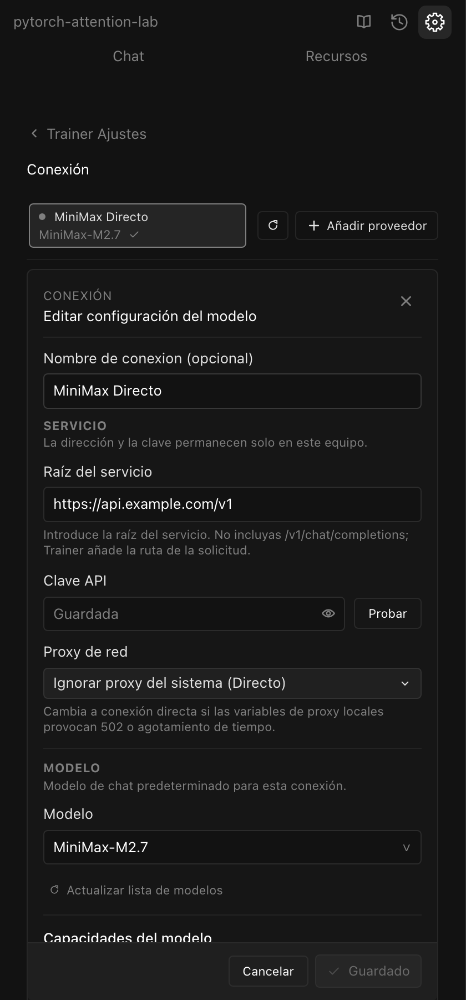
</p>

---

## Mecánicas centrales

### ① Compuertas de verificación — tú escribes el código, el código lo demuestra

Una tarjeta de práctica nunca avanza sin ejecutar verificación sobre tu archivo real; no existe ningún botón manual de «marcar como completado».

<p align="center"></p>

- **Sandbox aislado local** (`server/app/evaluator/service.py` — `EvaluatorService`): copia los archivos al directorio temporal, ejecuta comprobaciones sin ensuciar tu repositorio con `.pytest_cache` y evalúa cada criterio de `acceptance_criteria` + `expected_symbols`
- **Atestación vía VS Code Testing API** (`extension/src/testing/`): los resultados reales de tests atestiguan directamente en `/training/verification/attest` — ejecuciones desconocidas o interrumpidas nunca simulan un aprobado
- **Proxy de lectura y verificación Remote-SSH**: verifica en máquinas remotas sin sacar API Keys ni tu biblioteca del equipo local

### ② Memoria a largo plazo + `<LibraryRoot>` único unificado

Todo lo que Trainer recuerda sobre ti, cada material importado y cada apunte en Markdown viven en **una única carpeta `<LibraryRoot>`** de tu elección — manteniendo tus repositorios de código 100 % limpios (`git status` intacto).

<p align="center"></p>

```text
<LibraryRoot>/
├── Trainer Library/          # Recursos explorables y apuntes Markdown autoguardados
│   ├── Apuntes/              # Generados por `save_lecture_note` (legibles directo en disco)
│   └── Papers/               # PDFs importados, páginas web extraídas y referencias
└── .trainer/
    └── runtime/              # SQLite (`trainer.sqlite3`), índice Qdrant, checkpoints y auditoría
```

- **Memoria en dos niveles**: estado estructurado en SQLite + búsqueda semántica (`Qdrant` con fallback local) planificados sobre curvas de olvido **`py-fsrs`** (`server/app/memory/review_scheduler.py`)
- **Supresión durante el flujo vivo**: los repasos pendientes esperan mientras implementas un bloque activo para no cortar tu concentración
- **Aislamiento estricto entre workspaces**: aprobar en un proyecto nunca infla el dominio global (`server/app/memory/transfer_skills.py`)

### ③ Bucle pedagógico RethinkFun State-Flow

La pedagogía guiada por flujo de estado de Trainer está inspirada directamente en el divulgador técnico **[RethinkFun](https://rethink.fun)** (intuición y problema previo antes de fórmulas abstractas, deducción paso a paso sin saltos retóricos y código mínimo siempre conectado a la teoría). La práctica sucede dentro de la propia conversación y no en paneles separados de gestión CRUD:

<p align="center"></p>

- **Tres carriles pedagógicos calibrados** (`server/app/pedagogy/` + `server/app/llm/`):
  - **Guía rápida de código**: anclada en símbolos concretos y pruebas fallidas, sin rodeos innecesarios
  - **Explicaciones profundas por flujo de estado (`save_lecture_note`)**: deduce cada transición sin muletillas vacías, une código mínimo con teoría y guarda apuntes limpios en `<LibraryRoot>/Trainer Library/`
  - **Consulta de verdad verificada (`inspect_learning_truth`)**: responde sobre etapas y evidencias reales del servidor sin filtrar IDs internos ni JSON crudo
- **Máquina de estados de 5 fases** (`LEARN → TRY → VERIFY → REFLECT → RETURN` en `server/app/training/handoff.py`)

### ④ Tú escribes, el coach guía

El coach lee archivos, diagnósticos y estructura del workspace, mientras las ediciones reales permanecen siempre bajo tu control (`server/app/workspace/authority.py` impone solo lectura sobre el código fuente).

<p align="center"></p>

- Ritmo adaptativo (`AffectService` en `server/app/affect/service.py`) detecta tropiezos repetidos y cambia al modo conciso de rescate con un siguiente paso mínimo ejecutable

### ⑤ Anclaje real y calidad explicativa

- Guardias deterministas de continuidad y recuperación (`coaching_recovery.py`, `coaching_replies.py`) detectan streams vacíos, fallos de proveedor y deriva idiomática
- Evaluador de calidad de 5 dimensiones que vigila contexto del alumno, anclaje en símbolos reales, ausencia de respuestas copiables y claridad causal

---

## Dos destinos + Una conversación

> Arquitectura estable y serena: **Chat** y **Recursos** en la navegación superior; **Cajón de Aprendizaje**, **Historial** y **Ajustes** en la esquina superior derecha; **un único cuadro de entrada** en toda la interfaz.

| Superficie | Rol | Contenido |
|---|---|---|
| **Chat** (`coach`) | Espacio principal | Respuestas en flujo continuo, distintivos de apuntes `.md`, acciones por mensaje, tarjetas **FocusedPractice** plegables en línea (sin segundo editor), tira superior de 1 línea y paleta `$` |
| **Recursos** (`resources`) | Biblioteca y lector | Árbol unificado de `<LibraryRoot>`, filtro rápido local, vista previa Markdown nativa en VS Code con imágenes y KaTeX/Shiki/Mermaid, ingesta PDF/DOCX/URL y papelera recuperable |
| **Cajón de Aprendizaje** (`plan` / `training` / `progress`) | Memoria solo lectura | Hoja modal flotante sobre el Chat (conserva tu borrador inferior) con tres tarjetas uniformes: **Objetivo actual**, **Práctica pendiente** y **Dominio** (una **barra de 4 segmentos**, cero porcentajes) |
| **Ajustes** (`settings`) | Consola central | Conexión 5 protocolos + **Bypass directo de proxy**, estilo del coach & `$` Skills, **Workspace `<LibraryRoot>`** + Remote Companion, 8 idiomas y telemetría opt-in |

*(Las seis rutas internas — `coach`, `plan`, `resources`, `training`, `progress`, `settings` — siguen plenamente válidas para enlaces profundos y restauración.)*

<p align="center">
  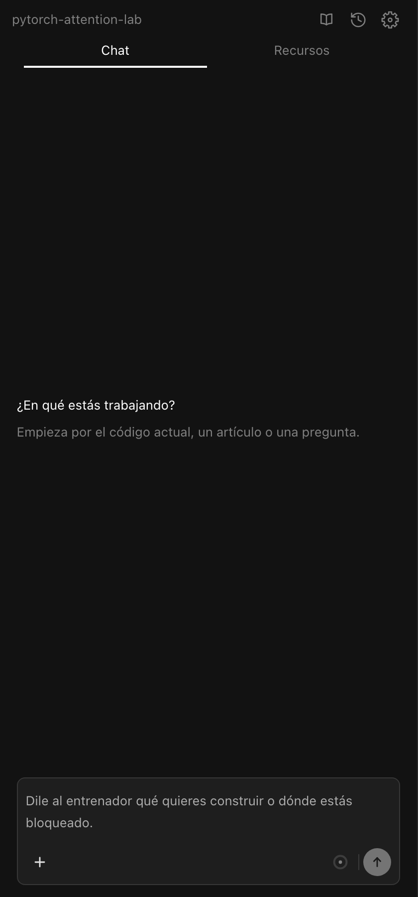
  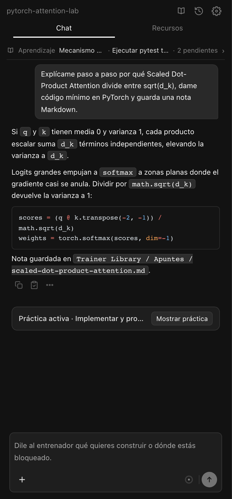
  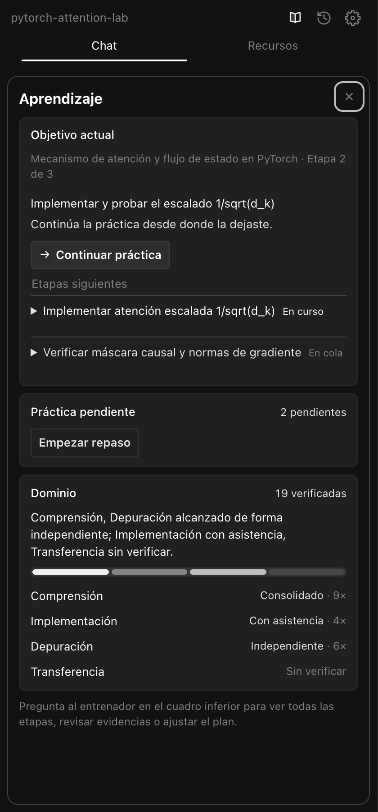
</p>
<p align="center">
  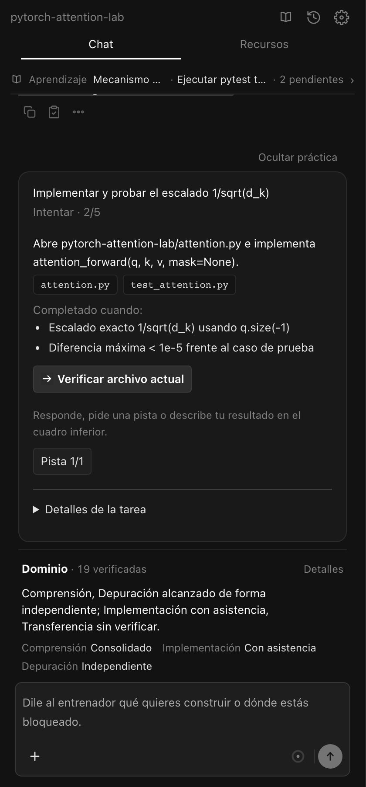
  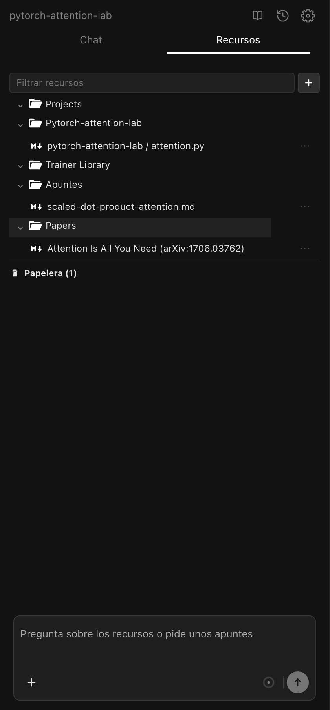
  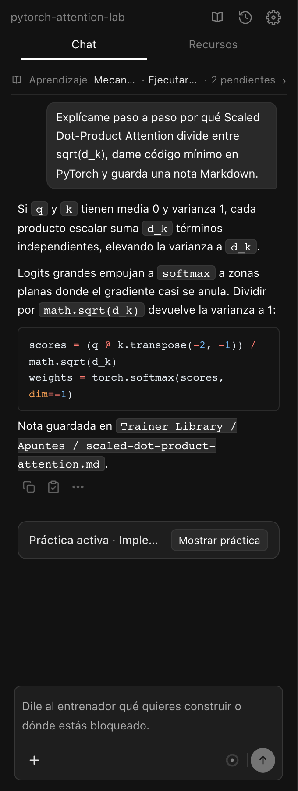
</p>

### `$` Skills personalizados — crea, comparte, instala

Escribe `$` en el compositor único para lanzar la paleta al instante. Gestiona tus skills en **Ajustes → Coach → Skills** — formato JSON puro sin `eval()` ni ejecución arbitraria, protegiendo siempre los disparadores integrados.

<p align="center">
  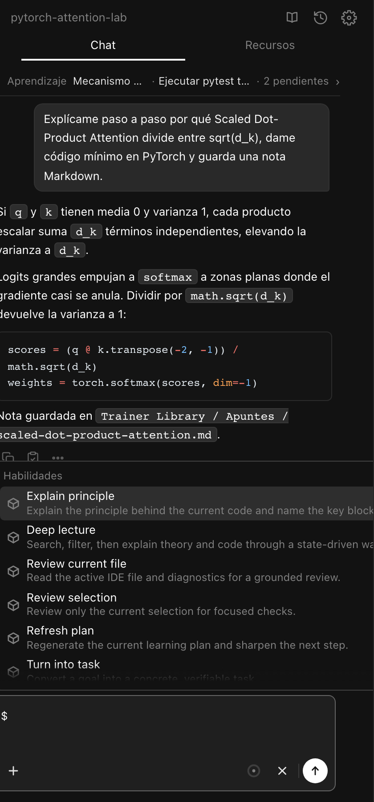
  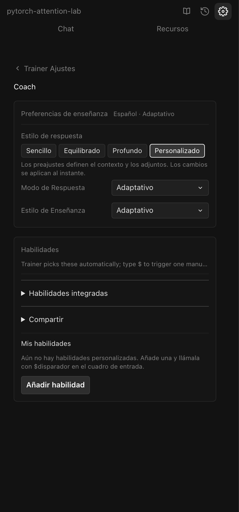
</p>

<p align="center"></p>

---

## Remote-SSH Companion

En proyectos sobre Linux/SSH remotos, Trainer divide **cerebro local y manos remotas**:

- **La UI, el sidecar Python, las API Keys y tu `<LibraryRoot>`** permanecen siempre en tu **equipo local**
- **`remote-extension/`** (`Trainer Workspace Companion`, empaquetada en `extension/bundled/remote/trainer-workspace-companion.vsix`) ejecuta lectura de código, búsqueda, diagnósticos y pruebas controladas (`trainer.remote.verify`) en el host remoto vía puente de comandos
- **Bloqueo duro de escritura remota**: los repositorios remotos quedan estrictamente protegidos contra modificaciones desde el agente

<p align="center">
  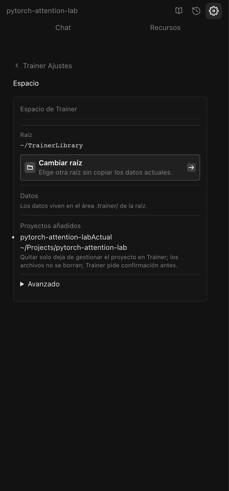
</p>

---

## Comparativa

| Dimensión | Herramientas Vibe | IDEs con Chat | Apps de Flashcards | **Trainer** |
|---|---|---|---|---|
| Escribe código por ti | ✅ | ✅ | ❌ | ❌ (límite intencional) |
| Verifica contra tu código real | ❌ | ❌ | ❌ | ✅ sandbox local + VS Code Testing + Remote-SSH |
| Persistencia entre sesiones | ⚠️ ventana | ⚠️ resúmenes | ✅ | ✅ SQLite + Qdrant bajo `<LibraryRoot>` |
| Mantiene tu repo git intacto | ⚠️ mezcla archivos | ⚠️ | n/a | ✅ un único `<LibraryRoot>`, cero escrituras en tu repo |
| Repaso espaciado FSRS | ❌ | ❌ | ✅ | ✅ con supresión en flujo vivo |
| Niveles de permiso | ❌ | ⚠️ Trust básico | ❌ | ✅ escalera de 6 niveles + bloqueo remoto |
| Suite de tests abierta | cerrada | cerrada | cerrada | ✅ **6.606 unit/integración + 166 E2E** |
| Internacionalización | ⚠️ | ⚠️ | ⚠️ | ✅ **8 idiomas** con gate automático en CI |

> Otras herramientas aceleran la escritura de código; **Trainer garantiza que realmente domines lo que construyes.**

---

## Demo de cinco minutos

1. **T+0:00 — Abrir Trainer**: Pulsa el icono en la barra de actividad y empieza directo en **Chat** sin formularios obligatorios.
2. **T+0:30 — Conectar modelo**: En **Ajustes → Conexión**, selecciona protocolo, URL, modelo y API Key en llavero (activa **Ignorar proxy del sistema (Directo)** si usas proxy local) y ejecuta **Probar conexión**.
3. **T+1:30 — Pedir explicación profunda**: Solicita *"Explica con flujo de estado por qué Scaled Dot-Product Attention divide entre sqrt(d_k) y guarda una nota Markdown"* — se guarda directo en `<LibraryRoot>/Trainer Library/`.
4. **T+2:30 — Practicar en línea**: Despliega la tarjeta **FocusedPractice** dentro del Chat, edita tu archivo real y responde o pide pistas desde el único compositor inferior.
5. **T+4:00 — Verificar y programar FSRS**: Pulsa **Verificar archivo actual** (o ejecuta tests por Testing API / Remote-SSH) para actualizar **Comprensión / Implementación / Depuración / Transferencia**.
6. **T+5:00 — Revisar Cajón de Aprendizaje**: Abre el icono del libro arriba a la derecha para ver **Objetivo actual**, **Práctica pendiente** y la barra unificada de 4 segmentos.

---

## Por qué se siente distinto

### Fallos honestos y bypass de proxy
- Las pasarelas desconocidas nunca se asumen compatibles con OpenAI en silencio
- **Ignorar proxy del sistema (Directo)** evita errores 502 o timeouts causados por variables `HTTP_PROXY` / `HTTPS_PROXY` por perfil
- Los streams vacíos o cortes de red muestran estados de recuperación accionables

### Test de velocidad y control de razonamiento
- Mide múltiples endpoints en paralelo con exclusión de arranque en frío y elige el más rápido en un clic
- El nivel de pensamiento se ajusta únicamente tras verificar las capacidades reales del modelo

<p align="center"></p>

### Biblioteca potente unificada en `<LibraryRoot>`
- Importa PDF (`PyMuPDF`), páginas web (`Trafilatura`), DOCX (`mammoth` / `MarkItDown`) o apuntes generados en `<LibraryRoot>/Trainer Library/`
- Búsqueda instantánea, vista previa Markdown enriquecida con fórmulas KaTeX y diagramas Mermaid, papelera recuperable y acceso contextual al Chat

<p align="center"></p>

### Captura rápida desde el navegador (`browser-extension/`)
- Extensión MV3 para Chrome/Edge **sin códigos de emparejamiento** — descubre automáticamente el sidecar local (`127.0.0.1`)
- Envía webs, PDFs de arXiv, repositorios de GitHub o texto seleccionado directo a `<LibraryRoot>/Trainer Library/` o al borrador del Chat, con colas FIFO offline y Side Panel completo en 8 idiomas

<p align="center">
  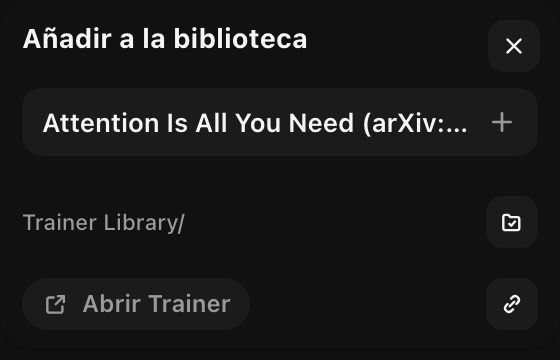
</p>

### Integración MCP (`docs/mcp.md`)
- Cliente stdio opcional para **Model Context Protocol** (`TRAINER_MCP_SERVERS`) que expone servidores externos (p. ej. GitHub / Gitee) dentro del bucle ReAct bajo la misma escalera fail-closed de 6 niveles — ver [`docs/mcp.md`](docs/mcp.md)

---

## Arquitectura

### Topología del sistema

```text
┌─────────────────────────────────────────────────────────────────────────┐
│                             VS Code Window                              │
│  ┌──────────────────────────────┐    ┌────────────────────────────────┐ │
│  │  Barra Trainer (Host UI)     │    │  Workspace Remote-SSH (Remoto) │ │
│  │  React 19 + Zustand (8 i18n) │    │  remote-extension (Companion)  │ │
│  │  Chat / Recursos + Cajón     │◄──►│  Lectura / Búsqueda / Diagnóst.│ │
│  └──────────────┬───────────────┘    │  y Ejecución de Tests Verif.   │ │
│                 │                    └────────────────────────────────┘ │
│  ┌──────────────▼───────────────┐                                       │
│  │  Extension Host (TypeScript) │  • SecretStorage (Llavero del SO)     │
│  │  CommandRegistry · Workspace │  • Testing API → Atestación Real      │
│  │  Gateway · Sidecar Manager   │  • Puente Extensión Navegador MV3     │
│  └──────────────┬───────────────┘                                       │
│                 │ http://127.0.0.1 + stream SSE                         │
│  ┌──────────────▼───────────────┐    ┌────────────────────────────────┐ │
│  │  Sidecar FastAPI (Python)    │───►│  Raíz Única <LibraryRoot>      │ │
│  │  • Bucle ReAct + Cliente MCP │    │  • Trainer Library/ (Apuntes)  │ │
│  │  • Núcleo RethinkFun         │    │  • .trainer/runtime/           │ │
│  │  • 5 Protocolos + Bypass Prox│    │    trainer.sqlite3 · Qdrant ·  │ │
│  │  • Planificador FSRS + Mem.  │    │    Checkpoints · Registro      │ │
│  │  • Autoridad de 6 niveles    │    │  (Cero escrituras en tu repo)  │ │
│  └──────────────────────────────┘    └────────────────────────────────┘ │
└─────────────────────────────────────────────────────────────────────────┘
```

### Estructura de directorios

| Carpeta | Contenido | Tamaño medido |
|---|---|---|
| `extension/src/` | Host VS Code: comandos, SecretStorage, WorkspaceGateway, SidecarProcessManager | `79` archivos TS (~`53.286` líneas) |
| `extension/webview/src/` | Workbench React: 2 destinos, cajón, compositor único, Shiki/KaTeX/Mermaid, 8 idiomas | `233` TS/TSX + `53` CSS (~`120.507` líneas) |
| `extension/tests/` | Suite `node:test`: host, gobernanza compartida, i18n, captura web, seguridad | `317` archivos · **`2.401` tests** |
| `server/app/` | Sidecar FastAPI: agente ReAct, pedagogía RethinkFun, FSRS, ingesta, evaluador | `232` archivos Python (~`173.863` líneas) |
| `server/tests/` | Suite backend `pytest` de rutas API, pedagogía, memoria y protocolos | `295` archivos · **`4.205` tests recogidos** |
| `shared/src/` | Módulos TypeScript puros deterministas compartidos entre Host, Webview y Tests | `76` módulos (~`29.508` líneas · `523` exports) |
| `remote-extension/src/` | Companion Remote-SSH (`extensionKind: ["workspace"]`) | `2` archivos TS (`746` líneas) |
| `browser-extension/` | Extensión Chromium MV3: popup, colas offline, menús contextuales y Side Panel | `8` archivos (`6.977` líneas) |
| `extension/bundled/` | Binario PyInstaller congelado + `trainer-workspace-companion.vsix` | ~`245 MB` |

### Contrato canónico (`WorkbenchSnapshot`)

Todas las rutas HTTP de estado devuelven el contrato único **`WorkbenchSnapshot`** (`33` campos de nivel superior en `server/app/core/models.py`), sincronizado de forma incremental vía `snapshot_revision`.

---

## Modelo de seguridad

- **Claves en el llavero del SO / VS Code `SecretStorage`** — jamás en repositorios, `<LibraryRoot>`, snapshots ni logs (`npm run verify:credentials`)
- **Workspace Trust de VS Code fail-closed** — las ventanas no confiables bloquean inspección y verificación remota
- **Escalera de autoridad en 6 niveles** (`server/app/workspace/authority.py`): solo lectura por defecto sobre repositorios del usuario; bloqueo absoluto de escrituras en Remote-SSH
- **Papelera recuperable + `<LibraryRoot>`**: eliminar un recurso lo mueve a la papelera en vez de borrarlo en bruto; cero archivos ocultos en tu proyecto git
- **Compartición de Skills solo JSON**: validación estricta de esquema/longitud sin ejecución de código
- **Telemetría opt-in desactivada por defecto**: nunca incluye rutas, código fuente ni conversaciones

---

## Compuertas de calidad

> Todas las métricas reflejan verificaciones reales en `main` (`v1.4.5`):

| Compuerta | Alcance y resultado verificado | Comando |
|---|---|---|
| **Tests del servidor (`pytest`)** | **295 archivos · 4.205 tests** (más subtests) | `npm run test:server` |
| **Tests de extensión (`node:test`)** | **317 archivos · 2.401 tests** (`2.400` aprobados, `1` omitido por plataforma, `0` fallos) | `npm run test:extension` |
| **Análisis estático y tipos** | `ruff check` (`0`) · `pyright` (`0`) · CSS + `tsc -b` (`0`) | `npm run check && npm run verify:server-pyright` |
| **Geometría UI** | Soberanía del compositor único, 2 destinos, sin desbordamiento (`340/420/460px`, dark/light, zh/en) | `npm run verify:ui-geometry` |
| **Completitud i18n** | **213** `appUiCopy` + **212** `settingsText` + **272** `hostCommandCopy` en **8 idiomas** (`0` faltantes) | `npm run verify:i18n` |
| **Vocabulario y secretos** | **68** archivos UI limpios · **4.027** archivos del repo sin credenciales en texto plano | `npm run verify:copy-vocabulary && npm run verify:credentials` |
| **Playwright E2E & Remote-SSH** | **30** specs Playwright (`166` tests) + matriz con sidecar real + Ubuntu Remote-SSH L2 (`20/20`) | `npm run test:experience-matrix` · `npm run test:remote-ssh-e2e` |
| **Targets CI de lanzamiento** | **3 plataformas de escritorio**: `win32-x64`, `darwin-arm64`, `linux-x64` | `.github/workflows/release.yml` |

*(Nota: la validación pedagógica humana `T-0028` sigue registrada como compuerta manual en [`docs/TRIAL-1.5.0-RC.md`](docs/TRIAL-1.5.0-RC.md).)*

---

## i18n · Ocho idiomas

Toda la interfaz, ajustes, comandos del host, extensión de navegador y documentación están disponibles en **8 idiomas**:

`zh-CN` · `en-US` · `es-ES` · `fr-FR` · `de-DE` · `ja-JP` · `ko-KR` · `pt-BR`

Verificado automáticamente por `npm run verify:i18n` (`extension/webview/src/lib/i18n/copy.ts`).

---

## Agradecimientos

- **Runtime y HTTP**: [FastAPI](https://github.com/fastapi/fastapi) · [Uvicorn](https://github.com/encode/uvicorn) · [Pydantic](https://github.com/pydantic/pydantic) · [httpx](https://github.com/encode/httpx) · [openai-python](https://github.com/openai/openai-python)
- **Memoria, FSRS e ingesta**: [py-fsrs](https://github.com/open-spaced-repetition/py-fsrs) · [qdrant-client](https://github.com/qdrant/qdrant-client) · [PyMuPDF](https://github.com/pymupdf/PyMuPDF) · [Trafilatura](https://github.com/adbar/trafilatura) · [MarkItDown](https://github.com/microsoft/markitdown)
- **Frontend y renderizado**: [React](https://github.com/facebook/react) · [Vite](https://github.com/vitejs/vite) · [Zustand](https://github.com/pmndrs/zustand) · [Zod](https://github.com/colinhacks/zod) · [react-markdown](https://github.com/remarkjs/react-markdown) · [KaTeX](https://github.com/KaTeX/KaTeX) · [Shiki](https://github.com/shikijs/shiki) · [Mermaid](https://github.com/mermaid-js/mermaid) · [@tanstack/react-table](https://github.com/TanStack/table) · [PDF.js](https://mozilla.github.io/pdf.js/) · [mammoth](https://github.com/mwilliamson/mammoth.js) · [docx-preview](https://github.com/VolodymyrBaydalka/docx-preview)
- **Tests y empaquetado**: [pytest](https://github.com/pytest-dev/pytest) · [Hypothesis](https://github.com/HypothesisWorks/hypothesis) · [ruff](https://github.com/astral-sh/ruff) · [pyright](https://github.com/microsoft/pyright) · [TypeScript](https://github.com/microsoft/TypeScript) · [Playwright](https://github.com/microsoft/playwright) · [PyInstaller](https://github.com/pyinstaller/pyinstaller)
- **Inspiración pedagógica**: Enfoque didáctico inspirado en el creador técnico **[RethinkFun](https://rethink.fun)** (intuición por flujo de estado antes de memorizar fórmulas) · [fsrs4anki](https://github.com/open-spaced-repetition/fsrs4anki)
- **Recursos visuales**: Generados con **[GPT Image](https://github.com/AI-yyf/trainer/tree/main/assets)** (`assets/MASCOT.md` · `assets/BANNER_PROMPT.md` · `assets/FEATURE_PROMPTS.md`)

---

## Licencia

[MIT](LICENSE)

---

## Citar Trainer

```bibtex
@software{trainer2026,
  title  = {Trainer: A Long-Term Coding Coach Living in Your Editor},
  author = {AI-yyf and contributors},
  year   = {2026},
  url    = {https://github.com/AI-yyf/trainer},
  note   = {v1.4.5}
}
```

---

<div align="center">

**// Entrena a tu IA · Crece con tu IA**

`v1.4.5` · Hecho con café, FSRS, pedagogía RethinkFun State-Flow, 6.606 tests automatizados y un coach que se niega a escribir tu código por ti.

</div>
