# Trainer

<div align="center">

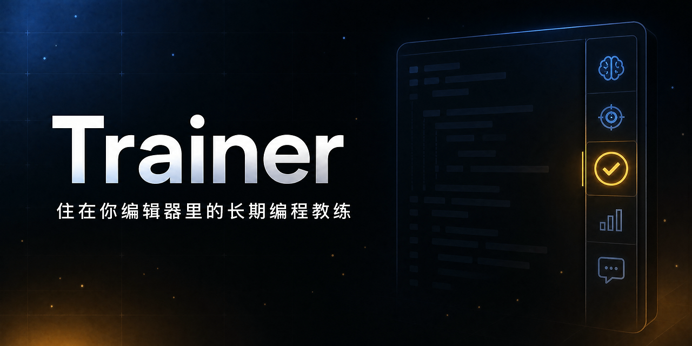

**Un coach technique et de programmation au long cours intégré à ta barre latérale VS Code.**

**Il planifie, entraîne, vérifie et mémorise d'une session à l'autre — mais refuse d'écrire ton code de production à ta place.**

**// Produire ≠ Grandir // Vérifier + Réviser = Grandir**

[English](README.md) · [简体中文](README_zh-CN.md) · [Español](README_es-ES.md) · Français · [Deutsch](README_de-DE.md) · [日本語](README_ja-JP.md) · [한국어](README_ko-KR.md) · [Português](README_pt-BR.md)

[](https://github.com/AI-yyf/trainer/blob/main/extension/package.json)
[](LICENSE)
[](#installation)
[](#garanties-de-qualité)
[](#i18n--huit-langues)

[Pourquoi](#pourquoi-trainer-existe) ·
[Installation](#installation) ·
[Trois étapes](#trois-étapes-pas-de-quatrième) ·
[Mécanismes](#mécanismes-clés) ·
[Deux destinations](#deux-destinations--une-conversation) ·
[Remote-SSH](#remote-ssh-companion) ·
[Comparaison](#comparaison) ·
[Démo 5 min](#démo-de-cinq-minutes) ·
[Conception](#pourquoi-cest-différent) ·
[Architecture](#architecture) ·
[Sécurité](#modèle-de-sécurité) ·
[Qualité](#garanties-de-qualité) ·
[Remerciements](#remerciements) ·
[🎭 La troupe](docs/CAST.md)

</div>

---

## Pourquoi Trainer existe

> Les devs ne bloquent pas faute de tutoriels.
> Ils bloquent parce que rien ne referme la boucle d'apprentissage.

Une discussion LLM s'évapore dès la fermeture de l'onglet ; les vidéos restent passives ; le concept compris à moitié mardi est oublié vendredi.

Pire : le **vibe coding** — trois mois à laisser l'IA écrire le code pendant que ta compréhension se vide.

**Trainer résout cela depuis l'intérieur de l'éditeur.**

Ce n'est pas un enrobage de chat : c'est un coach doté d'une mémoire durable, d'un programme et d'une politique de vérification :

- Il **planifie** ton apprentissage par étapes et suit où tu en es réellement — pas où tu crois être
- Il t'**entraîne** via des fiches, exercices théoriques et mises en pratique ciblées sur ton projet réel
- Il **vérifie** ta maîtrise face à ton vrai code — discuter de FastAPI ne compte pas tant que ton fichier ne le prouve pas
- Il se **souvient** d'une session et d'un projet à l'autre, planifiant les rappels sur la courbe d'oubli **FSRS**
- Il **n'écrit jamais ton code de production** — tu écris, il enseigne, **vous grandissez ensemble**

**Et cette rigueur dépasse le code.** La même boucle « vérifier d'abord » couvre la lecture analytique, les démonstrations de fond et l'apprentissage des langues grâce à des packs de vérification dédiés.

<div align="center">

| vibe coding · la norme actuelle | Trainer · ce que cela devrait être |
|:---:|:---:|
| `def ship(code):` <br> `    ai.write(code)` <br> `# tu l'as compris ?` <br> `    return forget(code)` | `def ship(code):` <br> `    you.write(code)` <br> `    ai.verify(code)` <br> `    you.recall(code)` <br> `    return grown(code)` |
| produire = oublier | produire + mémoire + rappel = grandir |

</div>

---

## Installation

**Via VSIX précompilé (trois plateformes vérifiées par CI) :**

Télécharge le `.vsix` correspondant à ton système (`darwin-arm64` / `linux-x64` / `win32-x64`) depuis [Releases](https://github.com/AI-yyf/trainer/releases/latest) :

```bash
code --install-extension trainer-extension-1.5.1-<platform>-<arch>.vsix --force
```

Ou depuis la vue Extensions de VS Code → `···` → *Installer depuis VSIX…* → recharger la fenêtre. Détails complets dans [`extension/README.install.md`](extension/README.install.md).

**Depuis les sources :**

```bash
git clone https://github.com/AI-yyf/trainer.git
cd trainer && npm ci
cd server && uv sync --frozen --extra dev --python 3.12 && cd ..
npm run build
```

Ouvre le dépôt dans VS Code et appuie sur `F5` (Extension Development Host), ou génère un VSIX local avec `npm run package:vsix`.

**Prérequis :** VS Code `≥ 1.96` · Python `3.12` (uniquement depuis les sources ; le `.vsix` embarque son sidecar gelé) · macOS (`arm64`) / Linux (`x64`) / Windows (`x64`).

---

## Trois étapes, pas de quatrième

Démarrage à froid **sans mur de configuration** : ouvre Trainer et arrive directement dans le Chat. Pour connecter ton modèle :

1. Ouvre **Paramètres → Connexion** (engrenage en haut à droite)
2. Choisis un protocole explicite (`OpenAI Chat`, `OpenAI Responses`, `Anthropic Messages`, `Gemini` ou `Azure OpenAI`), saisis l'**URL racine du service**, ta **clé API** (enregistrée exclusivement dans le trousseau du système via `SecretStorage`) et le **Modèle**
3. Si des variables proxy locales (`HTTP_PROXY` / `HTTPS_PROXY`) provoquent des erreurs `502` ou des délais d'attente, bascule **Proxy réseau** sur **Ignorer le proxy système (Direct)** puis clique sur **Tester la connexion**

Trainer récupère la liste des modèles, sonde le streaming, l'appel d'outils et le raisonnement, et rapporte les pannes avec franchise (`invalid_key_or_permission`, `network` ou flux vide).

<p align="center">
  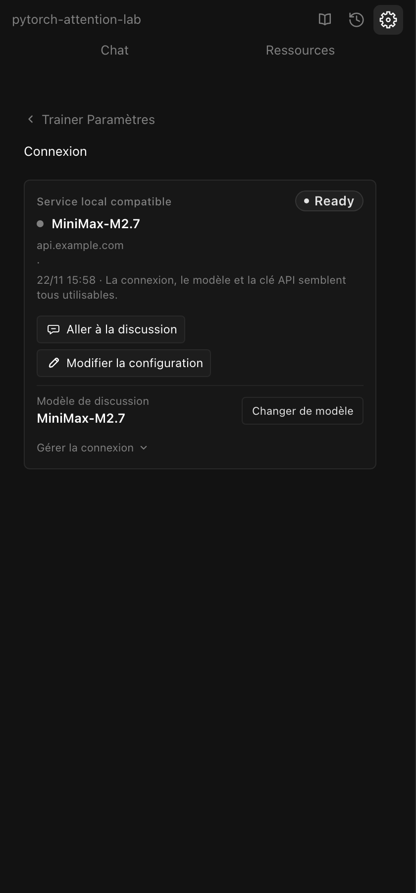
  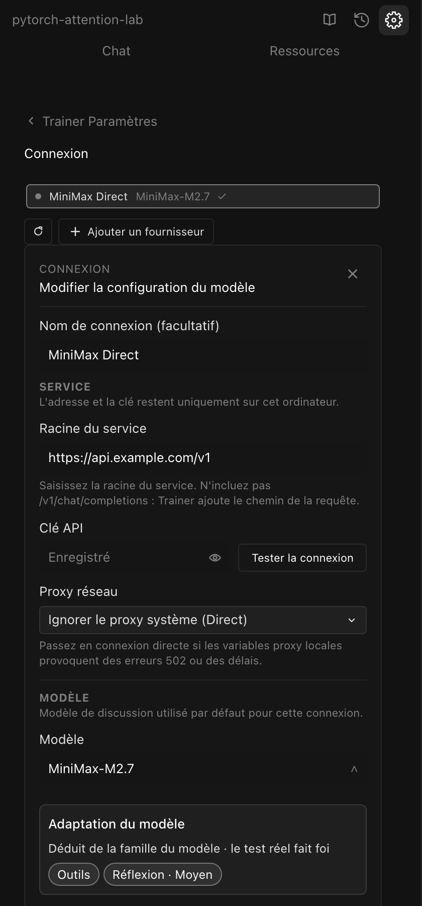
</p>

---

## Mécanismes clés

### ① Portes de vérification — tu écris le code, le code fait foi

Une carte d'entraînement ne progresse jamais tant que la vérification n'a pas tourné sur ton vrai fichier ; il n'y a volontairement aucun bouton « marquer comme terminé ».

<p align="center"></p>

- **Bac à sable isolé local** (`server/app/evaluator/service.py` — `EvaluatorService`) : copie les fichiers cibles en répertoire temporaire, lance les vérifications sans polluer ton dépôt avec `.pytest_cache` et évalue chaque critère `acceptance_criteria` + `expected_symbols`
- **Attestation via VS Code Testing API** (`extension/src/testing/`) : les résultats réels des tests sont attestés auprès de `/training/verification/attest` — un test interrompu ou inconnu ne produit jamais de faux succès
- **Proxy de lecture/vérification Remote-SSH** : exécute les vérifications à distance sans jamais exporter tes clés API ni ta bibliothèque

### ② Mémoire long terme + `<LibraryRoot>` unifié

Tout ce que Trainer retient, chaque ressource importée et chaque note Markdown sauvegardée résident dans **un seul dossier `<LibraryRoot>`** de ton choix — tes dépôts de code restent 100 % vierges (`git status` intact).

<p align="center"></p>

```text
<LibraryRoot>/
├── Trainer Library/          # Ressources consultables et notes Markdown sauvegardées
│   ├── Notes de cours/       # Produites par `save_lecture_note` (lisibles directement)
│   └── Papers/               # PDF importés, pages web extraites et synthèses
└── .trainer/
    └── runtime/              # SQLite (`trainer.sqlite3`), index Qdrant, checkpoints et journaux
```

- **Mémoire à deux niveaux** : état SQLite structuré + rappel sémantique (`Qdrant` avec repli local) orchestrés sur la courbe **`py-fsrs`** (`server/app/memory/review_scheduler.py`)
- **Silence pendant le flux actif** : les révisions dues s'effacent temporairement tant qu'une session de codage en cours exige ta concentration
- **Isolation inter-projets fail-closed** : réussir dans un projet ne gonfle jamais artificiellement la maîtrise globale (`server/app/memory/transfer_skills.py`)

### ③ Boucle pédagogique RethinkFun State-Flow

La méthode d'enseignement par flux d'état de Trainer est directement inspirée du créateur et vulgarisateur technique **[RethinkFun](https://rethink.fun)** (partir du blocage concret avant la formalisation, déduire étape par étape sans ellipses « évidentes » et relier chaque ligne de code minimale au principe théorique). La pratique s'intègre directement au fil de discussion plutôt que dans une administration CRUD parallèle :

<p align="center"></p>

- **Trois voies pédagogiques calibrées** (`server/app/pedagogy/` + `server/app/llm/`) :
  - **Guidage rapide sur le code** : ancré sur tes symboles et tests échoués, sans blabla superflu
  - **Cours approfondis par flux d'état (`save_lecture_note`)** : démontre chaque étape sans formules creuses, relie code minimal et théorie, et enregistre des notes `.md` propres dans `<LibraryRoot>/Trainer Library/`
  - **Audit factuel de progression (`inspect_learning_truth`)** : répond sur les étapes et preuves vérifiées sans exposer d'ID internes ni de JSON brut
- **Automate à 5 phases** (`LEARN → TRY → VERIFY → REFLECT → RETURN` dans `server/app/training/handoff.py`)

### ④ Tu écris, le coach guide

Le coach lit fichiers, diagnostics et architecture à tes côtés, tandis que le code reste exclusivement écrit par toi (`server/app/workspace/authority.py` protège tes sources en lecture seule).

<p align="center"></p>

- Rythme adaptatif (`AffectService` dans `server/app/affect/service.py`) repère les blocages répétés et passe en mode secours concis

### ⑤ Ancrage factuel et qualité des explications

- Les gardes déterministes (`coaching_recovery.py`, `coaching_replies.py`) bloquent flux vides, réponses cassées et dérives linguistiques
- Un score non bloquant en 5 dimensions mesure l'ancrage réel sur les symboles et l'absence de solution toute faite

---

## Deux destinations + Une conversation

> Architecture épurée et stable : **Chat** et **Ressources** en navigation principale ; **Tiroir d'apprentissage**, **Historique** et **Paramètres** en utilitaires d'en-tête ; **un seul champ de saisie** souverain.

| Surface | Rôle | Contenu |
|---|---|---|
| **Chat** (`coach`) | Espace principal | Réponses en streaming State-Flow, badges de notes `.md` enregistrées, actions par message, cartes **FocusedPractice** pliables en ligne (sans second champ), bandeau d'apprentissage d'une ligne, palette `$` |
| **Ressources** (`resources`) | Bibliothèque & lecteur | Arborescence unifiée `<LibraryRoot>`, filtre local instantané, aperçu Markdown VS Code avec images et KaTeX/Shiki/Mermaid, import PDF/DOCX/URL, corbeille récupérable |
| **Tiroir d'apprentissage** (`plan` / `training` / `progress`) | Mémoire en lecture seule | Feuille modale au-dessus du Chat (brouillon conservé) avec trois cartes homogènes : **Objectif actuel**, **Pratique à faire** et **Maîtrise** (une **barre à 4 segments**, zéro pourcentage) |
| **Paramètres** (`settings`) | Console de réglage | Connexion 5 protocoles + **Contournement proxy direct**, style du coach & Skills `$`, **Workspace `<LibraryRoot>`** + Remote Companion, 8 langues et télémétrie opt-in |

*(Les six routes internes historiques — `coach`, `plan`, `resources`, `training`, `progress`, `settings` — restent valides pour les liens et restaurations.)*

<p align="center">
  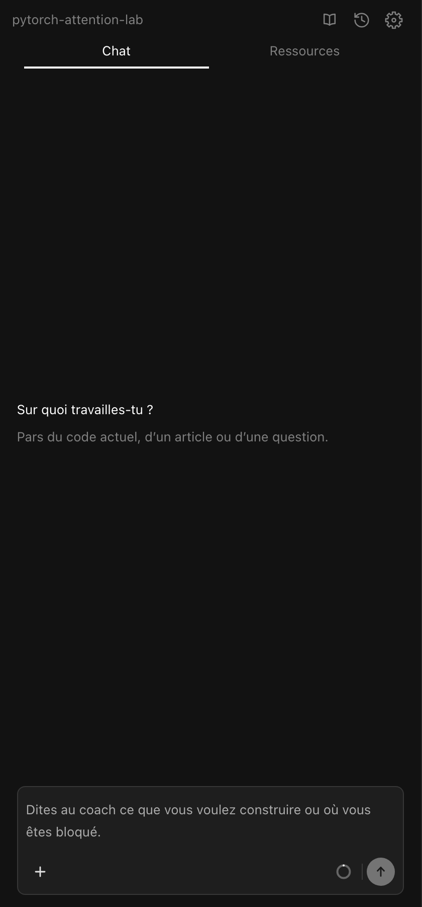
  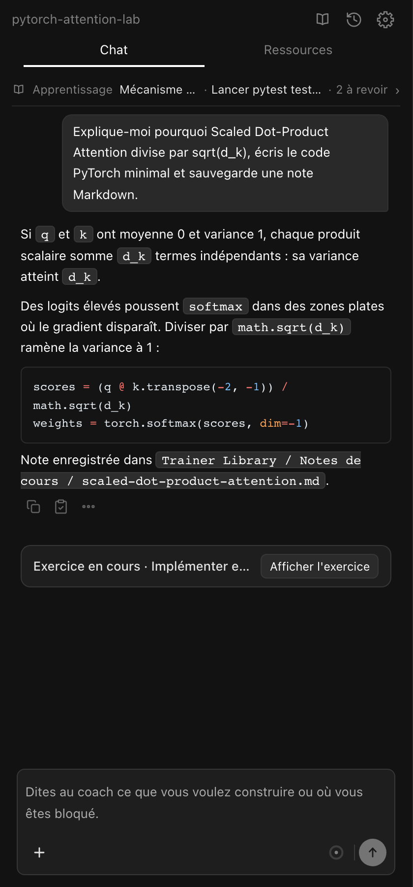
  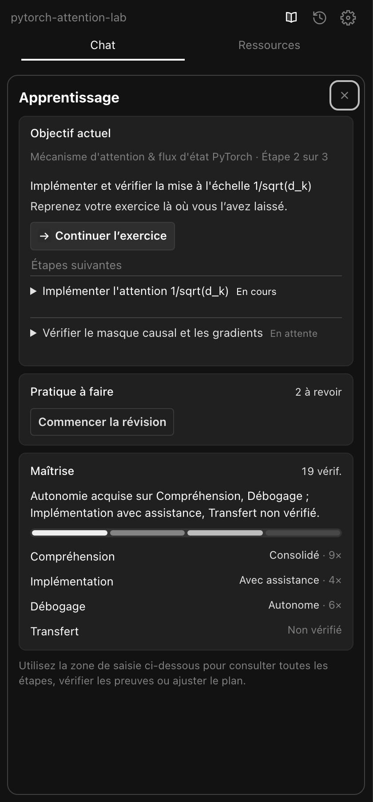
</p>
<p align="center">
  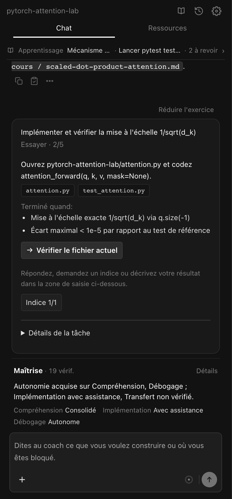
  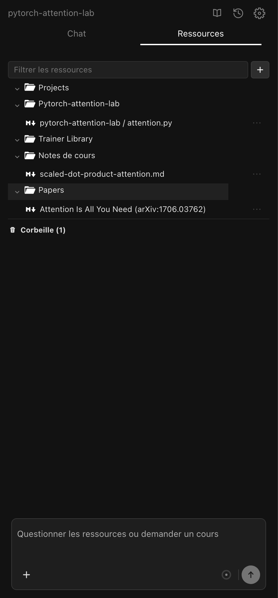
  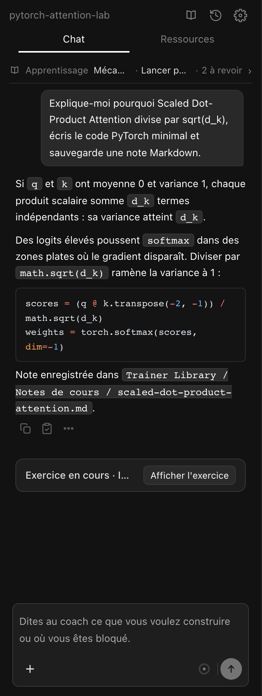
</p>

### `$` Skills personnalisés — créer, partager, installer

Tape `$` dans le compositeur unique pour ouvrir la palette instantanée. Gère tes skills dans **Paramètres → Coach → Compétences** — JSON pur (`{ trigger, title, prompt, keywords }`) sans `eval()` et protégeant les triggers natifs.

<p align="center">
  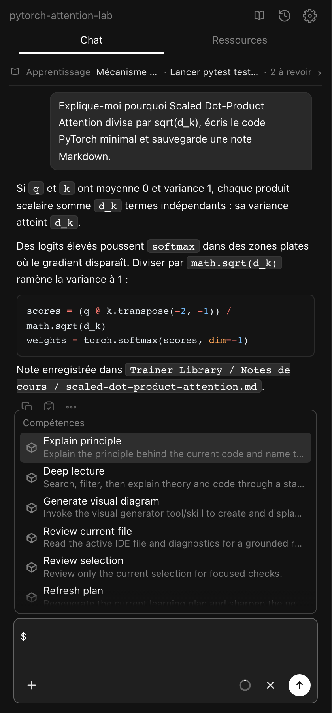
  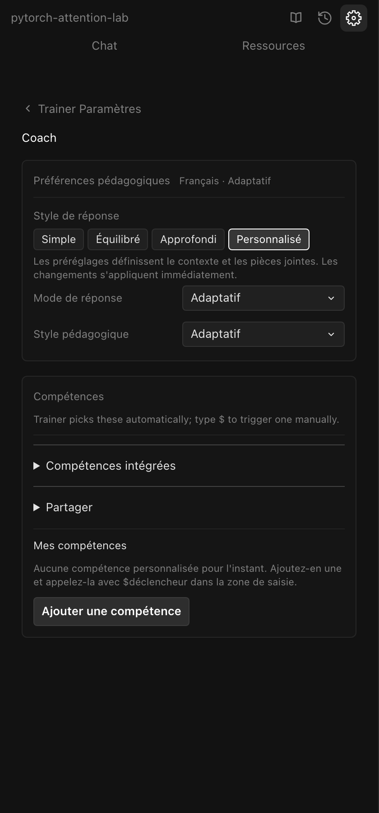
</p>

<p align="center"></p>

---

## Remote-SSH Companion

Pour tes espaces de travail Linux/SSH distants, Trainer sépare **cerveau local et mains distantes** :

- **L'interface, le sidecar Python, les clés API et `<LibraryRoot>`** demeurent toujours sur ton **poste local**
- **`remote-extension/`** (`Trainer Workspace Companion`, empaquetée dans `extension/bundled/remote/trainer-workspace-companion.vsix`) assure la lecture de fichiers, recherche, diagnostics et lancement vérifié des tests (`trainer.remote.verify`) côté serveur distant
- **Verrou strict d'écriture à distance** : aucune modification directe de tes fichiers distants n'est permise par l'agent

<p align="center">
  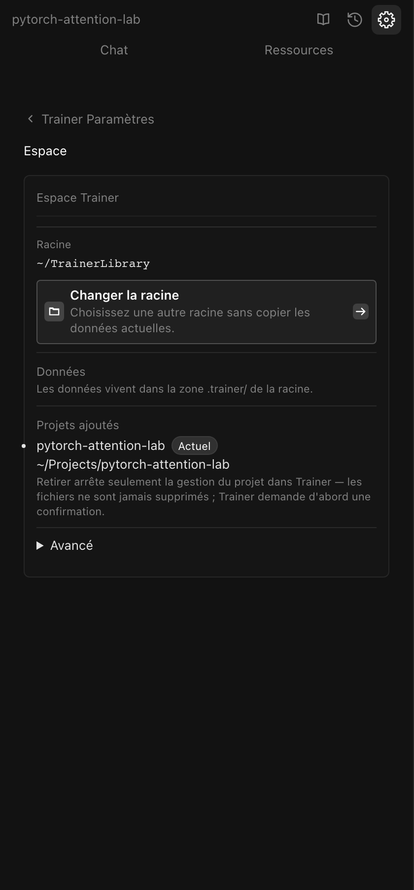
</p>

---

## Comparaison

| Critère | Outils Vibe | IDE avec Chat | Apps de Flashcards | **Trainer** |
|---|---|---|---|---|
| Écrit le code à ta place | ✅ | ✅ | ❌ | ❌ (limite assumée) |
| Vérifie sur ton vrai code | ❌ | ❌ | ❌ | ✅ sandbox + VS Code Testing + Remote-SSH |
| Mémoire inter-sessions | ⚠️ fenêtre | ⚠️ résumés | ✅ | ✅ SQLite + Qdrant sous `<LibraryRoot>` |
| Laisse ton dépôt git vierge | ⚠️ mélange fichiers | ⚠️ | n/a | ✅ un seul `<LibraryRoot>`, zéro écriture dans le dépôt |
| Répétition espacée FSRS | ❌ | ❌ | ✅ | ✅ avec pause en flux actif |
| Contrôle des permissions | ❌ | ⚠️ Trust basique | ❌ | ✅ échelle à 6 niveaux + verrou Remote-SSH |
| Suite de tests publique | fermé | fermé | fermé | ✅ **6 606 tests unitaires/intégration + 166 E2E** |
| Internationalisation | ⚠️ | ⚠️ | ⚠️ | ✅ **8 langues** contrôlées en CI |

> Les autres outils accélèrent la production de code ; **Trainer s'assure que tu maîtrises vraiment ce que tu livres.**

---

## Démo de cinq minutes

1. **T+0:00 — Ouvrir Trainer** : Clique sur l'icône Trainer pour entrer immédiatement dans **Chat**, sans formulaire bloquant.
2. **T+0:30 — Connecter un modèle** : Dans **Paramètres → Connexion**, renseigne protocole, URL, modèle et clé (bascule **Ignorer le proxy système (Direct)** si nécessaire) puis clique sur **Tester la connexion**.
3. **T+1:30 — Demander un cours State-Flow** : Demande *"Explique pourquoi Scaled Dot-Product Attention divise par sqrt(d_k) et enregistre une note Markdown"* — la fiche est créée dans `<LibraryRoot>/Trainer Library/`.
4. **T+2:30 — Pratiquer en ligne** : Ouvre la carte **FocusedPractice** dans le Chat, modifie ton code et échange via l'unique zone de saisie.
5. **T+4:00 — Vérifier et planifier FSRS** : Lance **Vérifier le fichier actuel** (ou les tests via Testing API / Remote-SSH) pour faire progresser **Compréhension / Implémentation / Débogage / Transfert**.
6. **T+5:00 — Consulter le Tiroir d'apprentissage** : Un clic sur l'icône livre en haut à droite affiche **Objectif actuel**, **Pratique à faire** et la barre unifiée à 4 segments.

---

## Pourquoi c'est différent

### Échecs honnêtes et bypass de proxy
- Les passerelles inconnues ne sont jamais présumées compatibles OpenAI
- **Ignorer le proxy système (Direct)** contourne par profil les variables `HTTP_PROXY` / `HTTPS_PROXY` défaillantes
- Les flux vides et erreurs d'auth affichent des actions de reprise explicites

### Test de vitesse et intensité de raisonnement
- Met en concurrence plusieurs endpoints avec préchauffage et adopte le plus rapide en un clic
- Le mode de réflexion s'adapte uniquement aux capacités réellement vérifiées du modèle

<p align="center"></p>

### Bibliothèque unifiée sous `<LibraryRoot>`
- Importe PDF (`PyMuPDF`), pages web (`Trafilatura`), DOCX (`mammoth` / `MarkItDown`) ou notes de cours vers `<LibraryRoot>/Trainer Library/`
- Filtre instantané, rendu Markdown VS Code avec KaTeX/Shiki/Mermaid, corbeille récupérable et contextualisation directe dans le Chat

<p align="center"></p>

### Extension navigateur & Side Panel (`browser-extension/`)
- Extension Chromium MV3 **sans code d'appairage** — découvre automatiquement le sidecar local (`127.0.0.1`)
- Envoie pages, PDF arXiv, dépôts GitHub ou extraits sélectionnés directement vers `<LibraryRoot>/Trainer Library/` ou le brouillon du Chat, avec files hors-ligne FIFO et Side Panel complet en 8 langues

<p align="center">
  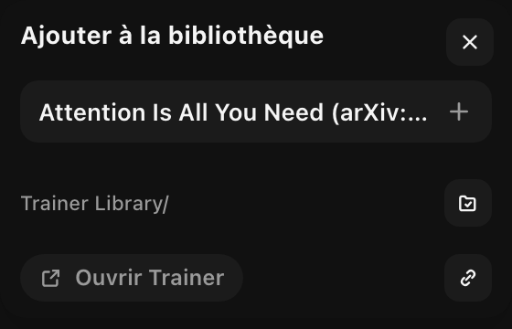
</p>

### Intégration MCP (`docs/mcp.md`)
- Client stdio **Model Context Protocol** optionnel (`TRAINER_MCP_SERVERS`) connectant GitHub / Gitee et outils externes dans la boucle ReAct sous les mêmes 6 niveaux d'autorité fail-closed — voir [`docs/mcp.md`](docs/mcp.md)

---

## Architecture

### Topologie du système

```text
┌─────────────────────────────────────────────────────────────────────────┐
│                             VS Code Window                              │
│  ┌──────────────────────────────┐    ┌────────────────────────────────┐ │
│  │  Barre Trainer (Hôte UI)     │    │  Workspace Remote-SSH (Distant)│ │
│  │  React 19 + Zustand (8 i18n) │    │  remote-extension (Companion)  │ │
│  │  Chat / Ressources + Tiroir  │◄──►│  Lecture / Recherche / Diagn.  │ │
│  └──────────────┬───────────────┘    │  et Exécution de Tests Vérif.  │ │
│                 │                    └────────────────────────────────┘ │
│  ┌──────────────▼───────────────┐                                       │
│  │  Extension Host (TypeScript) │  • SecretStorage (Trousseau OS)       │
│  │  CommandRegistry · Workspace │  • Testing API → Attestation Réelle   │
│  │  Gateway · Sidecar Manager   │  • Passerelle Extension MV3           │
│  └──────────────┬───────────────┘                                       │
│                 │ http://127.0.0.1 + flux SSE                           │
│  ┌──────────────▼───────────────┐    ┌────────────────────────────────┐ │
│  │  Sidecar FastAPI (Python)    │───►│  Racine Unique <LibraryRoot>   │ │
│  │  • Boucle ReAct + Client MCP │    │  • Trainer Library/ (Notes/PDF)│ │
│  │  • Noyau RethinkFun          │    │  • .trainer/runtime/           │ │
│  │  • 5 Protocoles + Proxy Dir. │    │    trainer.sqlite3 · Qdrant ·  │ │
│  │  • Planificateur FSRS + Mém. │    │    Checkpoints · Journal audit │ │
│  │  • Autorité 6 niveaux        │    │  (Zéro écriture dans le dépôt) │ │
│  └──────────────────────────────┘    └────────────────────────────────┘ │
└─────────────────────────────────────────────────────────────────────────┘
```

### Structure du dépôt

| Dossier | Contenu | Taille mesurée |
|---|---|---|
| `extension/src/` | Hôte VS Code : commandes, SecretStorage, WorkspaceGateway, SidecarProcessManager | `79` fichiers TS (~`53 286` lignes) |
| `extension/webview/src/` | Workbench React : 2 destinations, tiroir, compositeur unique, Shiki/KaTeX/Mermaid, 8 langues | `233` TS/TSX + `53` CSS (~`120 507` lignes) |
| `extension/tests/` | Suite `node:test` : hôte, gouvernance partagée, i18n, capture web, sécurité | `317` fichiers · **`2 401` tests** |
| `server/app/` | Sidecar FastAPI : agent ReAct, pédagogie RethinkFun, FSRS, ingestion, évaluateur | `232` fichiers Python (~`173 863` lignes) |
| `server/tests/` | Suite backend `pytest` : routes API, pédagogie, mémoire, protocoles, autorité | `295` fichiers · **`4 205` tests collectés** |
| `shared/src/` | Modules TypeScript purs déterministes partagés entre Hôte, Webview et Tests | `76` modules (~`29 508` lignes · `523` exports) |
| `remote-extension/src/` | Companion Remote-SSH (`extensionKind: ["workspace"]`) | `2` fichiers TS (`746` lignes) |
| `browser-extension/` | Extension Chromium MV3 : popup, files hors-ligne, menus contextuels et Side Panel | `8` fichiers (`6 977` lignes) |
| `extension/bundled/` | Binaire PyInstaller gelé + `trainer-workspace-companion.vsix` | ~`245 Mo` |

### Enveloppe canonique (`WorkbenchSnapshot`)

Toutes les routes HTTP d'état retournent l'objet canonique **`WorkbenchSnapshot`** (`33` champs de premier niveau dans `server/app/core/models.py`), synchronisé de manière incrémentale via `snapshot_revision`.

---

## Modèle de sécurité

- **Clés API dans le trousseau du système / VS Code `SecretStorage`** — jamais stockées dans les dépôts, `<LibraryRoot>`, snapshots ou logs (`npm run verify:credentials`)
- **Workspace Trust de VS Code fail-closed** — les fenêtres non approuvées bloquent inspection et vérification distante
- **Échelle d'autorité à 6 niveaux** (`server/app/workspace/authority.py`) : lecture seule par défaut sur les projets utilisateur ; écritures structurelles interdites sur Remote-SSH
- **Corbeille récupérable + `<LibraryRoot>`** : toute suppression passe en corbeille récupérable sans jamais déposer de fichiers cachés dans tes dépôts git
- **Partage de Skills pur JSON** : validation stricte de schéma et de taille sans exécution dynamique
- **Télémétrie opt-in désactivée par défaut** : n'exporte jamais code source, chemins ni prompts

---

## Garanties de qualité

> Chaque mesure ci-dessous correspond aux exécutions vérifiées sur `main` (`v1.5.1`) :

| Garantie | Portée et résultat vérifié | Commande |
|---|---|---|
| **Tests serveur (`pytest`)** | **295 fichiers · 4 205 tests** (plus sous-tests) | `npm run test:server` |
| **Tests extension (`node:test`)** | **317 fichiers · 2 401 tests** (`2 400` réussis, `1` ignoré selon plateforme, `0` échec) | `npm run test:extension` |
| **Analyse statique & types** | `ruff check` (`0`) · `pyright` (`0`) · CSS + `tsc -b` (`0`) | `npm run check && npm run verify:server-pyright` |
| **Géométrie UI** | Souveraineté du compositeur unique, 2 destinations, sans débordement (`340/420/460px`, dark/light, zh/en) | `npm run verify:ui-geometry` |
| **Complétude i18n** | **213** `appUiCopy` + **212** `settingsText` + **272** `hostCommandCopy` sur **8 langues** (`0` manque) | `npm run verify:i18n` |
| **Vocabulaire & secrets** | **68** fichiers UI conformes · **4 027** fichiers scannés sans clé en clair | `npm run verify:copy-vocabulary && npm run verify:credentials` |
| **Playwright E2E & Remote-SSH** | **30** specs Playwright (`166` tests) + matrice sidecar réel + Ubuntu Remote-SSH L2 (`20/20`) | `npm run test:experience-matrix` · `npm run test:remote-ssh-e2e` |
| **Cibles CI de release** | **3 cibles bureau** : `win32-x64`, `darwin-arm64`, `linux-x64` | `.github/workflows/release.yml` |

*(Note : la validation pédagogique humaine `T-0028` reste suivie comme étape manuelle dans [`docs/TRIAL-1.5.0-RC.md`](docs/TRIAL-1.5.0-RC.md).)*

---

## i18n · Huit langues

Interface, paramètres, messages hôte, extension navigateur et documentation sont maintenus parallèlement en **8 langues** :

`zh-CN` · `en-US` · `es-ES` · `fr-FR` · `de-DE` · `ja-JP` · `ko-KR` · `pt-BR`

Garanti automatiquement par `npm run verify:i18n` (`extension/webview/src/lib/i18n/copy.ts`).

---

## Remerciements

- **Runtime & HTTP** : [FastAPI](https://github.com/fastapi/fastapi) · [Uvicorn](https://github.com/encode/uvicorn) · [Pydantic](https://github.com/pydantic/pydantic) · [httpx](https://github.com/encode/httpx) · [openai-python](https://github.com/openai/openai-python)
- **Mémoire, FSRS & ingestion** : [py-fsrs](https://github.com/open-spaced-repetition/py-fsrs) · [qdrant-client](https://github.com/qdrant/qdrant-client) · [PyMuPDF](https://github.com/pymupdf/PyMuPDF) · [Trafilatura](https://github.com/adbar/trafilatura) · [MarkItDown](https://github.com/microsoft/markitdown)
- **Frontend & rendu** : [React](https://github.com/facebook/react) · [Vite](https://github.com/vitejs/vite) · [Zustand](https://github.com/pmndrs/zustand) · [Zod](https://github.com/colinhacks/zod) · [react-markdown](https://github.com/remarkjs/react-markdown) · [KaTeX](https://github.com/KaTeX/KaTeX) · [Shiki](https://github.com/shikijs/shiki) · [Mermaid](https://github.com/mermaid-js/mermaid) · [@tanstack/react-table](https://github.com/TanStack/table) · [PDF.js](https://mozilla.github.io/pdf.js/) · [mammoth](https://github.com/mwilliamson/mammoth.js) · [docx-preview](https://github.com/VolodymyrBaydalka/docx-preview)
- **Tests & packaging** : [pytest](https://github.com/pytest-dev/pytest) · [Hypothesis](https://github.com/HypothesisWorks/hypothesis) · [ruff](https://github.com/astral-sh/ruff) · [pyright](https://github.com/microsoft/pyright) · [TypeScript](https://github.com/microsoft/TypeScript) · [Playwright](https://github.com/microsoft/playwright) · [PyInstaller](https://github.com/pyinstaller/pyinstaller)
- **Inspiration pédagogique** : Approche didactique inspirée du créateur technique **[RethinkFun](https://rethink.fun)** (intuition par flux d'état avant les formules) · [fsrs4anki](https://github.com/open-spaced-repetition/fsrs4anki)
- **Visuels** : Générés avec **[GPT Image](https://github.com/AI-yyf/trainer/tree/main/assets)** (`assets/MASCOT.md` · `assets/BANNER_PROMPT.md` · `assets/FEATURE_PROMPTS.md`)

---

## Licence

[MIT](LICENSE)

---

## Citer Trainer

```bibtex
@software{trainer2026,
  title  = {Trainer: A Long-Term Coding Coach Living in Your Editor},
  author = {AI-yyf and contributors},
  year   = {2026},
  url    = {https://github.com/AI-yyf/trainer},
  note   = {v1.5.1}
}
```

---

<div align="center">

**// Entraîne ton IA · Grandis avec ton IA**

`v1.5.1` · Fait avec du café, FSRS, la pédagogie RethinkFun State-Flow, 6 606 tests automatisés et un coach qui refuse d'écrire ton code à ta place.

</div>
