# Trainer

<div align="center">


**VS Code のサイドバーに住み着く、長期のコーディング＆学習コーチ。**

**計画し、鍛え、検証し、セッションをまたいで記憶します — しかし、本番コードを代わりに書くことは決してありません。**

**// 出力 ≠ 成長 // 検証 + 復習 = 成長**

[English](README.md) · [简体中文](README_zh-CN.md) · [Español](README_es-ES.md) · [Français](README_fr-FR.md) · [Deutsch](README_de-DE.md) · 日本語 · [한국어](README_ko-KR.md) · [Português](README_pt-BR.md)

[](https://github.com/AI-yyf/trainer/blob/main/extension/package.json)
[](LICENSE)
[](#インストール)
[](#品質ゲート)
[](#i18n--8言語)

[なぜ](#なぜ-trainer-を作ったのか) ·
[インストール](#インストール) ·
[3ステップ](#セットアップは3ステップで完了) ·
[仕組み](#コアの仕組み) ·
[2つの入口](#2つの入口--1つの対話) ·
[Remote-SSH](#remote-ssh-companion) ·
[比較](#比較) ·
[5分デモ](#5分デモ) ·
[設計](#なぜ使い心地が違うのか) ·
[アーキテクチャ](#アーキテクチャ) ·
[安全モデル](#安全モデル) ·
[品質](#品質ゲート) ·
[謝辞](#謝辞) ·
[🎭 キャスト](docs/CAST.md)

</div>

---

## なぜ Trainer を作ったのか

> 開発者がつまずくのは、チュートリアルが足りないからではありません。
> 学習ループを閉じてくれるものが何ひとつないからです。

LLM との会話は閉じた瞬間に蒸発し、動画は一方通行。火曜日に半分だけ分かったつもりの概念は、金曜日には消えています。

さらに厄介なのが **バイブコーディング** — 何ヶ月も AI にコードを書かせ続け、自分は何も理解していない状態です。

**Trainer はこの問題をエディタの中から解決します。**

これはただのチャットラッパーではなく、記憶とカリキュラムと試験方針を備えたコーチです：

- 学習を段階ごとに**計画**し、感覚ではなく「本当に到達している位置」を追跡します
- 実際のプロジェクトに根ざしたカード、理論ドリル、インライン演習であなたを**鍛えます**
- 実際のコードで習得を**検証**します — 現在のファイルが証明しない限り、FastAPI について語っても習得とは認めません
- セッション・プロジェクト・週をまたいであなたを**記憶**し、**FSRS** の忘却曲線に沿って復習をスケジューリングします
- 本番コードをあなたの代わりに書くことは**決してありません** — あなたが書き、Trainer が教える。**ともに成長する**のです

**そして、この規律はコードの外へも広がります。** 同じ「まず検証」のループは、精読・原理講義・人文／語学学習も専用の検証パックと成長軸で支えます。

<div align="center">

| バイブコーディング · 今日の常識 | Trainer · あるべき姿 |
|:---:|:---:|
| `def ship(code):` <br> `    ai.write(code)` <br> `# 本当に理解しましたか？` <br> `    return forget(code)` | `def ship(code):` <br> `    you.write(code)` <br> `    ai.verify(code)` <br> `    you.recall(code)` <br> `    return grown(code)` |
| 出力 = 忘却 | 出力 + 記憶 + 想起 = 成長 |

</div>

---

## インストール

**ビルド済み VSIX から（CI 検証済み 3 プラットフォーム）：**

お使いの OS とアーキテクチャ（`darwin-arm64` / `linux-x64` / `win32-x64`）向けの `.vsix` を [Releases](https://github.com/AI-yyf/trainer/releases/latest) からダウンロードします：

```bash
code --install-extension trainer-extension-1.6.4-<platform>-<arch>.vsix --force
```

または VS Code の拡張機能パネル → `···` → *VSIX からのインストール…* → ウィンドウを再読み込み。詳細は [`extension/README.install.md`](extension/README.install.md) を参照してください。

**ソースからビルド：**

```bash
git clone https://github.com/AI-yyf/trainer.git
cd trainer && npm ci
cd server && uv sync --frozen --extra dev --python 3.12 && cd ..
npm run build
```

リポジトリを VS Code で開いて `F5`（Extension Development Host）を押すか、`npm run package:vsix` で VSIX を生成します。

**動作要件：** VS Code `≥ 1.96` · Python `3.12`（ソースビルド時のみ；VSIX には凍結済み sidecar を同梱）· macOS (`arm64`) / Linux (`x64`) / Windows (`x64`)。

---

## セットアップは3ステップで完了

コールドスタートに**設定の壁はありません**。Trainer を開けばすぐ**対話**に入れます。モデルを接続するときも 3 ステップだけです：

1. 右上の歯車アイコンから **設定 → 接続** を開く
2. 明示的プロトコル（`OpenAI Chat`、`OpenAI Responses`、`Anthropic Messages`、`Gemini`、`Azure OpenAI`）を選び、**サービスルート URL**・**API キー**（VS Code `SecretStorage` 経由で OS キーチェーンにのみ保存）・**モデル** を入力
3. ローカルのプロキシ環境変数（`HTTP_PROXY` / `HTTPS_PROXY`）で `502` やタイムアウトが起きる場合は、**ネットワークプロキシ**を **システムプロキシを無視（直接接続）** に切り替えて **接続テスト**

Trainer がライブモデル一覧を取得し、ストリーミング・ツール呼び出し・推論能力を実測して、エラーも誤魔化さず通知します（`invalid_key_or_permission`、`network`、空ストリーム拒否）。

<p align="center">
  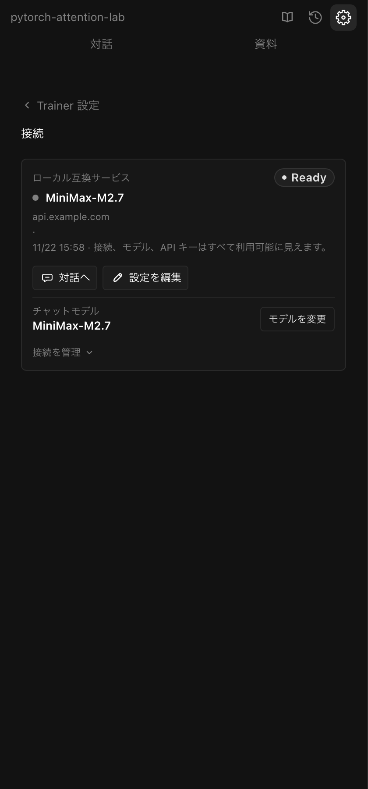
  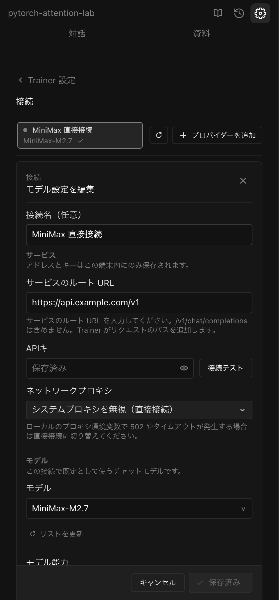
</p>

---

## コアの仕組み

### ① 検証ゲート — あなたがコードを書き、コード自身が証明する

実際のファイルに対して検証が走るまで、トレーニングカードは絶対に前進しません。「完了としてマーク」ボタンは意図的に存在しません。

<p align="center"></p>

- **独立したローカルサンドボックス**（`server/app/evaluator/service.py` — `EvaluatorService`）：一時ディレクトリへ対象ファイルをコピーして検査を実行し、リポジトリに `.pytest_cache` を残さず `acceptance_criteria` と `expected_symbols` を項目別に採点
- **VS Code Testing API 証明**（`extension/src/testing/`）：実際のテスト成否を `/training/verification/attest` へ報告 — 中断や不明結果を合格と偽装しません
- **Remote-SSH 読み取り／検証プロキシ**：API キーやライブラリを外に出さずリモートホスト上で検証を実行

### ② 長期記憶 + 単一統合 `<LibraryRoot>`

Trainer が覚えた学習履歴、収集資料、保存された講義ノートはすべて**1 つの `<LibraryRoot>` ディレクトリ**に統合され、あなたの開発リポジトリを 100% クリーンに保ちます（`git status` 汚染ゼロ）。

<p align="center"></p>

```text
<LibraryRoot>/
├── Trainer Library/          # 直接開ける資料群 & 自動保存 Markdown 講義ノート
│   ├── 講義ノート/            # `save_lecture_note` で出力（Finder / Explorer で即閲覧可能）
│   └── Papers/               # 取り込んだ PDF、Web 抜粋、リファレンスノート
└── .trainer/
    └── runtime/              # SQLite (`trainer.sqlite3`)、Qdrant ベクトル索引、チェックポイント、ログ
```

- **2 層メモリ**：構造化 SQLite + セマンティック検索（`Qdrant` + ローカルフォールバック）を **`py-fsrs`** の忘却曲線でスケジューリング（`server/app/memory/review_scheduler.py`）
- **実装集中中の割り込み抑止**：進行中の実装スレッドがある間は期限の復習通知を一時抑制
- **ワークスペース間の厳格隔離（fail-closed）**：単一プロジェクトでの合格を全体習熟へ過大評価しません（`server/app/memory/transfer_skills.py`）

### ③ RethinkFun State-Flow トレーニングループ

Trainer の状態フロー型直観指導メソッドは、AI 技術系クリエイター **[RethinkFun](https://rethink.fun)** 氏の解説手法から直接インスピレーションを得ています（既存手法の詰まり所から入り、「明らか」「自明」といった省略を排して状態変化を一歩ずつ導出し、最小限の実装コードと原理を常に往復させる方針）。別画面のカード管理 CRUD に飛ばされることなく、トレーニングはそのまま対話の流れに溶け込みます：

<p align="center"></p>

- **3 つの明確な指導レーン**（`server/app/pedagogy/` + `server/app/llm/`）：
  - **高速コードガイド**：実シンボルと失敗チェックを起点に、余計な説教なしで次の一手を案内
  - **状態フロー深掘り講義（`save_lecture_note`）**：「明らかに」等の水増し語を排し、状態変化ごとに数式と最小コードを結び付け、`<LibraryRoot>/Trainer Library/` に整理済み `.md` を自動保存
  - **事実に基づく進捗照会（`inspect_learning_truth`）**：サーバー記録を直接参照し、内部 UUID や生 JSON を漏らさず回答（証拠 0 件なら正直に 0 と伝えます）
- **5 フェーズ状態遷移マシン**（`LEARN → TRY → VERIFY → REFLECT → RETURN`、`server/app/training/handoff.py`）

### ④ あなたが書き、コーチが導く

コーチはファイル・診断結果・ワークスペース構成を読み取りますが、本番コードを書くのは常にあなたです（`server/app/workspace/authority.py` がソース書き換えを遮断）。

<p align="center"></p>

- 適応ペース調整（`AffectService`、`server/app/affect/service.py`）が連続失敗を検知すると、簡潔なレスキューモードへ切り替えます

### ⑤ グラウンディングと説明品質の監視

- 決定論的な応答継続・リカバリガード（`coaching_recovery.py`、`coaching_replies.py`）が空ストリームや言語ずれを防止
- 非ゲート型 5 次元スコアラーがコンテキスト結合・シンボル参照・答え丸投げ防止・因果明確性を継続観測

---

## 2つの入口 + 1つの対話

> 静かで安定したシェル：**対話** と **資料** の 2 つの主ナビゲーション、右上の **学習ドロワー／履歴／設定**、そして**常に画面下部の入力欄ただ 1 つ（Single-Composer Sovereignty）**。

| サーフェス | 役割 | 内容 |
|---|---|---|
| **対話** (`coach`) | メイン作業面 | State-Flow ストリーミング応答、保存済み `.md` ノートバッジ、メッセージ単位のアクション、折り畳み可能な**インライン練習カード**（第 2 テキスト欄なし）、1 行学習ストリップ、`$` スキルパレット |
| **資料** (`resources`) | ライブラリ & リーダー | 単一 `<LibraryRoot>` フォルダツリー、高速ローカル検索、画像・KaTeX・Shiki・Mermaid 対応 VS Code Markdown プレビュー、PDF/DOCX/URL 取り込み、復元可能なゴミ箱 |
| **学習ドロワー** (`plan` / `training` / `progress`) | 読み取り専用メモリ | 対話の上に重なるモーダルシート（入力中の下書きを保持）。**現在の目標**・**期限の練習**・**習得状況**（％表記なしの**統一 4 セグメント能力バー**）を 3 枚で提示 |
| **設定** (`settings`) | 設定コンソール | 5 プロトコル接続 + **直接プロキシバイパス**、コーチ設定 & `$` スキル、**ワークスペース `<LibraryRoot>`** + Remote Companion、8 言語・オプトイン計測 |

*（既存の 6 内部ルート `coach` / `plan` / `resources` / `training` / `progress` / `settings` はディープリンクや状態復元の互換性のため維持されています。）*

<p align="center">
  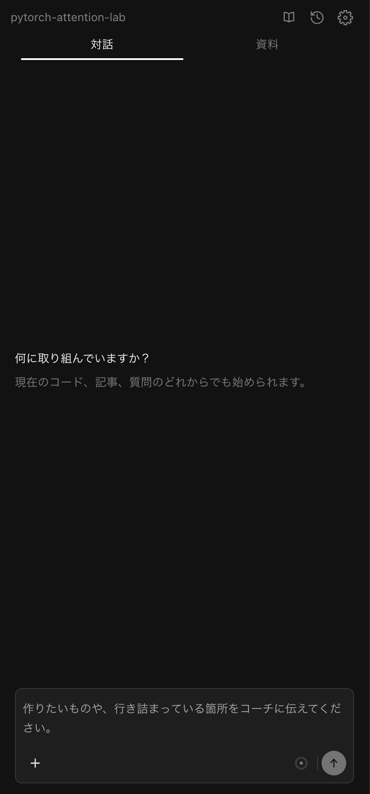
  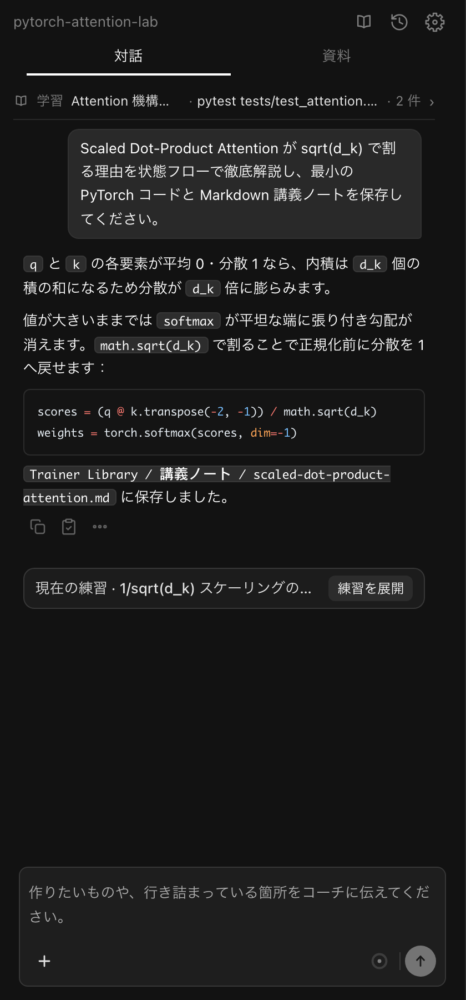
  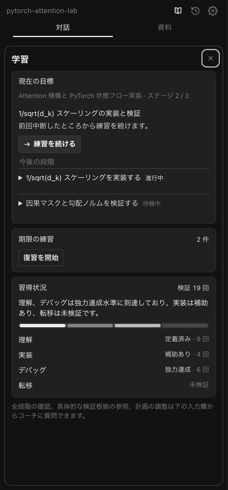
</p>
<p align="center">
  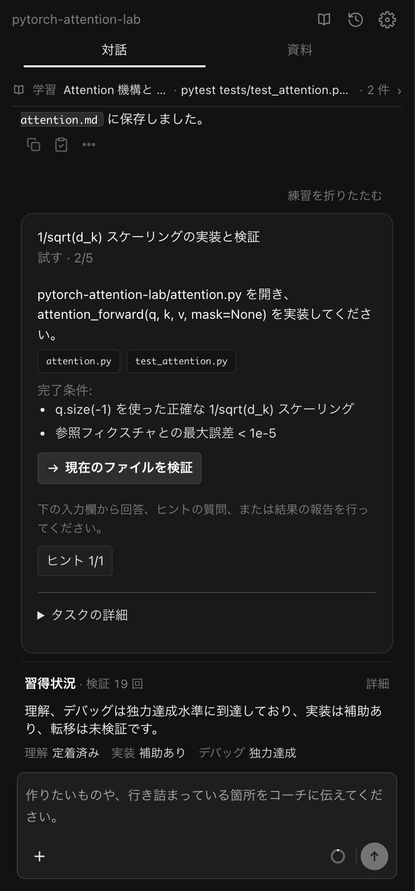
  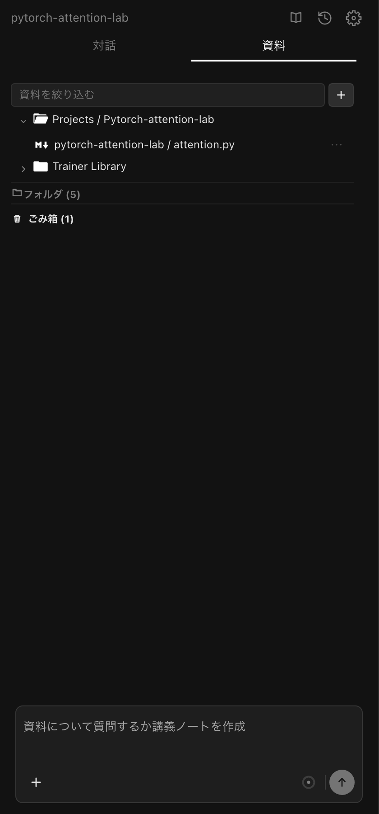
  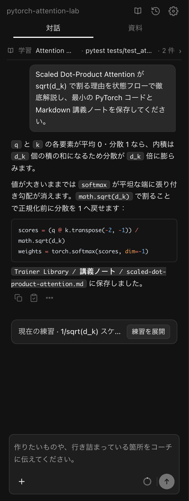
</p>

### カスタム `$` スキル — 作成・共有・導入

入力欄で `$` をタイプするだけでビルトインと自作スキルを呼び出せます。**設定 → コーチ → スキル** で管理でき、完全な純粋 JSON（`eval()` ゼロ・標準トリガー保護）で安全に共有できます。

<p align="center">
  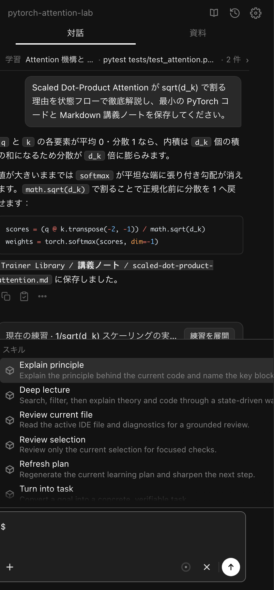
  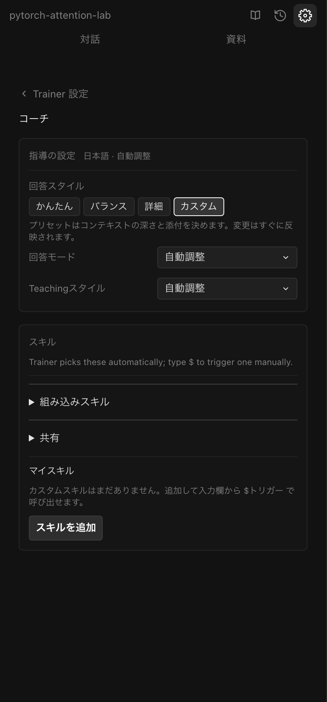
</p>

<p align="center"></p>

---

## Remote-SSH Companion

リモート Linux/SSH 開発でも **「ローカルの頭脳 ＋ リモートの手足」** 構成でフル機能が動きます：

- **UI 拡張・Python sidecar・API キー・`<LibraryRoot>`** は常に**手元のローカルマシン**に留まります
- **`remote-extension/`**（`Trainer Workspace Companion`、`extension/bundled/remote/trainer-workspace-companion.vsix` 同梱）がリモート側でファイル閲覧・検索・診断読み取り・テスト検証（`trainer.remote.verify`）を代行
- **リモート書き込みハードロック**：リモートリポジトリへの直接ソース書き換えは権限層で完全に禁止されます

<p align="center">
  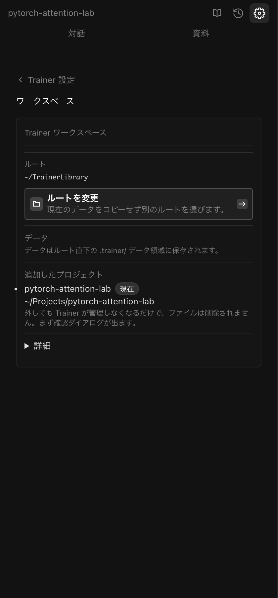
</p>

---

## 比較

| 観点 | Vibe ツール | チャット IDE | 暗記カードアプリ | **Trainer** |
|---|---|---|---|---|
| コードを代筆する | ✅ | ✅ | ❌ | ❌（意図的な境界） |
| 実コードに対する検証 | ❌ | ❌ | ❌ | ✅ ローカルサンドボックス + Testing + Remote-SSH |
| セッションをまたぐ記憶 | ⚠️ コンテキスト依存 | ⚠️ 要約 | ✅ | ✅ `<LibraryRoot>` 配下の SQLite + Qdrant |
| Git リポジトリを汚さない | ⚠️ ファイル混入 | ⚠️ | n/a | ✅ 単一 `<LibraryRoot>`、リポ書き込みゼロ |
| FSRS 間隔反復 | ❌ | ❌ | ✅ | ✅ 実装集中時の自動抑止付き |
| 権限レベル制御 | ❌ | ⚠️ 基本 Trust | ❌ | ✅ 6 段階 + リモート書込ハードロック |
| 公開テストスイート | クローズド | クローズド | クローズド | ✅ **4,288 単体/統合 + 105 E2E** |
| 多言語対応 | ⚠️ | ⚠️ | ⚠️ | ✅ **8 言語**（CI 完全性ゲート保証） |

> 他のツールは「コードを書く速度」を上げます；**Trainer は「書いたものを自分の力にする」ツールです。**

---

## 5分デモ

1. **T+0:00 — Trainer を開く**：左バーのアイコンを押せば設定の壁なしでそのまま **対話** に入れます。
2. **T+0:30 — モデル接続**：**設定 → 接続** でプロトコル・URL・モデル・キーチェーン API キーを入力し（ローカルプロキシが 502 を返す場合は **システムプロキシを無視（直接接続）** を選択）、**接続テスト**。
3. **T+1:30 — 原理講義とコードガイドを依頼**：たとえば *「Scaled Dot-Product Attention が sqrt(d_k) で割る理由を状態フローで説明して Markdown ノートに保存して」* — `<LibraryRoot>/Trainer Library/` へ即保存されます。
4. **T+2:30 — インライン練習に挑戦**：チャット内の **FocusedPractice** カードを展開し、手元のソースを編集しながら画面下部の**同じ 1 つの入力欄**で回答やヒントをやり取りします。
5. **T+4:00 — 実ファイル検証 & FSRS 記録**：**現在のファイルを検証**（または Remote-SSH 検証）を実行すると、**理解／実装／デバッグ／転移**の習熟状態が進み、次回の FSRS 復習日が組まれます。
6. **T+5:00 — 学習ドロワーで確認**：右上の本アイコンで **現在の目標**・**期限の練習**・**4 セグメント能力バー** を一望できます。

---

## なぜ使い心地が違うのか

### 正直な失敗表示 & プロキシ直連バイパス
- 未知のゲートウェイを黙って OpenAI 互換と決めつけません
- **システムプロキシを無視（直接接続）** を接続プロファイル単位で切り替え、ローカル `HTTP_PROXY` / `HTTPS_PROXY` 起因の 502／タイムアウトを回避
- 空ストリームや認証不備はスピナーで誤魔化さず具体的な復旧アクションを提示

### エンドポイント速度テスト & 推論強度制御
- 複数候補 URL をウォームアップ除外込みで並列計測し、ワンクリックで最速ルートを採用
- 実測済み能力に基づいて思考パラメータを安全に送信

<p align="center"></p>

### 統合ライブラリ `<LibraryRoot>`
- PDF（`PyMuPDF`）、Web（`Trafilatura`）、DOCX（`mammoth` / `MarkItDown`）、および自動生成された講義ノートを一括管理
- ローカルフィルタ、数式・図表付き Markdown プレビュー、復元可能ゴミ箱、ワンクリック対話引用に対応

<p align="center"></p>

### ブラウザ拡張キャプチャ & Side Panel（`browser-extension/`）
- Chromium MV3 拡張機能が**ペアリングコード不要**でローカル sidecar（`127.0.0.1`）を自動検出
- Web ページ・arXiv PDF・GitHub リポジトリ（`docs/` 含む選択可）・選択テキストを `<LibraryRoot>/Trainer Library/` や入力欄下書きへ即投入（オフライン FIFO キュー＋8 言語 Side Panel チャット完備）

<p align="center">
  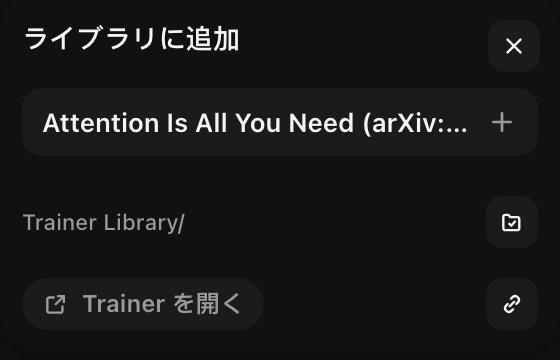
</p>

### MCP 外部ツール連携（`docs/mcp.md`）
- `TRAINER_MCP_SERVERS` 環境変数で有効化する stdio 型 **MCP クライアント** が GitHub / Gitee 等のツールを ReAct ループへ統合（同一の 6 段階権限ゲート適用）— 詳細は [`docs/mcp.md`](docs/mcp.md)

---

## アーキテクチャ

### システム構成図

```text
┌─────────────────────────────────────────────────────────────────────────┐
│                             VS Code Window                              │
│  ┌──────────────────────────────┐    ┌────────────────────────────────┐ │
│  │  Trainer サイドバー (ローカル)│    │  Remote-SSH 環境 (リモート)     │ │
│  │  React 19 + Zustand (8言語)  │    │  remote-extension (Companion)  │ │
│  │  対話 / 資料 + 学習ドロワー   │◄──►│  読取専用参照 / 検索 / 診断 /  │ │
│  └──────────────┬───────────────┘    │  検証テスト実行のみ            │ │
│                 │                    └────────────────────────────────┘ │
│  ┌──────────────▼───────────────┐                                       │
│  │  Extension Host (TypeScript) │  • SecretStorage (OS キーチェーン)    │
│  │  CommandRegistry · Workspace │  • Testing API → 実テスト検証報告     │
│  │  Gateway · Sidecar Manager   │  • Browser Extension MV3 ブリッジ     │
│  └──────────────┬───────────────┘                                       │
│                 │ http://127.0.0.1 + SSE ストリーム                     │
│  ┌──────────────▼───────────────┐    ┌────────────────────────────────┐ │
│  │  FastAPI Sidecar (Python)    │───►│  単一統合ルート <LibraryRoot>  │ │
│  │  • ReAct ループ + MCP        │    │  • Trainer Library/ (ノート等) │ │
│  │  • RethinkFun 教育カーネル    │    │  • .trainer/runtime/           │ │
│  │  • 5 プロトコル + 直連バイパス│    │    trainer.sqlite3 · Qdrant ·  │ │
│  │  • FSRS  scheduler + 記憶     │    │    チェックポイント · 監査ログ │ │
│  │  • 6 段階権限ガード           │    │  (ユーザーリポ書込ゼロ)        │ │
│  └──────────────────────────────┘    └────────────────────────────────┘ │
└─────────────────────────────────────────────────────────────────────────┘
```

### ディレクトリ構成（実測値）

| ディレクトリ | 内容 | 実測規模 |
|---|---|---|
| `extension/src/` | VS Code ホスト：コマンド、SecretStorage、WorkspaceGateway、Sidecar 管理 | `79` TS ファイル（約 `53,286` 行） |
| `extension/webview/src/` | React ワークベンチ：2 入口、ドロワー、単一入力欄、Shiki/KaTeX/Mermaid、8 言語 | `233` TS/TSX + `53` CSS（約 `120,507` 行） |
| `extension/tests/` | `node:test` スイート：ホスト、共有ガバナンス、i18n、ブラウザ拡張、セキュリティ | `161` ファイル · **`1,460` テスト** |
| `server/app/` | FastAPI sidecar：ReAct、RethinkFun、FSRS/メモリ、取り込み、サンドボックス検証 | `234` Python ファイル（約 `178,520` 行） |
| `server/tests/` | `pytest` バックエンドテスト（API、教育カーネル、メモリ、プロバイダ、権限） | `91` ファイル · **`2,828` 収集テスト** |
| `shared/src/` | Host・Webview・テストで共有する決定論的ガバナンス純粋関数モジュール | `77` モジュール（約 `30,414` 行 · `523` エクスポート） |
| `remote-extension/src/` | Remote-SSH Companion (`extensionKind: ["workspace"]`) | `2` TS ファイル（`746` 行） |
| `browser-extension/` | Chromium MV3 ポップアップ、オフラインキュー、コンテキストメニュー、Side Panel | `9` ファイル（`7,245` 行） |
| `extension/bundled/` | PyInstaller 凍結 sidecar & `trainer-workspace-companion.vsix` | 約 `270 MB` |

### 統一スナップショット契約（`WorkbenchSnapshot`）

すべての主要状態 HTTP ルートは **`WorkbenchSnapshot`**（`server/app/core/models.py` 内のトップレベル `33` フィールド）を返し、`snapshot_revision` により差分同期します。

---

## 安全モデル

- **API キーは OS キーチェーン / VS Code `SecretStorage` のみ** — リポジトリ・`<LibraryRoot>`・ログへ平文保存しません（`npm run verify:credentials`）
- **VS Code Workspace Trust を fail-closed で強制** — 未信頼ウィンドウではファイル検査・検証を遮断
- **6 段階ワークスペース権限ラダー**（`server/app/workspace/authority.py`）：開発リポジトリは既定で読み取り専用、Remote-SSH 環境では書き込みを強制ロック
- **復元可能なゴミ箱 + `<LibraryRoot>`**：削除してもゴミ箱へ移動し、開発リポジトリへ隠し設定やキャッシュを一切残しません
- **純粋 JSON スキル共有**：スキーマ／文字数検査のみ、動的コード実行なし
- **テレメトリは既定オフのオプトイン**：コードやパス・プロンプトは一切送信しません

---

## 品質ゲート

> 以下の数値はすべて `main` ブランチ（`v1.6.4`）で直接計測した実績です：

| ゲート | 対象と検証結果 | コマンド |
|---|---|---|
| **サーバーテスト (`pytest`)** | **91 ファイル · 2,828 テスト**（＋サブテスト） | `npm run test:server` |
| **拡張機能テスト (`node:test`)** | **161 ファイル · 1,460 テスト**（`1,460` 合格、`0` 条件スキップ、`0` 失敗） | `npm run test:extension` |
| **静的解析 & 型検証** | `ruff check` (`0`) · `pyright` (`0`) · CSS + `tsc -b` (`0`) | `npm run check && npm run verify:server-pyright` |
| **UI ジオメトリ検査** | 単一入力欄主権、2 入口シェル、はみ出し検査（`340/420/460px` × 明暗 × 中英） | `npm run verify:ui-geometry` |
| **i18n 完全性ゲート** | **194** `appUiCopy` + **196** `settingsText` + **273** `hostCommandCopy` × **8 言語**（欠損 0） | `npm run verify:i18n` |
| **語彙・機密スキャン** | UI 文言 **53 ファイル**異常なし · リポジトリ **4,753 ファイル**平文キー 0 件 | `npm run verify:copy-vocabulary && npm run verify:credentials` |
| **Playwright E2E & Remote-SSH** | **6** Playwright spec（`105` ケース）+ 実 sidecar 行列 + Ubuntu Remote-SSH L2 (`20/20`) | `npm run test:experience-matrix` · `npm run test:remote-ssh-e2e` |
| **CI リリースビルド対象** | **3 デスクトップ基盤**：`win32-x64`、`darwin-arm64`、`linux-x64` | `.github/workflows/release.yml` |

*（注：最終的な人手による教育品質受領確認 `T-0028` は [`docs/TRIAL-1.5.0-RC.md`](docs/TRIAL-1.5.0-RC.md) にて手動ゲートとして管理しています。）*

---

## i18n · 8言語

UI、設定画面、ホスト通知、ブラウザ拡張機能、README が **8 言語** で並行提供されています：

`zh-CN` · `en-US` · `es-ES` · `fr-FR` · `de-DE` · `ja-JP` · `ko-KR` · `pt-BR`

`npm run verify:i18n` によって欠損・他言語混入が自動検証されます（`extension/webview/src/lib/i18n/copy.ts`）。

---

## 謝辞

- **ランタイム & HTTP**：[FastAPI](https://github.com/fastapi/fastapi) · [Uvicorn](https://github.com/encode/uvicorn) · [Pydantic](https://github.com/pydantic/pydantic) · [httpx](https://github.com/encode/httpx) · [openai-python](https://github.com/openai/openai-python)
- **メモリ・FSRS・取り込み**：[py-fsrs](https://github.com/open-spaced-repetition/py-fsrs) · [qdrant-client](https://github.com/qdrant/qdrant-client) · [PyMuPDF](https://github.com/pymupdf/PyMuPDF) · [Trafilatura](https://github.com/adbar/trafilatura) · [MarkItDown](https://github.com/microsoft/markitdown)
- **フロントエンド & 描画**：[React](https://github.com/facebook/react) · [Vite](https://github.com/vitejs/vite) · [Zustand](https://github.com/pmndrs/zustand) · [Zod](https://github.com/colinhacks/zod) · [react-markdown](https://github.com/remarkjs/react-markdown) · [KaTeX](https://github.com/KaTeX/KaTeX) · [Shiki](https://github.com/shikijs/shiki) · [Mermaid](https://github.com/mermaid-js/mermaid) · [@tanstack/react-table](https://github.com/TanStack/table) · [PDF.js](https://mozilla.github.io/pdf.js/) · [mammoth](https://github.com/mwilliamson/mammoth.js) · [docx-preview](https://github.com/VolodymyrBaydalka/docx-preview)
- **テスト & パッケージ**：[pytest](https://github.com/pytest-dev/pytest) · [Hypothesis](https://github.com/HypothesisWorks/hypothesis) · [ruff](https://github.com/astral-sh/ruff) · [pyright](https://github.com/microsoft/pyright) · [TypeScript](https://github.com/microsoft/TypeScript) · [Playwright](https://github.com/microsoft/playwright) · [PyInstaller](https://github.com/pyinstaller/pyinstaller)
- **教授法の着想元**：状態フロー重視の直観的解説スタイルは AI 技術発信者 **[RethinkFun](https://rethink.fun)** 氏の教え方に触発されています · [fsrs4anki](https://github.com/open-spaced-repetition/fsrs4anki)
- **ビジュアルアセット**：**[GPT Image](https://github.com/AI-yyf/trainer/tree/main/assets)** で生成（`assets/MASCOT.md` · `assets/BANNER_PROMPT.md` · `assets/FEATURE_PROMPTS.md`）

---

## ライセンス

[MIT](LICENSE)

---

## Trainer の引用

```bibtex
@software{trainer2026,
  title  = {Trainer: A Long-Term Coding Coach Living in Your Editor},
  author = {AI-yyf and contributors},
  year   = {2026},
  url    = {https://github.com/AI-yyf/trainer},
  note   = {v1.6.4}
}
```

---

<div align="center">

**// AIを鍛える · AIとともに成長する**

`v1.6.4` · コーヒーと FSRS、RethinkFun State-Flow 教育カーネル、4,393 個の自動テスト、そしてあなたの代わりにコードを書くことを拒むコーチで作られています。

</div>
