# Trainer

<div align="center">


**VS Code 사이드바에서 함께 호흡하는 장기 코딩 & 학습 코치.**

**계획하고, 훈련하고, 검증하고, 세션을 넘어 기억하지만 — 프로덕션 코드를 대신 작성하는 일은 결코 없습니다.**

**// 출력 ≠ 성장 // 검증 + 복습 = 성장**

[English](README.md) · [简体中文](README_zh-CN.md) · [Español](README_es-ES.md) · [Français](README_fr-FR.md) · [Deutsch](README_de-DE.md) · [日本語](README_ja-JP.md) · 한국어 · [Português](README_pt-BR.md)

[](https://github.com/AI-yyf/trainer/blob/main/extension/package.json)
[](LICENSE)
[](#설치)
[](#품질-게이트)
[](#i18n--8개-언어)

[존재 이유](#trainer가-존재하는-이유) ·
[설치](#설치) ·
[3단계 설정](#세-단계뿐-네-번째는-없습니다) ·
[메커니즘](#핵심-메커니즘) ·
[두 가지 진입점](#두-가지-진입점--하나의-대화) ·
[Remote-SSH](#remote-ssh-companion) ·
[비교](#비교) ·
[5분 데모](#5분-데모) ·
[설계](#다르게-느껴지는-이유) ·
[아키텍처](#아키텍처) ·
[안전](#안전-모델) ·
[품질](#품질-게이트) ·
[감사의 말](#감사의-말) ·
[🎭 캐스트](docs/CAST.md)

</div>

---

## Trainer가 존재하는 이유

> 개발자가 막히는 이유는 튜토리얼이 부족해서가 아닙니다.
> 학습 루프를 닫아 주는 도구가 없기 때문입니다.

LLM 대화는 창을 닫는 순간 증발하고, 영상 강의는 일방향이며, 화요일에 절반쯤 이해한 개념은 금요일이면 사라집니다.

더 위험한 것은 **바이브 코딩(vibe coding)** — 석 달 내내 AI가 코드를 대신 짜게 두면서 정작 본인은 아무것도 이해하지 못하는 상태입니다.

**Trainer는 에디터 안에서 이 문제를 직접 해결합니다.**

단순한 채팅 래퍼가 아니라 기억, 커리큘럼, 그리고 엄격한 검증 원칙을 갖춘 코치입니다:

- 학습을 단계별로 **계획**하고, 느낌이 아니라 실제로 도달한 지점을 추적합니다
- 실제 프로젝트에 밀착한 카드, 원리 해설, 인라인 실습으로 **훈련**시킵니다
- 실제 코드를 실행해 숙달 여부를 **검증**합니다 — 현재 파일이 증명하지 않는 한 FastAPI를 말로 설명해도 인정되지 않습니다
- 세션, 프로젝트, 몇 주를 넘어 당신을 **기억**하며 **FSRS** 망각 곡선 위에 복습을 예약합니다
- 프로덕션 코드는 **절대 대신 쓰지 않습니다** — 당신이 쓰고, 코치가 가르치며, **함께 성장합니다**

**이 규율은 코드 밖으로도 확장됩니다.** 동일한 "먼저 검증" 루프는 논문 정독, 원리 강의, 인문/어학 학습까지 각 영역 전용 검증기와 숙련 차원으로 지원합니다.

<div align="center">

| vibe coding · 오늘날의 일상 | Trainer · 있어야 할 모습 |
|:---:|:---:|
| `def ship(code):` <br> `    ai.write(code)` <br> `# 정말 이해했나요?` <br> `    return forget(code)` | `def ship(code):` <br> `    you.write(code)` <br> `    ai.verify(code)` <br> `    you.recall(code)` <br> `    return grown(code)` |
| 출력 = 망각 | 출력 + 기억 + 회상 = 성장 |

</div>

---

## 설치

**사전 빌드된 VSIX로 설치 (CI 검증 완료 3대 데스크톱 플랫폼):**

사용 중인 OS와 아키텍처(`darwin-arm64` / `linux-x64` / `win32-x64`)에 맞는 `.vsix`를 [Releases](https://github.com/AI-yyf/trainer/releases/latest)에서 다운로드하세요:

```bash
code --install-extension trainer-extension-1.5.2-<platform>-<arch>.vsix --force
```

또는 VS Code 확장 패널 → `···` → *VSIX에서 설치…* → 창 다시 로드를 실행합니다. 자세한 내용은 [`extension/README.install.md`](extension/README.install.md)를 참고하세요.

**소스에서 빌드:**

```bash
git clone https://github.com/AI-yyf/trainer.git
cd trainer && npm ci
cd server && uv sync --frozen --extra dev --python 3.12 && cd ..
npm run build
```

VS Code에서 저장소를 열고 `F5`(Extension Development Host)를 누르거나 `npm run package:vsix`로 패키징하세요.

**요구 사항:** VS Code `≥ 1.96` · Python `3.12` (소스 빌드 시에만 필요; 배포용 `.vsix`에는 독립 동결된 sidecar 포함) · macOS (`arm64`) / Linux (`x64`) / Windows (`x64`).

---

## 세 단계뿐, 네 번째는 없습니다

초기 실행에 **설정 장벽이 없습니다**. Trainer를 열면 바로 **대화** 화면으로 진입합니다. 모델을 연결할 때도 세 단계면 충분합니다:

1. 우측 상단 톱니바퀴 아이콘에서 **설정 → 연결** 열기
2. 선언된 프로토콜(`OpenAI Chat`, `OpenAI Responses`, `Anthropic Messages`, `Gemini`, `Azure OpenAI`)을 고르고 **서비스 루트 URL**, **API 키**(VS Code `SecretStorage`를 통해 OS 키체인에만 저장), **모델** 입력
3. 로컬 프록시 환경 변수(`HTTP_PROXY` / `HTTPS_PROXY`) 때문에 `502` 나 타임아웃이 발생하면 **네트워크 프록시**를 **시스템 프록시 무시 (직접 연결)** 로 전환한 뒤 **연결 테스트** 클릭

Trainer가 실시간 모델 목록, 스트리밍, 도구 호출, 추론 능력을 직접 점검하며 오류 역시 있는 그대로 알립니다(`invalid_key_or_permission`, `network` 또는 빈 스트림 거부).

<p align="center">
  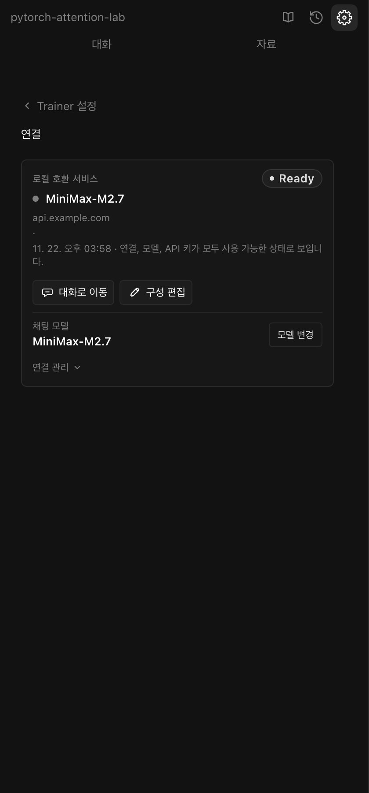
  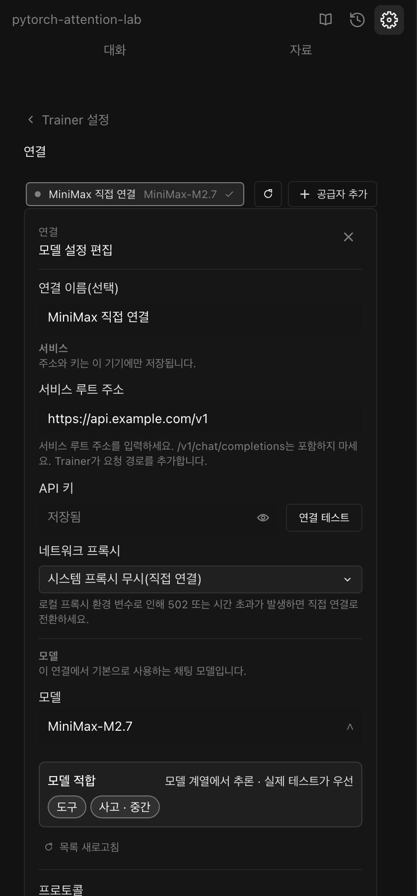
</p>

---

## 핵심 메커니즘

### ① 검증 게이트 — 당신이 코드를 쓰고, 코드가 스스로 증명합니다

실제 파일에 대한 검증이 실행되기 전까지 훈련 카드는 절대 다음으로 넘어가지 않습니다. "완료로 표시" 같은 수동 버튼은 의도적으로 존재하지 않습니다.

<p align="center"></p>

- **로컬 격리 샌드박스** (`server/app/evaluator/service.py` — `EvaluatorService`): 대상 파일을 임시 디렉토리로 복사해 검사하고 저장소에 `.pytest_cache` 를 남기지 않으며 `acceptance_criteria` + `expected_symbols` 항목별로 채점
- **VS Code Testing API 증명** (`extension/src/testing/`): 실제 테스트 통과/실패 결과를 `/training/verification/attest` 로 직접 전달 — 중단되거나 알 수 없는 실행은 절대 통과로 위장하지 않음
- **Remote-SSH 읽기/검증 프록시**: API 키나 라이브러리를 원격 서버로 보내지 않고 원격 파일 검증을 안전하게 수행

### ② 장기 기억 + 단일 통합 `<LibraryRoot>`

Trainer가 기억하는 학습 상태, 수집한 자료, 저장된 강의 노트는 모두 사용자가 지정한 **하나의 통합 `<LibraryRoot>` 폴더**에 보관되므로 개발 중인 코드 저장소는 100% 깨끗하게 유지됩니다 (`git status` 오염 제로).

<p align="center"></p>

```text
<LibraryRoot>/
├── Trainer Library/          # 직접 탐색 가능한 자료 및 자동 저장 Markdown 강의 노트
│   ├── 강의 노트/            # `save_lecture_note` 생성 파일 (탐색기에서 바로 열람 가능)
│   └── Papers/               # 가져온 PDF, 웹페이지 스냅샷, 참고 자료
└── .trainer/
    └── runtime/              # SQLite (`trainer.sqlite3`), Qdrant 벡터 인덱스, 체크포인트, 로그
```

- **2계층 영속 기억**: 구조화된 SQLite + 시맨틱 검색(`Qdrant` + 로컬 폴백)을 **`py-fsrs`** 망각 곡선으로 스케줄링 (`server/app/memory/review_scheduler.py`)
- **집중 흐름 보호**: 현재 구현 스레드가 진행 중일 때는 복습 알림을 잠시 뒤로 미뤄 몰입을 방해하지 않습니다
- **워크스페이스 간 Fail-closed 격리**: 한 프로젝트의 성공이 전체 숙련도를 부풀리지 않습니다 (`server/app/memory/transfer_skills.py`)

### ③ RethinkFun State-Flow 훈련 루프

Trainer 의 상태 흐름 기반 직관적 교수법은 AI 기술 크리에이터 **[RethinkFun](https://rethink.fun)** 의 교육 방식에서 직접 영감을 받았습니다(기존 해법이 막히는 지점부터 출발해 "자명하다" 같은 비약 없이 단계별로 유도하고, 최소 실행 코드를 원리에 곧바로 연결). 별도의 카드 CRUD 관리 화면으로 쫓아내지 않고 대화 안에서 모든 훈련이 자연스럽게 이어집니다:

<p align="center"></p>

- **세 가지 정밀 교육 트랙** (`server/app/pedagogy/` + `server/app/llm/`):
  - **빠른 코드 가이드**: 현재 심볼과 실패한 테스트에 고정해 군더더기 없는 다음 행동을 제시
  - **상태 흐름 심층 강의 (`save_lecture_note`)**: 군더더기 추임새("당연히 / 쉽게") 없이 수식·상태 변화를 단계별 유도하고 최소 실행 코드와 함께 `<LibraryRoot>/Trainer Library/` 에 깔끔한 `.md` 노트로 저장
  - **사실 기반 진실 조회 (`inspect_learning_truth`)**: 서버 검증 기록만을 근거로 계획과 증거를 답변하며 내부 UUID/원시 JSON을 절대 노출하지 않음 (증거가 0건이면 솔직하게 0건임을 고지)
- **5단계 상태 머신** (`LEARN → TRY → VERIFY → REFLECT → RETURN`, `server/app/training/handoff.py`)

### ④ 당신이 쓰고, 코치가 안내합니다

코치는 파일, 진단 정보, 프로젝트 구조를 대신 살펴보지만 실제 코드 수정은 언제나 당신의 손에서 이루어집니다 (`server/app/workspace/authority.py` 가 소스 쓰기를 차단).

<p align="center"></p>

- 적응형 페이싱 (`AffectService`, `server/app/affect/service.py`)이 연속 오류를 감지하면 자동으로 간결한 구조(`concise_rescue`) 모드로 전환합니다

### ⑤ 근거 고정 및 설명 품질 보장

- 결정론적 연속성/복구 가드 (`coaching_recovery.py`, `coaching_replies.py`)가 빈 스트림, 깨진 도구 응답, 언어 이탈을 차단
- 비차단 5차원 품질 측정기가 학습자 맥락 반영, 코드 심볼 고정, 정답 대필 금지를 상시 점검

---

## 두 가지 진입점 + 하나의 대화

> 차분하고 고정된 UI 구조: 상단의 **대화**와 **자료**, 우측 상단 유틸리티 3종(**학습 서랍 · 세션 기록 · 설정**), 그리고 전 화면을 관통하는 **단일 입력창(Single-Composer Sovereignty)**.

| 화면 영역 | 역할 | 구성 |
|---|---|---|
| **대화** (`coach`) | 기본 작업실 | State-Flow 스트리밍 해설, 저장된 `.md` 강의 배지, 메시지별 퀵 액션, 접고 펼 수 있는 **인라인 연습 카드**(두 번째 입력창 없음), 상단 1줄 학습 스트립, `$` 스킬 팔레트 |
| **자료** (`resources`) | 라이브러리 & 리더 | 통합 `<LibraryRoot>` 폴더 트리, 로컬 빠른 필터, 이미지/KaTeX/Shiki/Mermaid 지원 VS Code Markdown 미리보기, PDF/DOCX/URL 수집, 복구 가능한 휴지통 |
| **학습 서랍** (`plan` / `training` / `progress`) | 읽기 전용 메모리 | 대화 위에 뜨는 모달 시트(하단 초안 보존). **현재 목표**, **예정된 연습**, **숙달 현황**(퍼센트 없는 **통합 4구간 역량 막대**) 3장 제공 |
| **설정** (`settings`) | 제어 콘솔 | 5프로토콜 연결 + **프록시 직접 연결 우회**, 코치 스타일 & `$` 스킬, **워크스페이스 `<LibraryRoot>`** + Remote Companion, 8개 언어 및 텔레메트리 옵트인 |

*(기존 6개 내부 경로 `coach / plan / resources / training / progress / settings` 모두 딥링크 및 복원용으로 호환 유지됩니다.)*

<p align="center">
  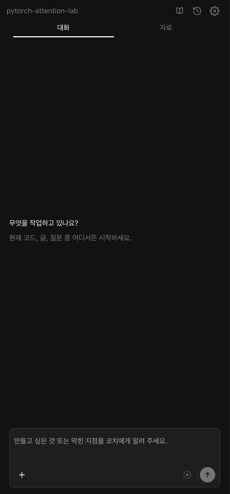
  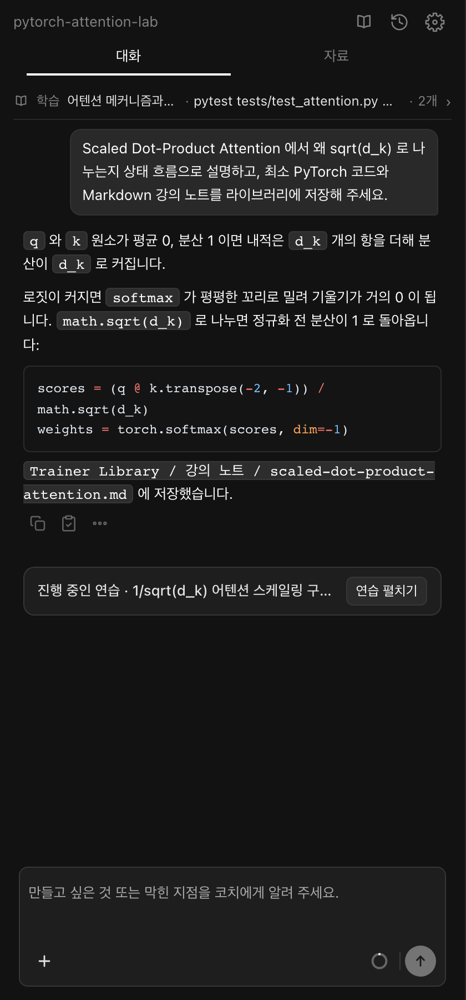
  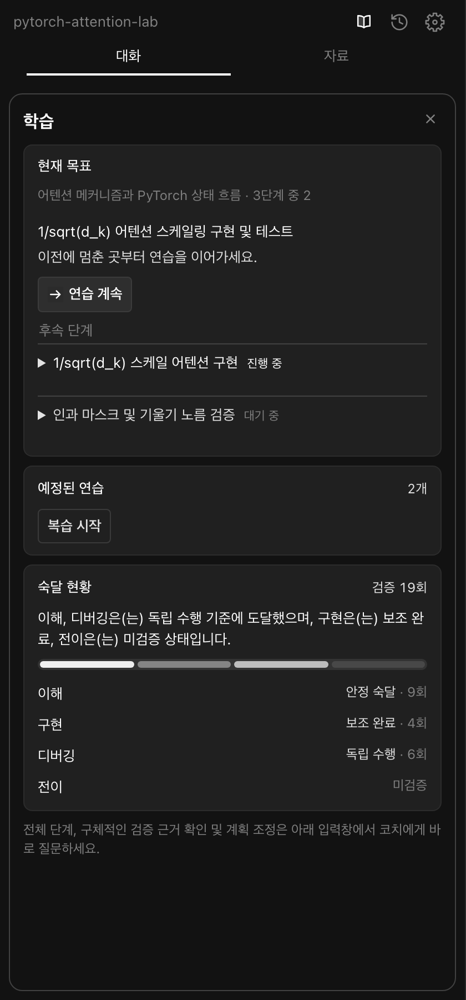
</p>
<p align="center">
  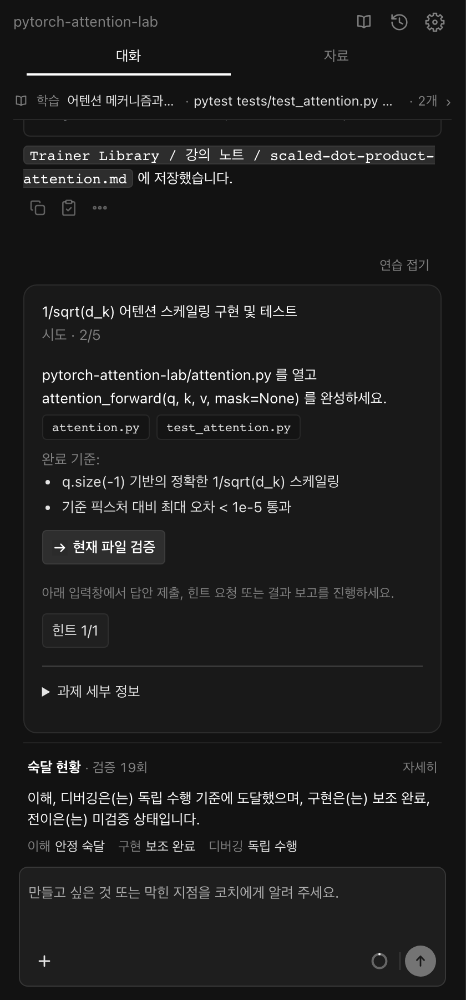
  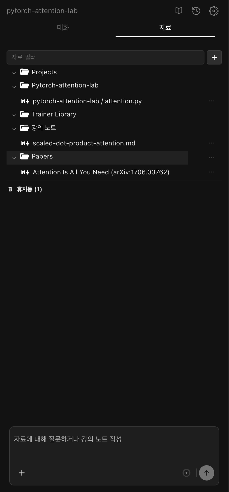
  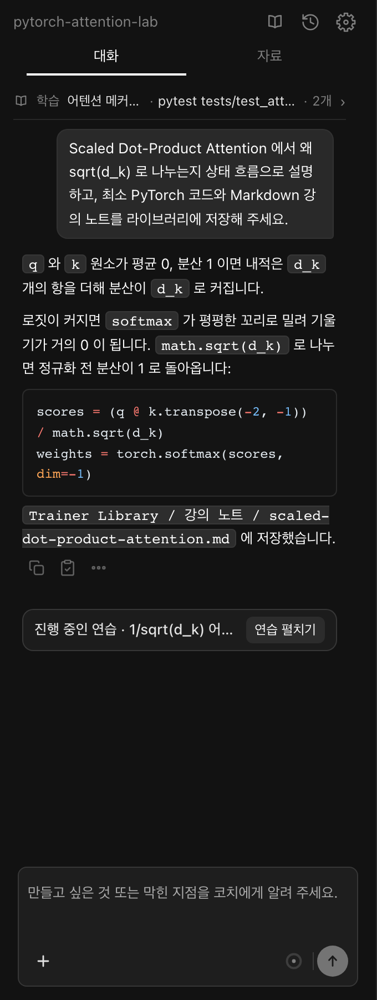
</p>

### 나만의 `$` 스킬 — 제작, 공유, 설치

유일한 입력창에서 `$` 를 입력하면 내장 및 사용자 정의 스킬 팔레트가 즉시 열립니다. **설정 → 코치 → 스킬** 에서 관리할 수 있으며, `eval()` 없는 순수 JSON 포맷으로 안전하게 공유됩니다.

<p align="center">
  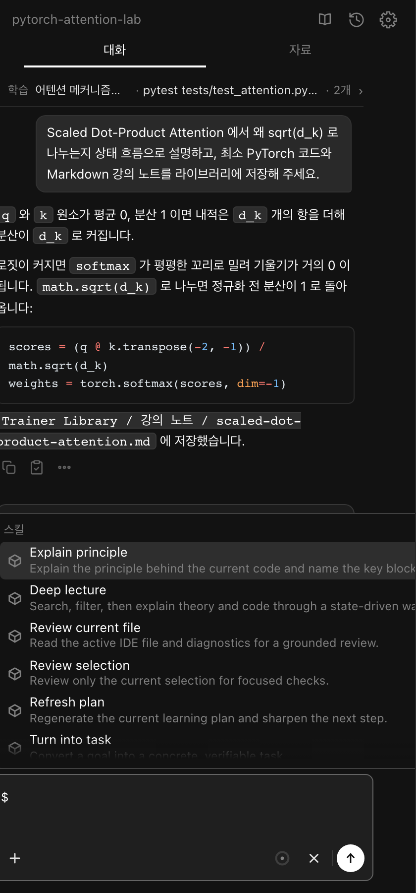
  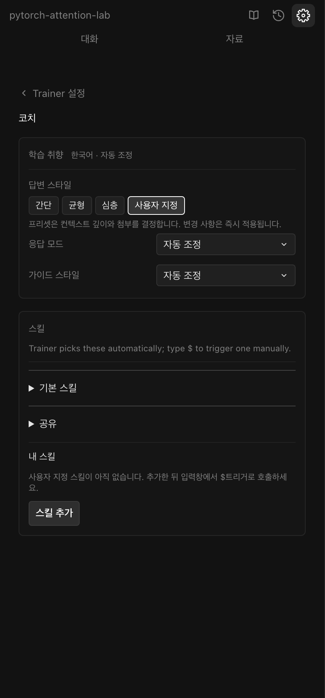
</p>

<p align="center"></p>

---

## Remote-SSH Companion

원격 Linux/SSH 개발 환경에서도 **「로컬 두뇌 + 원격 손발」** 구조로 동일하게 동작합니다:

- **UI 확장, Python sidecar, API 키, `<LibraryRoot>`** 는 언제나 **로컬 컴퓨터**에 안전하게 머뭅니다
- **`remote-extension/`** (`Trainer Workspace Companion`, `extension/bundled/remote/trainer-workspace-companion.vsix` 내장)이 원격 호스트에서 파일 읽기, 검색, 진단 조회, 제어된 테스트 실행(`trainer.remote.verify`)만 수행합니다
- **원격 쓰기 하드 잠금**: 원격 소스 저장소에 대한 쓰기 작업은 권한 계층에서 무조건 차단됩니다

<p align="center">
  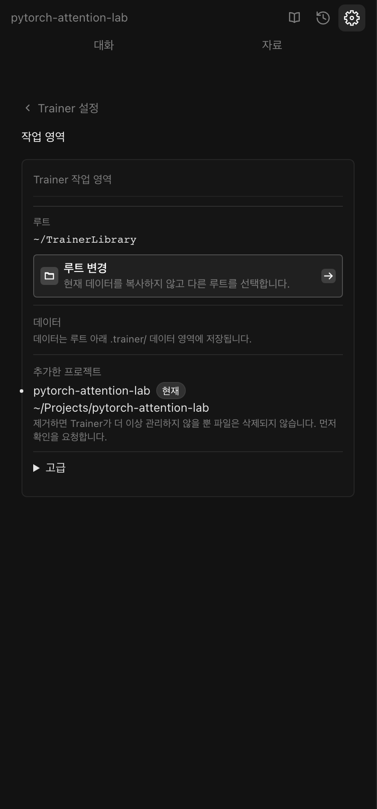
</p>

---

## 비교

| 항목 | Vibe 도구 | 채팅 IDE | 플래시카드 앱 | **Trainer** |
|---|---|---|---|---|
| 대신 코드를 써 주는가 | ✅ | ✅ | ❌ | ❌ (의도된 경계) |
| 실제 코드로 검증하는가 | ❌ | ❌ | ❌ | ✅ 로컬 샌드박스 + Testing API + Remote-SSH |
| 세션/프로젝트를 넘는 기억 | ⚠️ 컨텍스트 창 | ⚠️ 요약 | ✅ | ✅ `<LibraryRoot>` 내 SQLite + Qdrant |
| Git 저장소를 깨끗이 유지 | ⚠️ 파일 혼재 | ⚠️ | 해당 없음 | ✅ 단일 `<LibraryRoot>`, 소스 저장소 쓰기 0 |
| FSRS 간격 반복 | ❌ | ❌ | ✅ | ✅ 코딩 흐름 방해 방지 포함 |
| 작업 영역 권한 계층 | ❌ | ⚠️ 기본 신뢰 창 | ❌ | ✅ 6단계 계층 + 원격 쓰기 차단 |
| 공개 테스트 스위트 | 비공개 | 비공개 | 비공개 | ✅ **6,606 단위/통합 + 166 E2E** |
| 다국어 완성도 | ⚠️ | ⚠️ | ⚠️ | ✅ **8개 언어** CI 완결성 게이트 |

> 다른 도구는 코드를 더 빨리 뽑아내는 데 집중합니다; **Trainer는 당신이 만든 것을 진짜 자기 실력으로 만들게 합니다.**

---

## 5분 데모

1. **T+0:00 — 사이드바 열기**: 왼쪽 아이콘을 클릭하면 설정 장벽 없이 바로 **대화**로 들어갑니다.
2. **T+0:30 — 모델 연결**: **설정 → 연결**에서 프로토콜, URL, 모델, 키체인 API 키를 입력하고(필요 시 **시스템 프록시 무시(직접 연결)** 선택) **연결 테스트**를 누릅니다.
3. **T+1:30 — 심층 원리 또는 코드 도움 요청**: *"Scaled Dot-Product Attention 이 왜 sqrt(d_k) 로 나누는지 상태 흐름으로 설명하고 Markdown 노트로 저장해 줘"* — `<LibraryRoot>/Trainer Library/` 에 바로 저장됩니다.
4. **T+2:30 — 인라인 연습 진행**: 대화 속 **FocusedPractice** 카드를 펼치고 내 파일을 직접 수정하면서 아래 **유일한 입력창**으로 질문하거나 회고를 제출하세요.
5. **T+4:00 — 검증 및 FSRS 예약**: **현재 파일 검증**(또는 Remote-SSH 검증)을 통과하면 **이해 / 구현 / 디버깅 / 전이** 상태가 올라가고 다음 FSRS 복습 일정이 잡힙니다.
6. **T+5:00 — 학습 서랍 확인**: 우측 상단 책 아이콘으로 **현재 목표**, **예정된 연습**, **4구간 역량 막대**를 한눈에 확인합니다.

---

## 다르게 느껴지는 이유

### 정직한 실패와 프록시 우회
- 알 수 없는 게이트웨이를 임의로 OpenAI 호환으로 추측하지 않습니다
- **시스템 프록시 무시 (직접 연결)** 로 프로필별 로컬 프록시 변수(`HTTP_PROXY` / `HTTPS_PROXY`)로 인한 502 및 타임아웃을 즉시 우회
- 빈 스트림·인증 실패 시 무한 스피너 대신 실행 가능한 복구 안내를 표시

### 엔드포인트 속도 테스트 & 추론 강도 제어
- 웜업 지연을 제거한 뒤 여러 엔드포인트를 병렬 측정하여 원클릭으로 가장 빠른 경로를 적용
- 실제 검증된 모델 기능에 맞춰 사고(Thinking) 파라미터를 안전하게 전송

<p align="center"></p>

### `<LibraryRoot>` 기반 통합 자료실
- PDF(`PyMuPDF`), 웹(`Trafilatura`), DOCX(`mammoth` / `MarkItDown`) 및 자동 저장 강의 노트를 `<LibraryRoot>/Trainer Library/` 로 일원화
- 빠른 필터, 수식/다이어그램 포함 Markdown 미리보기, 복구 가능한 휴지통, 원클릭 대화 인용 지원

<p align="center"></p>

### 브라우저 빠른 수집 & Side Panel (`browser-extension/`)
- 페어링 코드 없이 로컬 sidecar(`127.0.0.1`)를 자동 탐색하는 Chromium MV3 확장 프로그램
- 웹페이지, arXiv PDF, GitHub 저장소 또는 드래그한 텍스트를 `<LibraryRoot>/Trainer Library/` 나 대화 초안으로 바로 전송하며 오프라인 FIFO 큐와 8개 언어 Side Panel 대화창을 기본 내장

<p align="center">
  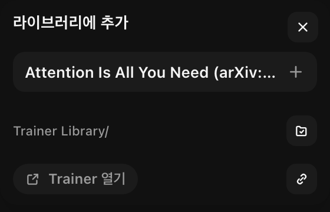
</p>

### MCP 외부 도구 연동 (`docs/mcp.md`)
- `TRAINER_MCP_SERVERS` 환경 변수로 켜는 stdio **MCP 클라이언트**가 GitHub / Gitee 등 외부 도구를 ReAct 루프에 안전하게 연결(동일한 6단계 fail-closed 권한 적용) — [`docs/mcp.md`](docs/mcp.md) 참조

---

## 아키텍처

### 시스템 토폴로지

```text
┌─────────────────────────────────────────────────────────────────────────┐
│                             VS Code Window                              │
│  ┌──────────────────────────────┐    ┌────────────────────────────────┐ │
│  │  Trainer 사이드바 (로컬 UI)   │    │  Remote-SSH 작업 영역 (원격)    │ │
│  │  React 19 + Zustand (8언어)  │    │  remote-extension (Companion)  │ │
│  │  대화 / 자료 + 학습 서랍      │◄──►│  읽기 전용 조회 / 검색 / 진단 /│ │
│  └──────────────┬───────────────┘    │  검증 테스트 실행만 담당       │ │
│                 │                    └────────────────────────────────┘ │
│  ┌──────────────▼───────────────┐                                       │
│  │  Extension Host (TypeScript) │  • SecretStorage (OS 키체인 키 보관)  │
│  │  CommandRegistry · Workspace │  • Testing API → 실제 테스트 인증     │
│  │  Gateway · Sidecar Manager   │  • Browser Extension MV3 브리지       │
│  └──────────────┬───────────────┘                                       │
│                 │ http://127.0.0.1 + SSE 스트림                         │
│  ┌──────────────▼───────────────┐    ┌────────────────────────────────┐ │
│  │  FastAPI Sidecar (Python)    │───►│  단일 통합 루트 <LibraryRoot>  │ │
│  │  • ReAct 루프 + MCP          │    │  • Trainer Library/ (노트/자료)│ │
│  │  • RethinkFun 교육 커널      │    │  • .trainer/runtime/           │ │
│  │  • 5 프로토콜 + 직접 프록시   │    │    trainer.sqlite3 · Qdrant ·  │ │
│  │  • FSRS 스케줄러 + 장기 기억  │    │    체크포인트 · 감사 원장      │ │
│  │  • 6단계 권한 가드            │    │  (코드 저장소 쓰기 오염 제로)  │ │
│  └──────────────────────────────┘    └────────────────────────────────┘ │
└─────────────────────────────────────────────────────────────────────────┘
```

### 디렉토리 구조 (실측 기준)

| 폴더 | 구성 내용 | 실측 규모 |
|---|---|---|
| `extension/src/` | VS Code 호스트: 명령 등록, SecretStorage, WorkspaceGateway, Sidecar 관리 | `79` TS 파일 (약 `53,286` 줄) |
| `extension/webview/src/` | React 워크벤치: 2진입점, 서랍, 단일 입력창, Shiki/KaTeX/Mermaid, 8언어 | `233` TS/TSX + `53` CSS (약 `120,507` 줄) |
| `extension/tests/` | `node:test` 스위트: 호스트, 공유 거버넌스, i18n, 브라우저 수집, 보안 | `317` 파일 · **`2,401` 테스트** |
| `server/app/` | FastAPI sidecar: ReAct, RethinkFun, FSRS/메모리, 수집, 샌드박스 검증 | `232` Python 파일 (약 `173,863` 줄) |
| `server/tests/` | `pytest` 백엔드 스위트(API, 교육, 메모리, 프로토콜, 권한) | `295` 파일 · **`4,205` 수집 테스트** |
| `shared/src/` | Host·Webview·테스트가 공유하는 결정론적 거버넌스 순수 함수 모듈 | `76` 모듈 (약 `29,508` 줄 · `523` 익스포트) |
| `remote-extension/src/` | Remote-SSH Companion (`extensionKind: ["workspace"]`) | `2` TS 파일 (`746` 줄) |
| `browser-extension/` | Chromium MV3 팝업, 오프라인 큐, 컨텍스트 메뉴, Side Panel | `8` 파일 (`6,977` 줄) |
| `extension/bundled/` | 동결된 PyInstaller sidecar & `trainer-workspace-companion.vsix` | 약 `245 MB` |

### 정규 스냅샷 계약 (`WorkbenchSnapshot`)

모든 주요 상태 HTTP 라우트는 **`WorkbenchSnapshot`**(`server/app/core/models.py` 최상위 `33` 필드)을 반환하며 `snapshot_revision` 으로 증분 동기화합니다.

---

## 안전 모델

- **API 키는 OS 키체인 / VS Code `SecretStorage` 에만 보관** — 저장소, `<LibraryRoot>`, 스냅샷, 로그에 평문 기록 없음 (`npm run verify:credentials`)
- **VS Code Workspace Trust fail-closed 적용** — 신뢰하지 않은 창에서는 파일 검사 및 원격 검증 차단
- **6단계 작업 영역 권한 계층** (`server/app/workspace/authority.py`): 개발 저장소는 기본 읽기 전용, Remote-SSH 는 쓰기 영구 잠금
- **복구 가능한 휴지통 + `<LibraryRoot>`**: 삭제 시 휴지통으로 안전 이동하며 코드 저장소에 숨김 파일/캐시를 남기지 않음
- **순수 JSON 스킬 공유**: 동적 코드 실행 경로 없이 엄격한 길이/스키마 검증
- **텔레메트리 기본 꺼짐(Opt-in)**: 소스 코드·경로·프롬프트는 절대 전송하지 않음

---

## 품질 게이트

> 아래 모든 수치는 `main` 브랜치(`v1.5.2`)에서 직접 검증된 실측 결과입니다:

| 게이트 | 범위 및 검증 결과 | 명령어 |
|---|---|---|
| **서버 테스트 (`pytest`)** | **295 파일 · 4,205 테스트** (및 서브테스트) | `npm run test:server` |
| **확장 테스트 (`node:test`)** | **317 파일 · 2,401 테스트** (`2,400` 통과, `1` 플랫폼 조건 스킵, `0` 실패) | `npm run test:extension` |
| **정적 분석 & 타입** | `ruff check` (`0`) · `pyright` (`0`) · CSS + `tsc -b` (`0`) | `npm run check && npm run verify:server-pyright` |
| **UI 지오메트리 게이트** | 단일 입력창 주권, 2진입점 셸, 오버플로우 검증 (`340/420/460px`, 다크/라이트, 중/영) | `npm run verify:ui-geometry` |
| **i18n 완결성 게이트** | **213** `appUiCopy` + **212** `settingsText` + **272** `hostCommandCopy` × **8언어** (누락 0) | `npm run verify:i18n` |
| **용어 & 시크릿 게이트** | UI 파일 **68개** 내부 용어 누출 0 · 저장소 **4,027개** 평문 시크릿 0 | `npm run verify:copy-vocabulary && npm run verify:credentials` |
| **Playwright E2E & Remote-SSH** | **30** Playwright spec (`166` 케이스) + 실제 sidecar 매트릭스 + Ubuntu Remote-SSH L2 (`20/20`) | `npm run test:experience-matrix` · `npm run test:remote-ssh-e2e` |
| **CI 릴리스 빌드 대상** | **3개 데스크톱 타겟**: `win32-x64`, `darwin-arm64`, `linux-x64` | `.github/workflows/release.yml` |

*(참고: 수동 교육 품질 승인 `T-0028` 은 [`docs/TRIAL-1.5.0-RC.md`](docs/TRIAL-1.5.0-RC.md) 에서 수동 게이트로 관리됩니다.)*

---

## i18n · 8개 언어

전체 UI 문구, 설정, 호스트 명령, 브라우저 캡처 확장 및 문서가 **8개 언어**로 나란히 유지됩니다:

`zh-CN` · `en-US` · `es-ES` · `fr-FR` · `de-DE` · `ja-JP` · `ko-KR` · `pt-BR`

`npm run verify:i18n` 게이트가 모든 키와 타 언어 혼입을 자동 차단합니다 (`extension/webview/src/lib/i18n/copy.ts`).

---

## 감사의 말

- **런타임 & HTTP**: [FastAPI](https://github.com/fastapi/fastapi) · [Uvicorn](https://github.com/encode/uvicorn) · [Pydantic](https://github.com/pydantic/pydantic) · [httpx](https://github.com/encode/httpx) · [openai-python](https://github.com/openai/openai-python)
- **기억, FSRS & 수집**: [py-fsrs](https://github.com/open-spaced-repetition/py-fsrs) · [qdrant-client](https://github.com/qdrant/qdrant-client) · [PyMuPDF](https://github.com/pymupdf/PyMuPDF) · [Trafilatura](https://github.com/adbar/trafilatura) · [MarkItDown](https://github.com/microsoft/markitdown)
- **프론트엔드 & 렌더링**: [React](https://github.com/facebook/react) · [Vite](https://github.com/vitejs/vite) · [Zustand](https://github.com/pmndrs/zustand) · [Zod](https://github.com/colinhacks/zod) · [react-markdown](https://github.com/remarkjs/react-markdown) · [KaTeX](https://github.com/KaTeX/KaTeX) · [Shiki](https://github.com/shikijs/shiki) · [Mermaid](https://github.com/mermaid-js/mermaid) · [@tanstack/react-table](https://github.com/TanStack/table) · [PDF.js](https://mozilla.github.io/pdf.js/) · [mammoth](https://github.com/mwilliamson/mammoth.js) · [docx-preview](https://github.com/VolodymyrBaydalka/docx-preview)
- **테스트 & 패키징**: [pytest](https://github.com/pytest-dev/pytest) · [Hypothesis](https://github.com/HypothesisWorks/hypothesis) · [ruff](https://github.com/astral-sh/ruff) · [pyright](https://github.com/microsoft/pyright) · [TypeScript](https://github.com/microsoft/TypeScript) · [Playwright](https://github.com/microsoft/playwright) · [PyInstaller](https://github.com/pyinstaller/pyinstaller)
- **교육 방식 영감**: 상태 흐름 직관 강의 스타일은 AI 기술 크리에이터 **[RethinkFun](https://rethink.fun)** 의 교수법에서 영감을 받았습니다 · [fsrs4anki](https://github.com/open-spaced-repetition/fsrs4anki)
- **비주얼 에셋**: **[GPT Image](https://github.com/AI-yyf/trainer/tree/main/assets)** 로 생성 (`assets/MASCOT.md` · `assets/BANNER_PROMPT.md` · `assets/FEATURE_PROMPTS.md`)

---

## 라이선스

[MIT](LICENSE)

---

## Trainer 인용하기

```bibtex
@software{trainer2026,
  title  = {Trainer: A Long-Term Coding Coach Living in Your Editor},
  author = {AI-yyf and contributors},
  year   = {2026},
  url    = {https://github.com/AI-yyf/trainer},
  note   = {v1.5.2}
}
```

---

<div align="center">

**// AI를 훈련하고 · AI와 함께 성장하세요**

`v1.5.2` · 커피와 FSRS, RethinkFun State-Flow 교육 커널, 6,606개의 자동화 테스트, 그리고 대신 코드를 쓰기를 거부하는 코치가 만들었습니다.

</div>
