# Trainer

<div align="center">


**Um coach técnico e de programação de longo prazo que vive na barra lateral do seu VS Code.**

**Ele planeja, treina, verifica e lembra entre sessões — mas se recusa a escrever código de produção por você.**

**// Output ≠ Crescimento // Verificar + Revisar = Crescimento**

[English](README.md) · [简体中文](README_zh-CN.md) · [Español](README_es-ES.md) · [Français](README_fr-FR.md) · [Deutsch](README_de-DE.md) · [日本語](README_ja-JP.md) · [한국어](README_ko-KR.md) · Português

[](https://github.com/AI-yyf/trainer/blob/main/extension/package.json)
[](LICENSE)
[](#instalação)
[](#portões-de-qualidade)
[](#i18n--oito-idiomas)

[Por quê](#por-que-o-trainer-existe) ·
[Instalação](#instalação) ·
[Três passos](#três-passos-não-quatro) ·
[Mecânicas](#mecânicas-centrais) ·
[Dois destinos](#dois-destinos--uma-conversa) ·
[Remote-SSH](#remote-ssh-companion) ·
[Comparação](#comparação) ·
[Demo de 5 min](#demo-de-cinco-minutos) ·
[Design](#por-que-parece-diferente) ·
[Arquitetura](#arquitetura) ·
[Segurança](#modelo-de-segurança) ·
[Qualidade](#portões-de-qualidade) ·
[Agradecimentos](#agradecimentos) ·
[🎭 O elenco](docs/CAST.md)

</div>

---

## Por que o Trainer existe

> Desenvolvedores não travam por falta de tutoriais.
> Eles travam porque nada fecha o ciclo de aprendizagem.

Um chat com um LLM evapora no instante em que termina; vídeos são passivos; o conceito que você quase entendeu na terça-feira já sumiu na sexta.

Pior: **vibe coding** — meses deixando a IA escrever código enquanto você não compreende mais como nada funciona.

**O Trainer resolve isso de dentro do editor.**

Não é uma casca de chat — é um coach com memória duradoura, currículo em etapas e critério rigoroso de verificação:

- **Planeja** seu aprendizado em etapas e acompanha onde você está de verdade — não onde acha que está
- **Treina** com cartões, exercícios teóricos e práticas integradas ao seu projeto real
- **Verifica** o domínio frente ao seu código real — falar de FastAPI não vale nada até o arquivo atual comprovar
- **Lembra** entre sessões, projetos e semanas, agendando revisões na curva de esquecimento **FSRS**
- **Nunca escreve código de produção por você** — você escreve, ele ensina e **vocês crescem juntos**

**E essa disciplina vai além de código.** O mesmo ciclo de «verificar primeiro» sustenta leitura atenta, deduções conceituais e estudo de idiomas via pacotes dedicados de verificação e dimensões de progresso.

<div align="center">

| vibe coding · o padrão atual | Trainer · como deveria ser |
|:---:|:---:|
| `def ship(code):` <br> `    ai.write(code)` <br> `# você entendeu?` <br> `    return forget(code)` | `def ship(code):` <br> `    you.write(code)` <br> `    ai.verify(code)` <br> `    you.recall(code)` <br> `    return grown(code)` |
| output = esquecimento | output + memória + recordação = crescimento |

</div>

---

## Instalação

**Via VSIX pré-compilado (três plataformas verificadas em CI):**

Baixe o `.vsix` compatível com o seu sistema e arquitetura (`darwin-arm64` / `linux-x64` / `win32-x64`) em [Releases](https://github.com/AI-yyf/trainer/releases/latest):

```bash
code --install-extension trainer-extension-1.4.5-<platform>-<arch>.vsix --force
```

Ou no painel de Extensões do VS Code → `···` → *Instalar do VSIX…* → recarregue a janela. Veja mais detalhes em [`extension/README.install.md`](extension/README.install.md).

**A partir do código-fonte:**

```bash
git clone https://github.com/AI-yyf/trainer.git
cd trainer && npm ci
cd server && uv sync --frozen --extra dev --python 3.12 && cd ..
npm run build
```

Abra o repositório no VS Code e pressione `F5` (Extension Development Host) ou gere um VSIX local com `npm run package:vsix`.

**Requisitos:** VS Code `≥ 1.96` · Python `3.12` (apenas para build do código-fonte; o `.vsix` empacota o sidecar congelado) · macOS (`arm64`) / Linux (`x64`) / Windows (`x64`).

---

## Três passos, não quatro

Inicialização a frio **sem barreira obrigatória**: abra o Trainer e entre direto no **Chat**. Ao conectar um modelo:

1. Abra **Configurações → Conexão** (ícone de engrenagem no canto superior direito)
2. Selecione o protocolo declarado (`OpenAI Chat`, `OpenAI Responses`, `Anthropic Messages`, `Gemini` ou `Azure OpenAI`) e informe a **raiz do serviço**, sua **API Key** (armazenada apenas no cofre do sistema operacional via `SecretStorage`) e o **Modelo**
3. Se variáveis de proxy locais (`HTTP_PROXY` / `HTTPS_PROXY`) causarem erros `502` ou timeouts, altere **Proxy de rede** para **Ignorar proxy do sistema (Direto)** e clique em **Testar conexão**

O Trainer obtém os modelos reais, testa streaming, chamadas de ferramentas e raciocínio, reportando falhas com transparência (`invalid_key_or_permission`, `network` ou rejeição de stream vazio).

<p align="center">
  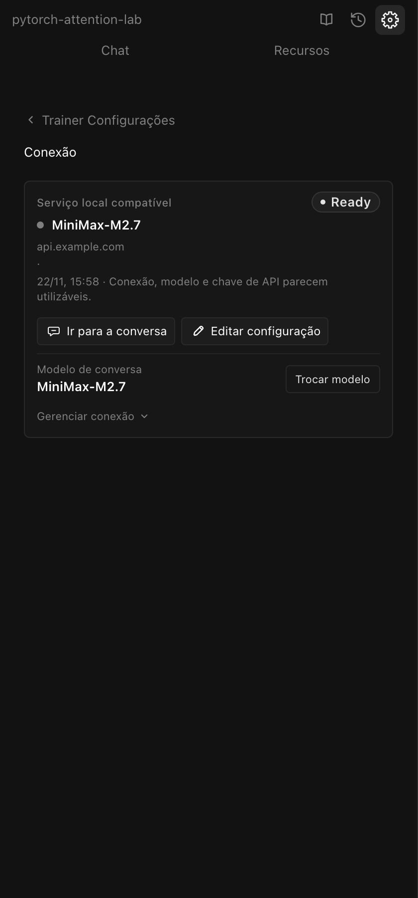
  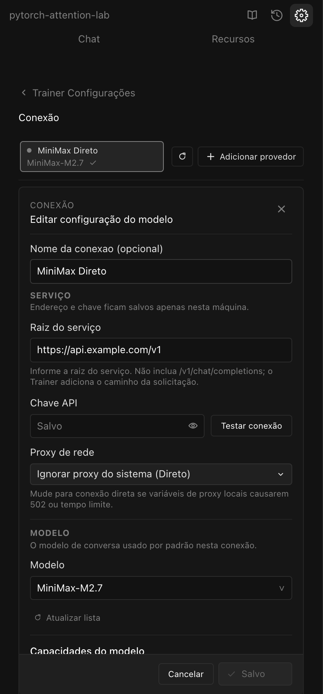
</p>

---

## Mecânicas centrais

### ① Portões de verificação — você escreve o código, o código prova

Um cartão de prática nunca avança antes que a verificação rode sobre o seu arquivo real; não existe botão manual de «marcar como concluído».

<p align="center"></p>

- **Sandbox isolada local** (`server/app/evaluator/service.py` — `EvaluatorService`): copia os arquivos-alvo para diretório temporário, executa checagens sem sujar o seu repositório com `.pytest_cache` e pontua cada item de `acceptance_criteria` + `expected_symbols`
- **Atestação via VS Code Testing API** (`extension/src/testing/`): resultados reais de testes atestam direto em `/training/verification/attest` — execuções desconhecidas ou interrompidas nunca falsificam aprovação
- **Proxy de leitura e verificação Remote-SSH**: verifica arquivos em máquinas remotas sem enviar suas API Keys ou sua biblioteca para fora do computador local

### ② Memória de longo prazo + `<LibraryRoot>` único unificado

Tudo o que o Trainer lembra sobre você, cada recurso capturado e cada nota salva vivem em **uma única pasta `<LibraryRoot>`** de sua escolha — mantendo seus repositórios de código 100% limpos (`git status` zerado).

<p align="center"></p>

```text
<LibraryRoot>/
├── Trainer Library/          # Recursos navegáveis e notas Markdown salvas automaticamente
│   ├── Notas de aula/        # Geradas via `save_lecture_note` (legíveis direto no gerenciador)
│   └── Papers/               # PDFs importados, páginas web extraídas e referências
└── .trainer/
    └── runtime/              # SQLite (`trainer.sqlite3`), índice Qdrant, checkpoints e logs
```

- **Memória em dois níveis**: estado SQLite estruturado + recuperação semântica (`Qdrant` com fallback local) agendados pela curva **`py-fsrs`** (`server/app/memory/review_scheduler.py`)
- **Supressão durante fluxo vivo**: revisões pendentes aguardam enquanto há implementação ativa para proteger seu foco
- **Isolamento fail-closed entre workspaces**: passar em um projeto nunca infla artificialmente o domínio global (`server/app/memory/transfer_skills.py`)

### ③ Ciclo pedagógico RethinkFun State-Flow

A metodologia de ensino por fluxo de estado do Trainer foi inspirada diretamente no criador e educador técnico **[RethinkFun](https://rethink.fun)** (partir do ponto exato em que a abordagem anterior trava, deduzir passo a passo sem atalhos do tipo «é óbvio» e ligar cada linha mínima de código diretamente à teoria). O treino acontece dentro da própria conversa em vez de telas CRUD desconectadas:

<p align="center"></p>

- **Três faixas pedagógicas calibradas** (`server/app/pedagogy/` + `server/app/llm/`):
  - **Guia rápido de código**: ancorado em símbolos reais e falhas concretas, sem sermões desnecessários
  - **Aulas profundas por fluxo de estado (`save_lecture_note`)**: deduz equações e transições passo a passo, une código mínimo à teoria e grava `.md` limpos em `<LibraryRoot>/Trainer Library/`
  - **Consulta de verdade verificada (`inspect_learning_truth`)**: responde sobre etapas e evidências diretamente do servidor sem vazar UUIDs internos ou JSON bruto
- **Máquina de estados em 5 fases** (`LEARN → TRY → VERIFY → REFLECT → RETURN` em `server/app/training/handoff.py`)

### ④ Você escreve, o coach orienta

O coach lê arquivos, diagnósticos e estrutura do workspace, enquanto edições reais ficam exclusivamente nas suas mãos (`server/app/workspace/authority.py` garante acesso somente leitura aos seus repositórios).

<p align="center"></p>

- Ritmo adaptativo (`AffectService` em `server/app/affect/service.py`) detecta erros repetidos e muda automaticamente para o modo enxuto de resgate

### ⑤ Ancoragem factual e qualidade explicativa

- Guardas determinísticos de continuidade e recuperação (`coaching_recovery.py`, `coaching_replies.py`) barram streams vazios, erros de gateway e desvios de idioma
- Avaliador não bloqueante em 5 dimensões monitora vínculo ao contexto, ancoragem em símbolos e recusa de respostas prontas

---

## Dois destinos + Uma conversa

> Arquitetura serena e estável: **Chat** e **Recursos** no topo; **Gaveta de Aprendizado**, **Histórico** e **Configurações** no utilitário superior direito; **um único campo de entrada** em toda a interface.

| Superfície | Papel | Conteúdo |
|---|---|---|
| **Chat** (`coach`) | Espaço principal | Respostas em streaming State-Flow, distintivos de notas `.md`, ações por mensagem, cartões **FocusedPractice** recolhíveis em linha (sem segunda caixa de texto), faixa superior de 1 linha e paleta `$` |
| **Recursos** (`resources`) | Biblioteca e leitor | Árvore unificada `<LibraryRoot>`, filtro local instantâneo, preview Markdown nativo com imagens e KaTeX/Shiki/Mermaid, ingestão PDF/DOCX/URL e lixeira recuperável |
| **Gaveta de Aprendizado** (`plan` / `training` / `progress`) | Memória somente leitura | Folha modal sobre o Chat (mantém rascunho inferior) com três cartões uniformes: **Objetivo atual**, **Prática pendente** e **Domínio** (uma **barra de 4 segmentos**, zero percentuais) |
| **Configurações** (`settings`) | Console de controle | Conexão 5 protocolos + **Bypass direto de proxy**, estilo do coach & `$` Skills, **Workspace `<LibraryRoot>`** + Remote Companion, 8 idiomas e telemetria opt-in |

*(Todas as seis rotas internas — `coach`, `plan`, `resources`, `training`, `progress`, `settings` — seguem válidas para atalhos e restauração.)*

<p align="center">
  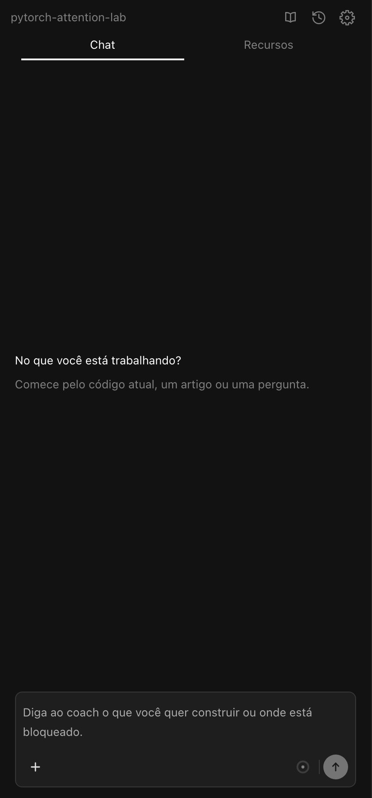
  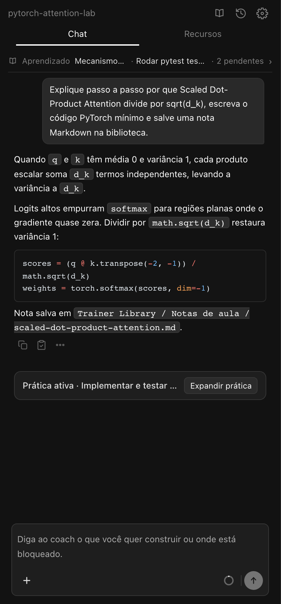
  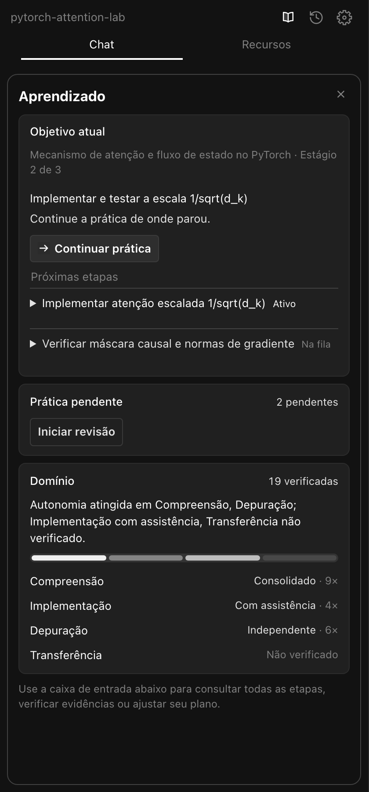
</p>
<p align="center">
  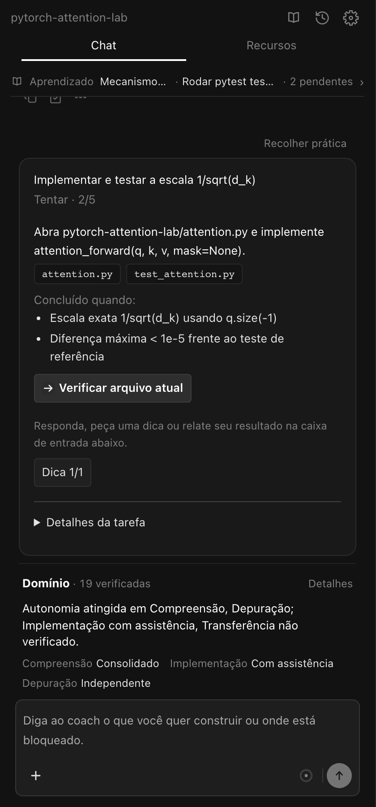
  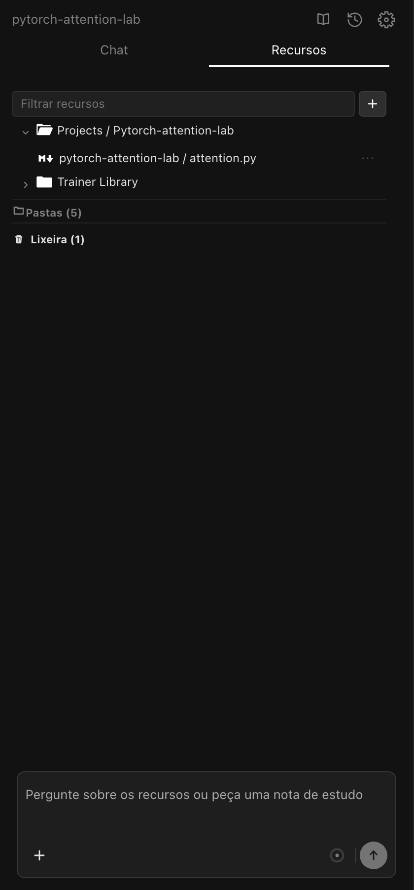
  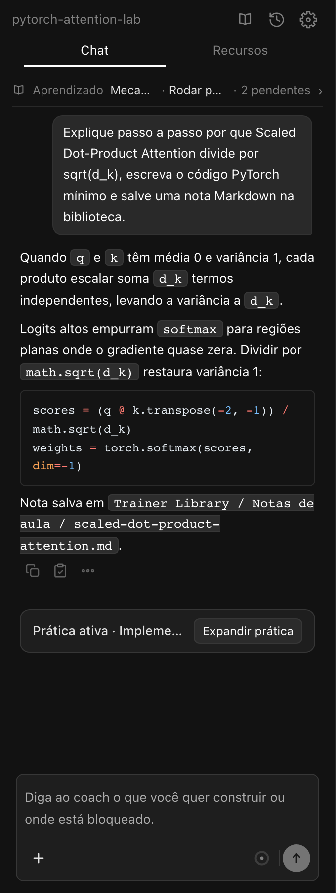
</p>

### `$` Skills personalizados — criar, compartilhar, instalar

Digite `$` no compositor único para abrir a paleta instantaneamente. Gerencie suas skills em **Configurações → Coach → Skills** — formato JSON puro sem `eval()` e protegendo os gatilhos nativos.

<p align="center">
  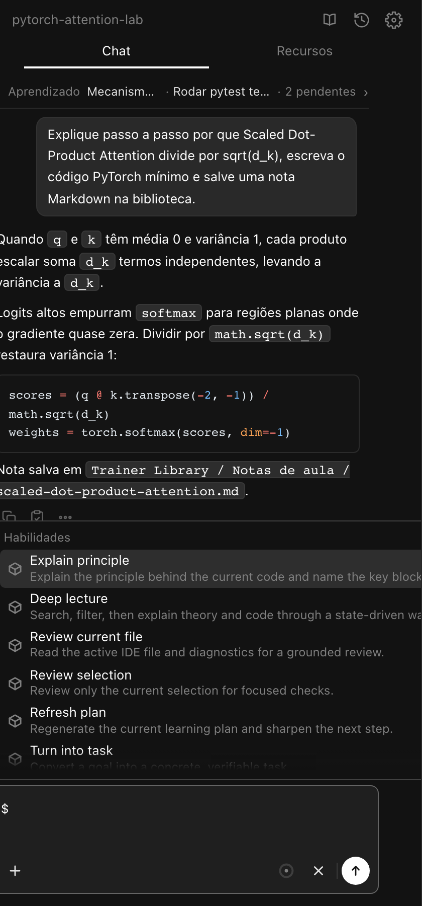
  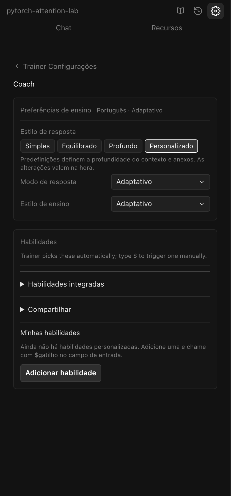
</p>

<p align="center"></p>

---

## Remote-SSH Companion

Para projetos em Linux/SSH remotos, o Trainer divide **cérebro local e mãos remotas**:

- **A UI, o sidecar Python, as API Keys e o `<LibraryRoot>`** permanecem sempre no seu **computador local**
- **`remote-extension/`** (`Trainer Workspace Companion`, empacotada em `extension/bundled/remote/trainer-workspace-companion.vsix`) executa leitura de código, busca, diagnósticos e validação controlada de testes (`trainer.remote.verify`) no servidor remoto
- **Bloqueio rígido de escrita remota**: o repositório remoto permanece estritamente protegido contra edições pelo agente

<p align="center">
  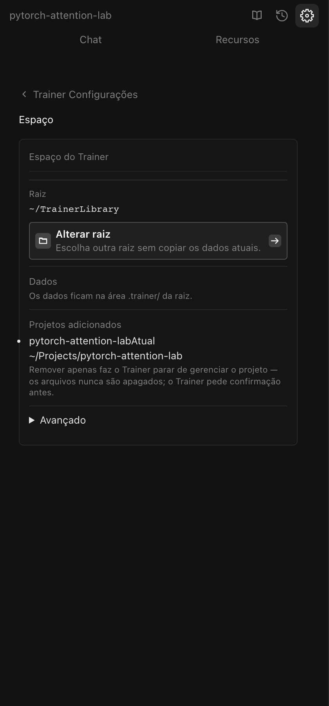
</p>

---

## Comparação

| Dimensão | Ferramentas Vibe | IDEs com Chat | Apps de Flashcards | **Trainer** |
|---|---|---|---|---|
| Escreve código por você | ✅ | ✅ | ❌ | ❌ (limite intencional) |
| Verifica contra seu código real | ❌ | ❌ | ❌ | ✅ sandbox local + VS Code Testing + Remote-SSH |
| Persistência entre sessões | ⚠️ janela | ⚠️ resumos | ✅ | ✅ SQLite + Qdrant sob `<LibraryRoot>` |
| Mantém seu repo git intacto | ⚠️ mistura arquivos | ⚠️ | n/a | ✅ `<LibraryRoot>` único, zero escrita no repo |
| Repetição espaçada FSRS | ❌ | ❌ | ✅ | ✅ com supressão em fluxo ativo |
| Modelo de permissões | ❌ | ⚠️ Trust básico | ❌ | ✅ escada de 6 níveis + trava remota |
| Suíte de testes aberta | fechada | fechada | fechada | ✅ **6.606 unit/integração + 166 E2E** |
| Internacionalização | ⚠️ | ⚠️ | ⚠️ | ✅ **8 idiomas** com gate automático em CI |

> Outras ferramentas fazem você gerar código mais rápido; **o Trainer garante que você domine o que constrói.**

---

## Demo de cinco minutos

1. **T+0:00 — Abrir o Trainer**: Clique no ícone da barra lateral e caia direto no **Chat**, sem telas obrigatórias de bloqueio.
2. **T+0:30 — Conectar modelo**: Em **Configurações → Conexão**, configure protocolo, URL, modelo e API Key no cofre (ative **Ignorar proxy do sistema (Direto)** se necessário) e clique em **Testar conexão**.
3. **T+1:30 — Pedir explicação profunda**: Pergunte *"Explique com fluxo de estado por que Scaled Dot-Product Attention divide por sqrt(d_k) e salve uma nota Markdown"* — salva direto em `<LibraryRoot>/Trainer Library/`.
4. **T+2:30 — Praticar na conversa**: Expanda o cartão **FocusedPractice** dentro do Chat, edite seu código e responda ou peça dicas pelo compositor único inferior.
5. **T+4:00 — Verificar e agendar FSRS**: Clique em **Verificar arquivo atual** (ou rode testes via Testing API / Remote-SSH) para avançar em **Compreensão / Implementação / Depuração / Transferência**.
6. **T+5:00 — Abrir Gaveta de Aprendizado**: Clique no ícone de livro no topo direito para conferir **Objetivo atual**, **Prática pendente** e a barra de 4 segmentos.

---

## Por que parece diferente

### Falhas honestas e bypass de proxy
- Gateways desconhecidos nunca são assumidos silenciosamente como compatíveis com OpenAI
- **Ignorar proxy do sistema (Direto)** contorna variáveis `HTTP_PROXY` / `HTTPS_PROXY` locais por perfil de conexão
- Streams vazios ou falhas de autenticação exibem ações claras de recuperação

### Teste de velocidade e intensidade de raciocínio
- Disputa endpoints candidatos em paralelo com exclusão de cold-start e aplica o mais rápido em um clique
- A intensidade de pensamento adapta-se apenas às capacidades realmente verificadas do modelo

<p align="center"></p>

### Biblioteca completa unificada em `<LibraryRoot>`
- Importe PDF (`PyMuPDF`), páginas web (`Trafilatura`), DOCX (`mammoth` / `MarkItDown`) ou notas geradas em `<LibraryRoot>/Trainer Library/`
- Filtro local instantâneo, preview Markdown rico com KaTeX e Mermaid, lixeira recuperável e envio direto para o Chat

<p align="center"></p>

### Captura rápida no navegador (`browser-extension/`)
- Extensão Chromium MV3 **sem código de pareamento** — descobre automaticamente o sidecar local (`127.0.0.1`)
- Capture páginas web, PDFs arXiv, repositórios GitHub ou seleções de texto direto para `<LibraryRoot>/Trainer Library/` ou para o compositor do Chat, com filas FIFO offline e Side Panel completo nos 8 idiomas

<p align="center">
  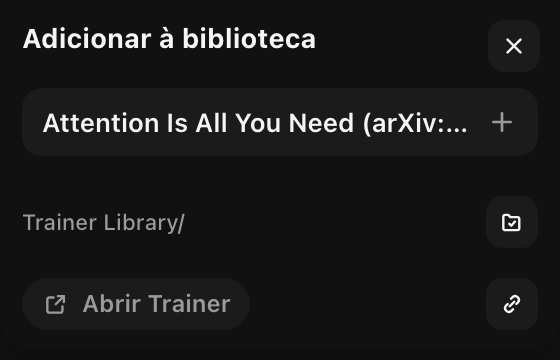
</p>

### Integração MCP (`docs/mcp.md`)
- Cliente stdio opcional para **Model Context Protocol** (`TRAINER_MCP_SERVERS`) integrando servidores externos (ex.: GitHub / Gitee) no loop ReAct sob a mesma escada fail-closed de 6 níveis — veja [`docs/mcp.md`](docs/mcp.md)

---

## Arquitetura

### Topologia do sistema

```text
┌─────────────────────────────────────────────────────────────────────────┐
│                             VS Code Window                              │
│  ┌──────────────────────────────┐    ┌────────────────────────────────┐ │
│  │  Sidebar Trainer (Host UI)   │    │  Workspace Remote-SSH (Remoto) │ │
│  │  React 19 + Zustand (8 i18n) │    │  remote-extension (Companion)  │ │
│  │  Chat / Recursos + Gaveta    │◄──►│  Leitura / Busca / Diagnóst.   │ │
│  └──────────────┬───────────────┘    │  e Execução Verificada de Test │ │
│                 │                    └────────────────────────────────┘ │
│  ┌──────────────▼───────────────┐                                       │
│  │  Extension Host (TypeScript) │  • SecretStorage (Cofre do SO)        │
│  │  CommandRegistry · Workspace │  • Testing API → Atestação Real       │
│  │  Gateway · Sidecar Manager   │  • Ponte Extensão Navegador MV3       │
│  └──────────────┬───────────────┘                                       │
│                 │ http://127.0.0.1 + stream SSE                         │
│  ┌──────────────▼───────────────┐    ┌────────────────────────────────┐ │
│  │  Sidecar FastAPI (Python)    │───►│  Raiz Única <LibraryRoot>      │ │
│  │  • Loop ReAct + Cliente MCP  │    │  • Trainer Library/ (Notas/PDF)│ │
│  │  • Núcleo RethinkFun         │    │  • .trainer/runtime/           │ │
│  │  • 5 Protocolos + Proxy Dir. │    │    trainer.sqlite3 · Qdrant ·  │ │
│  │  • Agendador FSRS + Memória  │    │    Checkpoints · Registro      │ │
│  │  • Autoridade em 6 níveis    │    │  (Zero escrita no seu repo)    │ │
│  └──────────────────────────────┘    └────────────────────────────────┘ │
└─────────────────────────────────────────────────────────────────────────┘
```

### Estrutura de diretórios

| Pasta | Conteúdo | Tamanho medido |
|---|---|---|
| `extension/src/` | Host VS Code: comandos, SecretStorage, WorkspaceGateway, SidecarProcessManager | `79` arquivos TS (~`53.286` linhas) |
| `extension/webview/src/` | Workbench React: 2 destinos, gaveta, compositor único, Shiki/KaTeX/Mermaid, 8 idiomas | `233` TS/TSX + `53` CSS (~`120.507` linhas) |
| `extension/tests/` | Suíte `node:test`: host, governança compartilhada, i18n, captura web, segurança | `317` arquivos · **`2.401` testes** |
| `server/app/` | Sidecar FastAPI: agente ReAct, pedagogia RethinkFun, FSRS, ingestão, avaliador | `232` arquivos Python (~`173.863` linhas) |
| `server/tests/` | Suíte backend `pytest` de rotas API, pedagogia, memória e protocolos | `295` arquivos · **`4.205` testes coletados** |
| `shared/src/` | Módulos TypeScript puros determinísticos compartilhados entre Host, Webview e Testes | `76` módulos (~`29.508` linhas · `523` exports) |
| `remote-extension/src/` | Companion Remote-SSH (`extensionKind: ["workspace"]`) | `2` arquivos TS (`746` linhas) |
| `browser-extension/` | Extensão Chromium MV3: popup, filas offline, menus de contexto e Side Panel | `8` arquivos (`6.977` linhas) |
| `extension/bundled/` | Binário PyInstaller congelado + `trainer-workspace-companion.vsix` | ~`245 MB` |

### Contrato canônico (`WorkbenchSnapshot`)

Todas as rotas HTTP principais de estado retornam o objeto único **`WorkbenchSnapshot`** (`33` campos de nível superior em `server/app/core/models.py`), sincronizado incrementalmente via `snapshot_revision`.

---

## Modelo de segurança

- **API Keys no cofre do SO / VS Code `SecretStorage`** — nunca gravadas em workspaces, `<LibraryRoot>`, snapshots ou logs (`npm run verify:credentials`)
- **Workspace Trust do VS Code fail-closed** — janelas não confiáveis bloqueiam inspeção e verificação remota
- **Escada de autoridade em 6 níveis** (`server/app/workspace/authority.py`): somente leitura por padrão em repositórios do usuário; bloqueio total de escrita no Remote-SSH
- **Lixeira recuperável + `<LibraryRoot>`**: exclusões movem para lixeira recuperável sem criar dotfiles ocultos no seu projeto git
- **Compartilhamento de Skills puro JSON**: validação rígida de esquema/tamanho sem execução dinâmica de código
- **Telemetria opt-in desligada por padrão**: nunca exporta código-fonte, caminhos ou conversas

---

## Portões de qualidade

> Todos os números refletem verificações reais na branch `main` (`v1.4.5`):

| Portão | Escopo e resultado verificado | Comando |
|---|---|---|
| **Testes do servidor (`pytest`)** | **295 arquivos · 4.205 testes** (mais subtestes) | `npm run test:server` |
| **Testes da extensão (`node:test`)** | **317 arquivos · 2.401 testes** (`2.400` aprovados, `1` skip condicional, `0` falhas) | `npm run test:extension` |
| **Análise estática e tipos** | `ruff check` (`0`) · `pyright` (`0`) · CSS + `tsc -b` (`0`) | `npm run check && npm run verify:server-pyright` |
| **Geometria de UI** | Soberania do compositor único, 2 destinos, zero overflow (`340/420/460px`, dark/light, zh/en) | `npm run verify:ui-geometry` |
| **Completude i18n** | **213** `appUiCopy` + **212** `settingsText` + **272** `hostCommandCopy` em **8 idiomas** (`0` faltas) | `npm run verify:i18n` |
| **Vocabulário e segredos** | **68** arquivos UI limpos · **4.027** arquivos escaneados sem credenciais em texto claro | `npm run verify:copy-vocabulary && npm run verify:credentials` |
| **Playwright E2E & Remote-SSH** | **30** specs Playwright (`166` casos) + matriz sidecar real + Ubuntu Remote-SSH L2 (`20/20`) | `npm run test:experience-matrix` · `npm run test:remote-ssh-e2e` |
| **Targets CI de release** | **3 plataformas desktop**: `win32-x64`, `darwin-arm64`, `linux-x64` | `.github/workflows/release.yml` |

*(Nota: o aceite pedagógico humano `T-0028` permanece registrado como portão manual em [`docs/TRIAL-1.5.0-RC.md`](docs/TRIAL-1.5.0-RC.md).)*

---

## i18n · Oito idiomas

Toda a interface, configurações, comandos do host, extensão de navegador e documentação acompanham **8 idiomas**:

`zh-CN` · `en-US` · `es-ES` · `fr-FR` · `de-DE` · `ja-JP` · `ko-KR` · `pt-BR`

Verificado automaticamente via `npm run verify:i18n` (`extension/webview/src/lib/i18n/copy.ts`).

---

## Agradecimentos

- **Runtime & HTTP**: [FastAPI](https://github.com/fastapi/fastapi) · [Uvicorn](https://github.com/encode/uvicorn) · [Pydantic](https://github.com/pydantic/pydantic) · [httpx](https://github.com/encode/httpx) · [openai-python](https://github.com/openai/openai-python)
- **Memória, FSRS & ingestão**: [py-fsrs](https://github.com/open-spaced-repetition/py-fsrs) · [qdrant-client](https://github.com/qdrant/qdrant-client) · [PyMuPDF](https://github.com/pymupdf/PyMuPDF) · [Trafilatura](https://github.com/adbar/trafilatura) · [MarkItDown](https://github.com/microsoft/markitdown)
- **Frontend & renderização**: [React](https://github.com/facebook/react) · [Vite](https://github.com/vitejs/vite) · [Zustand](https://github.com/pmndrs/zustand) · [Zod](https://github.com/colinhacks/zod) · [react-markdown](https://github.com/remarkjs/react-markdown) · [KaTeX](https://github.com/KaTeX/KaTeX) · [Shiki](https://github.com/shikijs/shiki) · [Mermaid](https://github.com/mermaid-js/mermaid) · [@tanstack/react-table](https://github.com/TanStack/table) · [PDF.js](https://mozilla.github.io/pdf.js/) · [mammoth](https://github.com/mwilliamson/mammoth.js) · [docx-preview](https://github.com/VolodymyrBaydalka/docx-preview)
- **Testes & empacotamento**: [pytest](https://github.com/pytest-dev/pytest) · [Hypothesis](https://github.com/HypothesisWorks/hypothesis) · [ruff](https://github.com/astral-sh/ruff) · [pyright](https://github.com/microsoft/pyright) · [TypeScript](https://github.com/microsoft/TypeScript) · [Playwright](https://github.com/microsoft/playwright) · [PyInstaller](https://github.com/pyinstaller/pyinstaller)
- **Inspiração pedagógica**: Didática por fluxo de estado inspirada no criador técnico **[RethinkFun](https://rethink.fun)** (intuição antes da formalização) · [fsrs4anki](https://github.com/open-spaced-repetition/fsrs4anki)
- **Ativos visuais**: Gerados com **[GPT Image](https://github.com/AI-yyf/trainer/tree/main/assets)** (`assets/MASCOT.md` · `assets/BANNER_PROMPT.md` · `assets/FEATURE_PROMPTS.md`)

---

## Licença

[MIT](LICENSE)

---

## Como citar o Trainer

```bibtex
@software{trainer2026,
  title  = {Trainer: A Long-Term Coding Coach Living in Your Editor},
  author = {AI-yyf and contributors},
  year   = {2026},
  url    = {https://github.com/AI-yyf/trainer},
  note   = {v1.4.5}
}
```

---

<div align="center">

**// Treine sua IA · Cresça com sua IA**

`v1.4.5` · Feito com café, FSRS, pedagogia RethinkFun State-Flow, 6.606 testes automatizados e um coach que se recusa a escrever código por você.

</div>
