# Trainer

<div align="center">


**一个住进 VS Code 侧边栏的长期技术教练（从编程起步）。**

**它会规划、会训练、会验证、会记住你——但绝不替你写生产代码。**

**// 产出代码 ≠ 个人成长 // 验证 + 间隔复习 = 真正掌握**

[English](README.md) · 简体中文 · [Español](README_es-ES.md) · [Français](README_fr-FR.md) · [Deutsch](README_de-DE.md) · [日本語](README_ja-JP.md) · [한국어](README_ko-KR.md) · [Português](README_pt-BR.md)

[](https://github.com/AI-yyf/trainer/blob/main/extension/package.json)
[](LICENSE)
[](#安装)
[](#质量门禁)
[](#i18n--八种语言)

[为什么做](#为什么会有-trainer) ·
[安装](#安装) ·
[三步上手](#三步上手没有第四步) ·
[核心机制](#核心机制) ·
[两入口一对话](#两入口一对话--唯一输入框) ·
[Remote-SSH](#remote-ssh-远端协同) ·
[对比](#横向对比) ·
[五分钟体验](#五分钟实操演示) ·
[产品设计](#为什么它用起来不一样) ·
[系统架构](#系统架构) ·
[安全模型](#安全模型) ·
[质量门禁](#质量门禁) ·
[致谢](#致谢) ·
[🎭 角色阵容](docs/CAST.md)

</div>

---

## 为什么会有 Trainer

> 开发者卡住，从来不是因为缺教程；
> 而是因为没有任何东西把“理解—动手—验证—复习”闭成环。

和大模型聊完，关掉窗口记忆就蒸发了；看视频永远是被动输入；周二似懂非懂的概念，到周五又彻底还给了屏幕。

更危险的是 **vibe coding** —— 连着三个月让 AI 帮你写代码，产出看似飞快，自己却什么都没真正掌握。

**Trainer 直接从编辑器内部解决这个问题。**

它不是又一个聊天套壳，而是一位自带长期记忆、课程推进与严格验收纪律的教练：

- **规划路径**：围绕你的真实项目拆出阶段目标，记录你“真实做到”的位置，而不是自以为会的位置
- **精准训练**：通过内联练习卡片、原理深讲与推理型卡片，在真实工作流中刻意练习
- **实证核验**：只在你的真实代码与测试跑通后才推进掌握度——口头上把 FastAPI 讲得再明白，文件没通过验证也不算数
- **跨期记忆**：跨会话、跨项目、跨周记住你的薄弱点与突破，在 **FSRS 遗忘曲线** 临界点推送复习
- **绝不代写生产代码**：你动手写、它来教与验，**人与 AI 共同成长**

**这套纪律并不止步于编程。** 同一套“先验证再推进”的闭环同样支持论文精读、架构推导与文理跨学科学习，各自走独立的核验逻辑与能力维度。

<div align="center">

| vibe coding · 今天的常态 | Trainer · 应有的方式 |
|:---:|:---:|
| `def ship(code):` <br> `    ai.write(code)` <br> `# 你真的懂了吗？` <br> `    return forget(code)` | `def ship(code):` <br> `    you.write(code)` <br> `    ai.verify(code)` <br> `    you.recall(code)` <br> `    return grown(code)` |
| 只有产出 = 快速遗忘 | 亲手产出 + 记忆 + 复现 = 真实成长 |

</div>

---

## 安装

**方式 A：直接安装预构建 VSIX（支持三大桌面平台）**

从 [Releases](https://github.com/AI-yyf/trainer/releases/latest) 下载与你系统架构匹配的 `.vsix`（`darwin-arm64` / `linux-x64` / `win32-x64`）：

```bash
code --install-extension trainer-extension-1.6.2-<platform>-<arch>.vsix --force
```

或在 VS Code 扩展面板点击 `···` → **从 VSIX 安装** → 重载窗口即可。详细安装说明与数据目录规范见 [`extension/README.install.md`](extension/README.install.md)。

**方式 B：从源码运行与打包**

```bash
git clone https://github.com/AI-yyf/trainer.git
cd trainer && npm ci
cd server && uv sync --frozen --extra dev --python 3.12 && cd ..
npm run build
```

在 VS Code 中打开仓库按 `F5` 启动扩展开发宿主，或执行 `npm run package:vsix` 打出本地安装包。

**环境要求**：VS Code `≥ 1.96` · Python `3.12`（仅源码运行需要；发布版 VSIX 内置冻结 sidecar 二进制）· macOS (`arm64`) / Linux (`x64`) / Windows (`x64`)。

---

## 三步上手，没有第四步

冷启动**零拦截墙**：打开侧边栏直接就能进入**对话**；配置模型或沉淀资料时只需三步：

1. 点击右上角齿轮进入 **设置 → 连接**
2. 选定声明式协议（`OpenAI Chat`、`OpenAI Responses`、`Anthropic Messages`、`Gemini` 或 `Azure OpenAI`），填入 **服务根地址**、**API Key**（仅存系统钥匙串，不落代码仓）与默认 **聊天模型**
3. 若本机代理环境变量导致网关 `502` 或超时，直接在表单中将 **网络代理** 切为 **忽略系统代理（直连）**，点击 **测试连接**

Trainer 会实时拉取模型列表、探测流式、工具调用与推理思考能力，并诚实给出失败原因（如 `invalid_key_or_permission`、网络阻断或空流拒收——绝不把半残响应伪装成已就绪）。

<p align="center">
  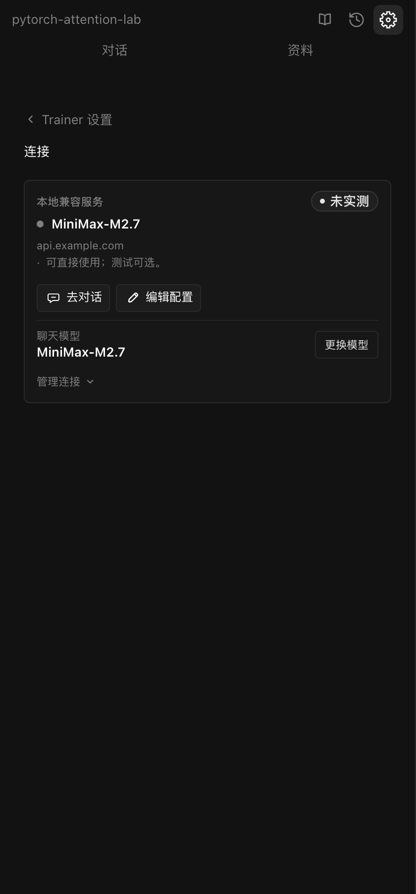
  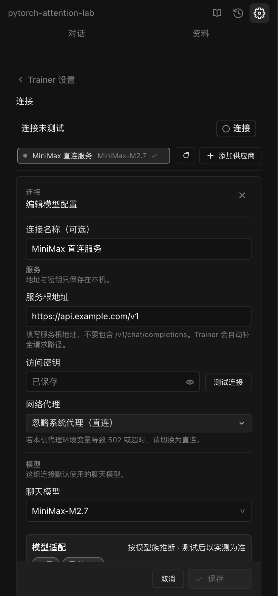
</p>

---

## 核心机制

### ① 验证门禁 —— 你写代码，代码自己作证

训练卡绝不会凭空推进，界面上**刻意不存在“手动标记已完成”按钮**，只有真实通过校验才能前进。

<p align="center"></p>

- **独立临时沙箱验证**（`server/app/evaluator/service.py` —— `EvaluatorService`）：复制当前文件到隔离临时目录执行检查（不往用户仓库乱写 `.pytest_cache`），逐项核对 `acceptance_criteria` 与 `expected_symbols`
- **VS Code Testing API 宿主签名回传**（`extension/src/testing/`）：真实测试跑通或失败结果直接回传 `/training/verification/attest`，超时或中断绝不编造通过结论
- **Remote-SSH 只读验测代理**：远端执行检查并将核验凭据安全回传本机，API Key 与学习库全程不离开本机

### ② 长期记忆 + 统一 `<LibraryRoot>` 单根存储

Trainer 彻底告别分散存储与目录污染：一切学习资料、讲稿笔记、记忆索引与运行时状态全部收拢在你指定的 **唯一学习库根目录 `<LibraryRoot>`** 下，**用户代码工程目录零写入**（`git status` 永远干净）。

<p align="center"></p>

```text
<LibraryRoot>/
├── Trainer Library/          # 可直接浏览的资料库与自动保存的 Markdown 讲稿
│   ├── 学习讲稿/              # 由 save_lecture_note 生成（访达 / 资源管理器直接可读）
│   └── Papers/               # 导入的 PDF、网页正文快照与参考笔记
└── .trainer/
    └── runtime/              # SQLite (`trainer.sqlite3`)、Qdrant 向量索引、检查点与事件账本
```

- **双层持久记忆**：SQLite 结构化账本 + `Qdrant` 语义召回，由 **`py-fsrs`** 遗忘曲线精准安排复习时机（`server/app/memory/review_scheduler.py`）
- **实时开发防打断**：当检测到你正在专注实现某个函数或排查调试主线时，系统自动延后复习推送，不打断心流
- **跨工作区严格隔离**：单项目通关不会虚高全域掌握度；只有跨多个工作区复现的能力才会沉淀为可迁移技能（`server/app/memory/transfer_skills.py`）

### ③ RethinkFun 状态流教学内核 —— 快节奏引导、深推导讲稿、实事求是问答

Trainer 的状态流直观教学法直接受技术博主 **[RethinkFun](https://rethink.fun)** 启发（从直觉问题切入、逐帧消解状态缺口、不堆“显然/易得”跳步垫词，并将可运行代码逐行回指底层原理）。所有教学与训练自然收敛进对话流，而不是另开一套繁琐的卡片增删改查后台：

<p align="center"></p>

- **三条教学泳道精准分流**（`server/app/pedagogy/` + `server/app/llm/`）：
  - **快节奏代码引导**：锚定当前报错与符号契约，一步一点拨，不堆砌废话长文
  - **状态流深度讲透（`save_lecture_note`）**：从旧思路卡点切入逐帧消解认知缺口（零“显然 / 易得 / 众所周知”垫词），代码逐行回指原理，并一键沉淀成可读 Markdown 讲稿进 `<LibraryRoot>/Trainer Library/`
  - **真值审计与推理复习（`inspect_learning_truth`）**：问“我现在学到哪了 / 有多少验证证据”，教练直接查询服务端账本如实回答——0 证据时绝不编造掌握度，回复零内部 ID / 字段泄露
- **五相状态机**（`LEARN → TRY → VERIFY → REFLECT → RETURN`，`server/app/training/handoff.py`），仅承认白名单可信验证源

### ④ 你动手写，教练只负责点拨与把关

教练会替你通读相关源码、诊断报错与调用链，但**修改源码的手永远是你自己**（`server/app/workspace/authority.py` 从底层保证对用户工程目录只读）。

<p align="center"></p>

- **情绪感知自适应**（`AffectService`）：连续多次出错时自动切换到更克制聚焦的 `concise_rescue` 语气，给你可执行的最小下一步

### ⑤ 事实锚定与解释质量保障

- 确定性回复续接与纠偏守卫（`coaching_recovery.py` / `coaching_replies.py`）自动拦截空流、跨语言跑偏与异常网关响应
- 非阻塞 5 维解释质量观测器持续监测“是否结合当前学习者上下文 / 是否锚定代码符号 / 是否违规直接代写 / 因果推导是否清晰”

---

## 两入口一对话 + 唯一输入框

> 克制清晰的信息架构：**对话** 与 **资料** 两大主入口；右上角常驻 **学习抽屉 / 会话历史 / 设置**；全工作台严格保持**底部唯一输入框主权**（练习卡片内无第二文本框）。

| 界面区 | 定位 | 承载内容 |
|---|---|---|
| **对话** (`coach`) | 核心工作面 | 流式状态流讲解、Markdown 讲稿落盘徽标、单条回复快捷操作、可平滑折叠的 **内联练习卡片**、顶部一行学习条、`$` 技能面板 |
| **资料** (`resources`) | 知识库与阅读器 | `<LibraryRoot>` 文件夹树、本地快速筛选框、图文并茂的 VS Code Markdown 渲染预览（含 KaTeX / Shiki / Mermaid）、PDF/网页导入、可恢复回收站 |
| **学习抽屉** (`plan`/`training`/`progress` 兼容路由) | 只读记忆浮层 | 浮动于对话之上且完整保留底部输入草稿；叠放三张同语法卡片：**当前目标**、**到期练习**、**掌握进度**（单一 **4 段正式能力条**，零百分比、零系统内词） |
| **设置** (`settings`) | 全局控制台 | 五协议连接 + **忽略系统代理直连**、教练风格与 `$` 技能、**工作区 `<LibraryRoot>`** 与远端边界、8 语言与遥测开关 |

*（原有 `coach / plan / resources / training / progress / settings` 六条内部路由全部保持兼容解析，命令面板与深链继续可用。）*

<p align="center">
  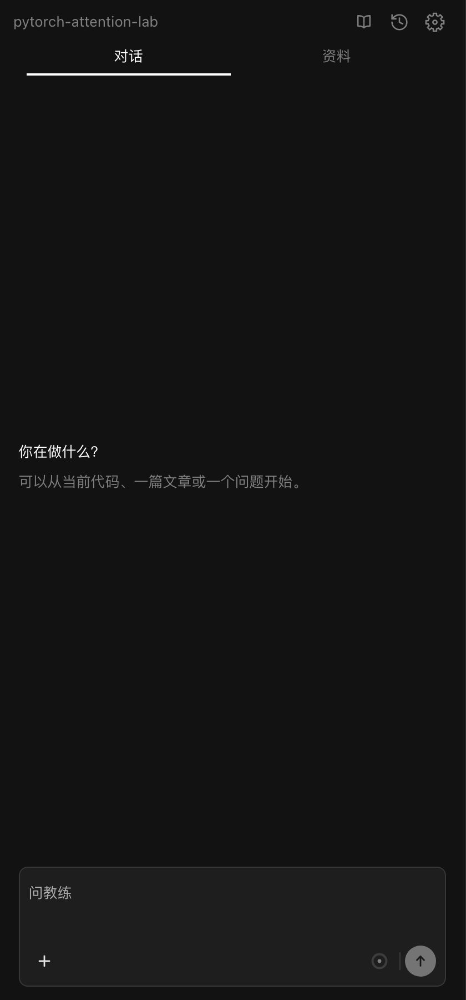
  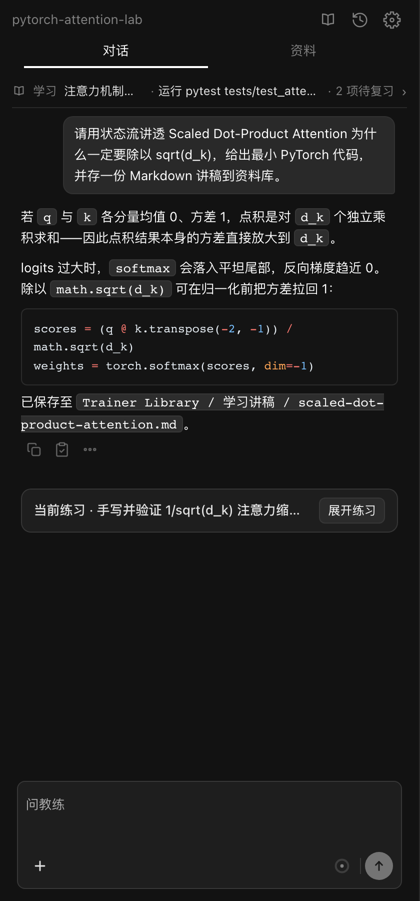
  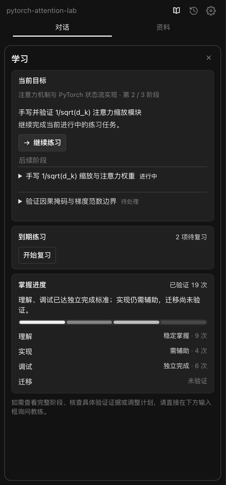
</p>
<p align="center">
  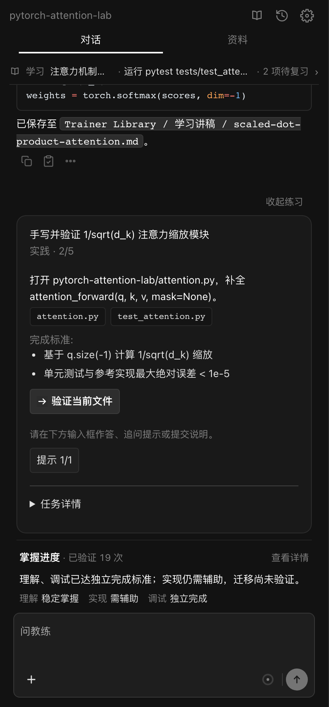
  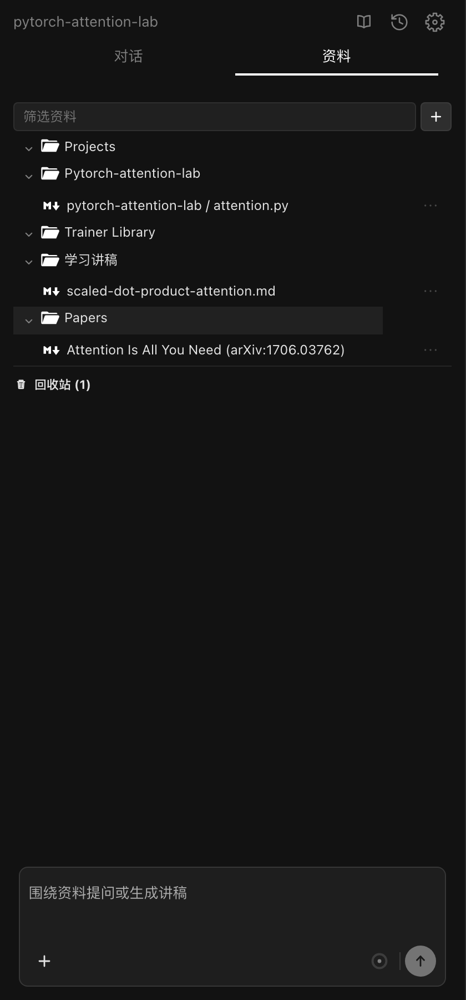
  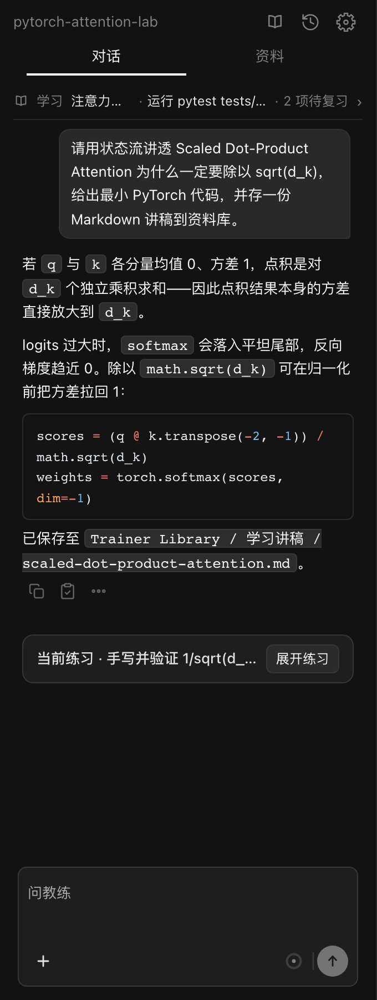
</p>

### 自定义 `$` 技能 —— 一键复用、导出分享

在唯一输入框输入 `$` 即可呼出技能面板；在 **设置 → 教练 → 技能** 中管理内置或自定义 Prompt 技能。所有导入导出均为**纯 JSON 数据**（`{ trigger, title, prompt, keywords }`），严格限制长度、拒绝 `eval()`、且内置 trigger 受保护不可被覆盖。

<p align="center">
  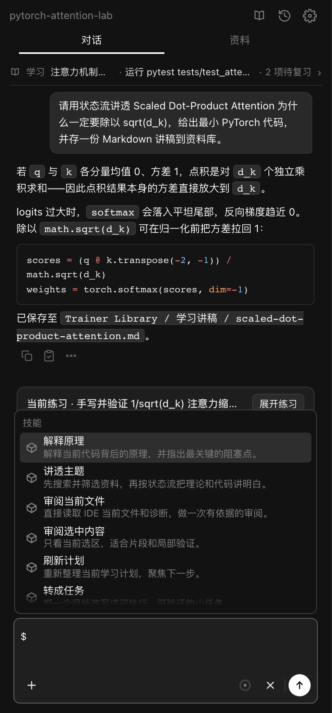
  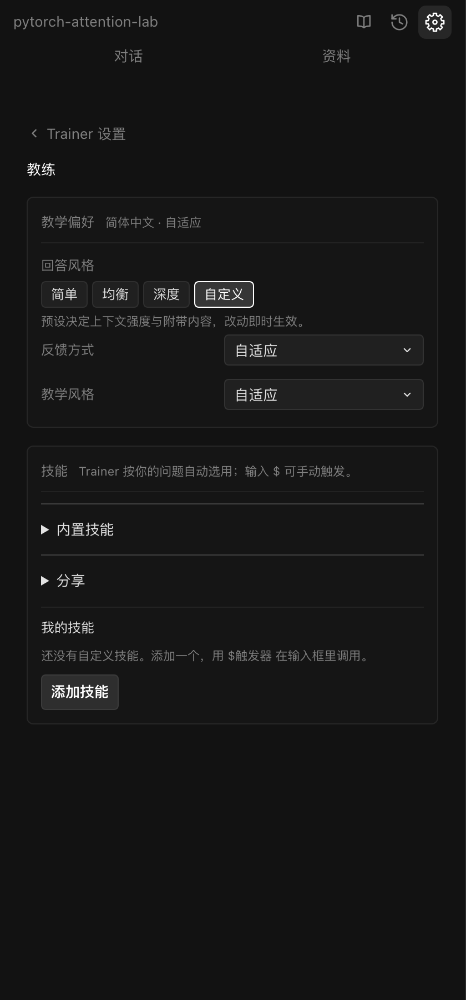
</p>

<p align="center"></p>

---

## Remote-SSH 远端协同

针对连接 Linux 服务器做开发与训练的场景，Trainer 采用 **「本机大脑 + 远端手脚」** 架构：

- **UI 面板、Python 推理 sidecar、API 密钥、记忆数据库与 `<LibraryRoot>`** 始终留在本机
- **`remote-extension/`**（`Trainer Workspace Companion`，随安装包打包于 `extension/bundled/remote/trainer-workspace-companion.vsix`）轻量化运行于远端编码窗口，通过 VS Code 命令通道负责读取远端代码、搜索、诊断及执行受控测试
- **远端只写隔离**：远端源码目录默认并硬性锁定禁止越权写改，测试结果由 `trainer.remote.verify` 安全流式回传并记为正式验证证据

<p align="center">
  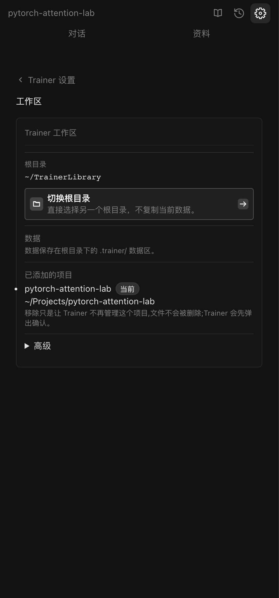
</p>

---

## 横向对比

| 维度 | Vibe Coding 工具 | 通用 AI Chat IDE | 记忆卡工具 | **Trainer** |
|---|---|---|---|---|
| 替你写生产代码 | ✅ | ✅ | ❌ | ❌（核心边界） |
| 真实代码与测试门禁 | ❌ | ❌ | ❌ | ✅ 本地沙箱 + Testing API + Remote-SSH |
| 跨会话/跨周持久记忆 | ⚠️ 受限于上下文 | ⚠️ 简单摘要 | ✅ | ✅ SQLite + Qdrant 统一存于 `<LibraryRoot>` |
| 保持用户 git 仓库干净 | ⚠️ 易混入产物 | ⚠️ | 不适用 | ✅ 唯一 `<LibraryRoot>`，源码仓零写入 |
| FSRS 遗忘曲线调度 | ❌ | ❌ | ✅ | ✅ 支持心流防打断 |
| 权限与远端安全分级 | ❌ | ⚠️ 仅基础信任弹窗 | ❌ | ✅ 六级权限阶梯 + 远端越权硬锁 |
| 开源测试保障规模 | 闭源 | 闭源 | 闭源 | ✅ **6,606 个单元/集成用例 + 166 个 E2E** |
| 完整多语言适配 | ⚠️ | ⚠️ | ⚠️ | ✅ **8 语言**全量 CI 完整性守卫 |

> 其他工具让你“交付得更快”；**Trainer 让你“真的会写了”。**

---

## 五分钟实操演示

1. **T+0:00 — 打开侧边栏**：点击左侧栏 Trainer 图标直接进 **对话**，无开屏配置墙阻挡。
2. **T+0:30 — 连上你的模型**：进 **设置 → 连接**，填入协议、服务根地址、模型与 Key（系统代理若导致 502/超时一键切 **直连**），点击 **测试连接**。
3. **T+1:30 — 请求深度讲稿或代码诊断**：在底部输入框提问（如 *“用状态流讲透 Scaled Dot-Product Attention 并存成 Markdown 笔记”*），讲稿自动落盘至 `<LibraryRoot>/Trainer Library/`。
4. **T+2:30 — 动手做当前练习**：在对话内展开当前 **FocusedPractice** 练习卡片，直接在你的源码里修改——依然通过**唯一输入框**追问思路或提交反思。
5. **T+4:00 — 跑通真实核验**：点击 **验证当前文件**（或在远端触发 `trainer.remote.verify`）。通过真实核验后，能力状态在 **理解 / 实现 / 调试 / 迁移** 四维度如实跃升，并排好下一次 FSRS 复习。
6. **T+5:00 — 一眼看清全局**：点右上角书本图标打开 **学习抽屉**，直接查看当前目标、到期复习与 4 段能力条。

---

## 为什么它用起来不一样

### 诚实失败与直连旁路
- 未知中转网关绝不盲猜成 OpenAI 兼容协议
- **忽略系统代理（直连）** 单项开关绕开本机代理端口干扰导致的 502 / 超时，无需改动系统环境
- 流式空包、鉴权错误或中断恢复直接提示明确原因，绝不靠转圈掩盖错误

### 端点并发测速与推理适配
- 预热剔除冷启动波动后并发测速多路地址，毫秒级反馈一键切换最快通道
- 依据实测 + 模型族推断 `Tools / Thinking / Vision / Streaming`，不向不支持的接口硬塞思考参数

<p align="center"></p>

### 统一高能资料库
- 一键导入 PDF（`PyMuPDF`）、网页（`Trafilatura`）、DOCX（`mammoth` / `MarkItDown`）以及教练自动沉淀的 Markdown 讲稿
- 全部归集于 `<LibraryRoot>/Trainer Library/`，支持 VS Code 富 Markdown 渲染阅读与图床预览、可恢复回收站及行内“围绕此资料提问”

<p align="center"></p>

### 浏览器拓展极速采集与 Side Panel（`browser-extension/`）
- Chromium MV3 扩展**零配对码**自动发现本机 Trainer sidecar（`127.0.0.1`）
- 网页、arXiv PDF、GitHub 仓库（可选 `含 docs/`）或划词内容一键入 `<LibraryRoot>/Trainer Library/` 或预填教练输入框，自带离线双队列与 **8 语言完整对话 Side Panel**

<p align="center">
  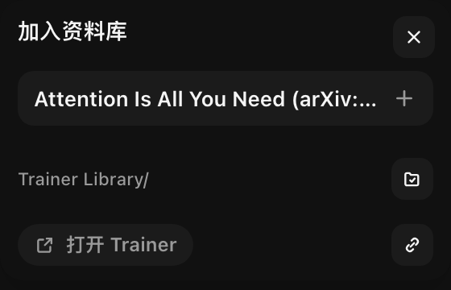
</p>

### MCP 外部工具接入（`docs/mcp.md`）
- 通过 `TRAINER_MCP_SERVERS` 显式开启 stdio 传输的 **MCP（Model Context Protocol）** 客户端，自动把 GitHub / Gitee 等外部服务工具映射进教练代理工具池，并受同一套**六级权限阶梯 fail-closed 约束** —— 详见 [`docs/mcp.md`](docs/mcp.md)

---

## 系统架构

### 系统拓扑

```text
┌─────────────────────────────────────────────────────────────────────────┐
│                             VS Code Window                              │
│  ┌──────────────────────────────┐    ┌────────────────────────────────┐ │
│  │  Trainer 侧边栏 (React 19)    │    │  Remote-SSH 远端编码窗口        │ │
│  │  对话 / 资料 + 学习抽屉        │◄──►│  remote-extension (Companion)  │ │
│  │  8 语言 · 唯一输入框主权       │    │  远端只读查文件与测试执行代理   │ │
│  └──────────────┬───────────────┘    └────────────────────────────────┘ │
│                 │                                                       │
│  ┌──────────────▼───────────────┐                                       │
│  │  扩展宿主 Host (TypeScript)   │  • SecretStorage (系统钥匙串保管密钥)  │
│  │  命令注册 · 工作区网关 ·       │  • Testing API → 真实测试验证签收     │
│  │  Sidecar 生命周期管理器       │  • Browser Extension MV3 通信桥       │
│  └──────────────┬───────────────┘                                       │
│                 │ http://127.0.0.1 + SSE 流式通道                        │
│  ┌──────────────▼───────────────┐    ┌────────────────────────────────┐ │
│  │  FastAPI Sidecar (Python)    │───►│  唯一学习库根 <LibraryRoot>     │ │
│  │  • ReAct 工具代理环 + MCP     │    │  • Trainer Library/ (讲稿/资料) │ │
│  │  • RethinkFun 状态流教学内核  │    │  • .trainer/runtime/           │ │
│  │  • 5 协议网关 + 代理直连开关  │    │    trainer.sqlite3 · Qdrant ·  │ │
│  │  • FSRS 遗忘调度 + 结构化记忆 │    │    检查点 · 审计事件账本        │ │
│  │  • 六级工作区权限守卫         │    │  (用户代码仓库保持零写入污染)   │ │
│  └──────────────────────────────┘    └────────────────────────────────┘ │
└─────────────────────────────────────────────────────────────────────────┘
```

### 目录结构（当前仓库实测）

| 目录 | 职责内容 | 实测规模 |
|---|---|---|
| `extension/src/` | VS Code 宿主：命令注册、钥匙串 Provider、WorkspaceGateway、Sidecar 进程管理 | `79` 个 TS 文件（约 `53,286` 行） |
| `extension/webview/src/` | React 工作台：两入口一对话、学习抽屉、唯一输入框、Shiki/KaTeX/Mermaid、8 语言文案 | `233` 个 TS/TSX + `53` CSS（约 `120,507` 行） |
| `extension/tests/` | `node:test` 测试集：宿主行为、共享治理、i18n 完整性、浏览器采集、权限安全 | `317` 个文件 · **`2,401` 个用例** |
| `server/app/` | FastAPI 后端：ReAct 代理、RethinkFun 内核、记忆/FSRS、文档解析、沙箱验证、权限门控 | `232` 个 Python 文件（约 `173,863` 行） |
| `server/tests/` | 后端 `pytest` 测试集：API 路由、教学内核、FSRS/记忆、5 协议、安全隔离 | `295` 个文件 · **`4,205` 个收集用例** |
| `shared/src/` | 宿主、Webview 与测试共用的确定性治理纯函数与协议定义 | `76` 个模块（约 `29,508` 行 · `523` 导出符号） |
| `remote-extension/src/` | Remote-SSH 远端伴侣扩展（`extensionKind: ["workspace"]`） | `2` 个 TS 文件（`746` 行） |
| `browser-extension/` | Chromium MV3 快速采集弹窗、离线投递队列、右键菜单与 Side Panel 对话端 | `8` 个源码文件（`6,977` 行） |
| `extension/bundled/` | 随 VSIX 打包的冻结 Python sidecar 二进制与 `trainer-workspace-companion.vsix` | 约 `245 MB` |

### 统一快照契约（`WorkbenchSnapshot`）

全部主状态读取接口均返回统一规范 **`WorkbenchSnapshot`**（`server/app/core/models.py` 共 `33` 个顶层字段），借助 `snapshot_revision` 实现轻量增量同步，前后端状态严丝合缝。

---

## 安全模型

- **密钥只入操作系统钥匙串 / VS Code `SecretStorage`**：永不落盘至工作区、`<LibraryRoot>`、快照或日志（`npm run verify:credentials` 全仓扫描门禁守护）
- **Workspace Trust 强制拦截**：未信任窗口自动阻止文件分析、沙箱与远端核验动作
- **六级权限阶梯**（`server/app/workspace/authority.py`）：默认对用户源码仅只读，Remote-SSH 远端工作区从底层硬性锁死任何破坏性或重组写入
- **单根库 + 可恢复回收站**：删除资料仅移入可恢复回收站；用户代码仓永不被写入缓存目录或状态文件
- **纯 JSON 技能分享**：严格字段大小校验与内置 Trigger 保护，杜绝脚本注入
- **遥测默认关闭（Opt-in）**：开启后也只含本地事件粗糙计数，不含源码、路径与个人对话内容

---

## 质量门禁

> 以下每一项均为当前 `main` 分支（`v1.6.2`）实测数据，不虚报未验证项：

| 门禁 | 实测覆盖与结果 | 执行命令 |
|---|---|---|
| **后端测试 (`pytest`)** | **295 个文件 · 4,205 个测试用例**（含多组 subtests） | `npm run test:server` |
| **前端与共享 (`node:test`)** | **317 个文件 · 2,401 个测试**（`2,400` 通过，`1` 平台条件跳过，`0` 失败） | `npm run test:extension` |
| **静态 lint 与类型检查** | `ruff check`（0 错）· `pyright`（0 错）· CSS 节分段 + `tsc -b`（0 错） | `npm run check && npm run verify:server-pyright` |
| **UI 几何门禁** | 唯一输入框主权、两入口壳层、无溢出校验（`340/420/460px` × 深浅色 × 中英） | `npm run verify:ui-geometry` |
| **i18n 完整性门禁** | **213** 处 `appUiCopy` + **212** 处 `settingsText` + **272** 处 `hostCommandCopy` 覆盖 **8 语言**（0 缺失 / 0 串文） | `npm run verify:i18n` |
| **文案词汇与凭据安全** | **68** 份 UI 文件零内部黑话泄露 · **4,027** 份文件扫描零明文密钥泄露 | `npm run verify:copy-vocabulary && npm run verify:credentials` |
| **E2E 与 Remote-SSH** | **30** 个 Playwright E2E 测试集（`166` 条测试）+ 真实 sidecar 矩阵 + Ubuntu Remote-SSH L2 实测（`20/20`） | `npm run test:experience-matrix` · `npm run test:remote-ssh-e2e` |
| **CI 跨平台发布构建** | **三大原生桌面目标**：`win32-x64`、`darwin-arm64`、`linux-x64`（Windows/Linux ARM64 暂未提供 CI 构建证明） | `.github/workflows/release.yml` |

*（说明：最终人工教学主观体验签收 `T-0028` 仍保持人工把关状态，步骤见 [`docs/TRIAL-1.5.0-RC.md`](docs/TRIAL-1.5.0-RC.md)。）*

---

## i18n · 八种语言

界面正文、设置项、扩展宿主提示、浏览器扩展及 README 文档全面支持 **8 种语言**：

`zh-CN`（简体中文）· `en-US`（English）· `es-ES`（Español）· `fr-FR`（Français）· `de-DE`（Deutsch）· `ja-JP`（日本語）· `ko-KR`（한국어）· `pt-BR`（Português）

通过 `npm run verify:i18n` 对 8 套表、占位符与跨语种漏翻实现自动化拦截（`extension/webview/src/lib/i18n/copy.ts`）。

---

## 致谢

- **运行时与 HTTP 通信**：[FastAPI](https://github.com/fastapi/fastapi) · [Uvicorn](https://github.com/encode/uvicorn) · [Pydantic](https://github.com/pydantic/pydantic) · [httpx](https://github.com/encode/httpx) · [openai-python](https://github.com/openai/openai-python)
- **长期记忆、FSRS 与文档解析**：[py-fsrs](https://github.com/open-spaced-repetition/py-fsrs) · [qdrant-client](https://github.com/qdrant/qdrant-client) · [PyMuPDF](https://github.com/pymupdf/PyMuPDF) · [Trafilatura](https://github.com/adbar/trafilatura) · [MarkItDown](https://github.com/microsoft/markitdown)
- **前端与富文本渲染**：[React](https://github.com/facebook/react) · [Vite](https://github.com/vitejs/vite) · [Zustand](https://github.com/pmndrs/zustand) · [Zod](https://github.com/colinhacks/zod) · [react-markdown](https://github.com/remarkjs/react-markdown) · [KaTeX](https://github.com/KaTeX/KaTeX) · [Shiki](https://github.com/shikijs/shiki) · [Mermaid](https://github.com/mermaid-js/mermaid) · [@tanstack/react-table](https://github.com/TanStack/table) · [PDF.js](https://mozilla.github.io/pdf.js/) · [mammoth](https://github.com/mwilliamson/mammoth.js) · [docx-preview](https://github.com/VolodymyrBaydalka/docx-preview)
- **测试、静态检查与打包**：[pytest](https://github.com/pytest-dev/pytest) · [Hypothesis](https://github.com/HypothesisWorks/hypothesis) · [ruff](https://github.com/astral-sh/ruff) · [pyright](https://github.com/microsoft/pyright) · [TypeScript](https://github.com/microsoft/TypeScript) · [Playwright](https://github.com/microsoft/playwright) · [PyInstaller](https://github.com/pyinstaller/pyinstaller)
- **教学方法与理念启发**：状态流直观教学方式灵感源自 AI 技术博主 **[RethinkFun](https://rethink.fun)** · [open-spaced-repetition/fsrs4anki](https://github.com/open-spaced-repetition/fsrs4anki)
- **视觉素材**：由 **[GPT Image](https://github.com/AI-yyf/trainer/tree/main/assets)** 生成（规范见 `assets/MASCOT.md` · `assets/BANNER_PROMPT.md` · `assets/FEATURE_PROMPTS.md`）

---

## 许可证

[MIT](LICENSE)

---

## 引用 Trainer

```bibtex
@software{trainer2026,
  title  = {Trainer: A Long-Term Coding Coach Living in Your Editor},
  author = {AI-yyf and contributors},
  year   = {2026},
  url    = {https://github.com/AI-yyf/trainer},
  note   = {v1.6.2}
}
```

---

<div align="center">

**// 训练你的 AI · 与 AI 共同成长**

`v1.6.2` · 由咖啡、FSRS、RethinkFun 状态流教学内核、6,606 个自动化测试，以及一颗拒绝替你写代码的心共同构筑。

</div>
