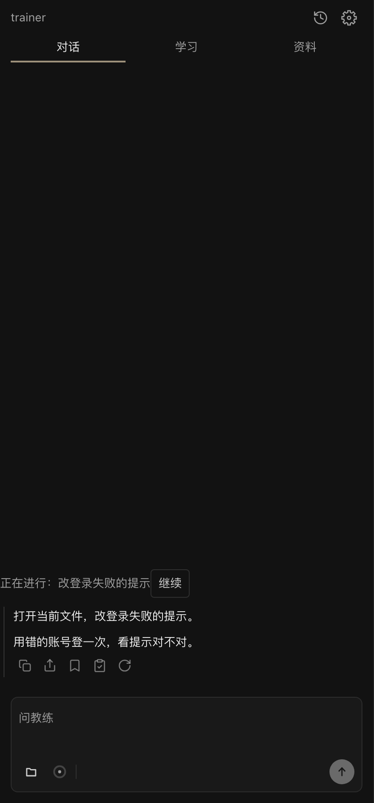
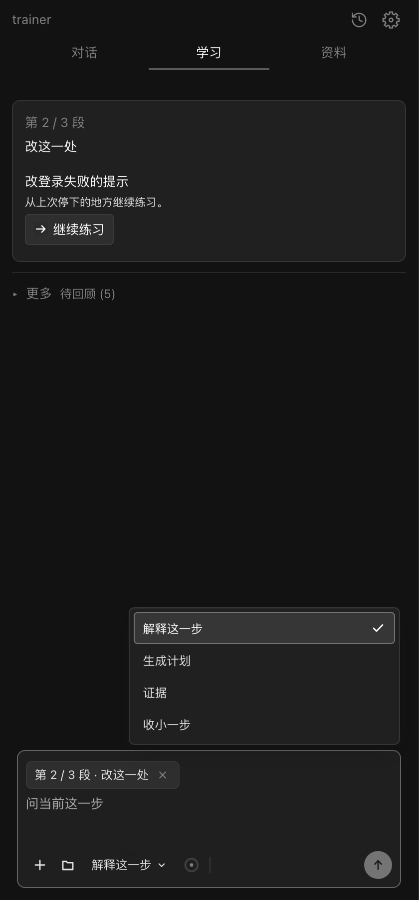
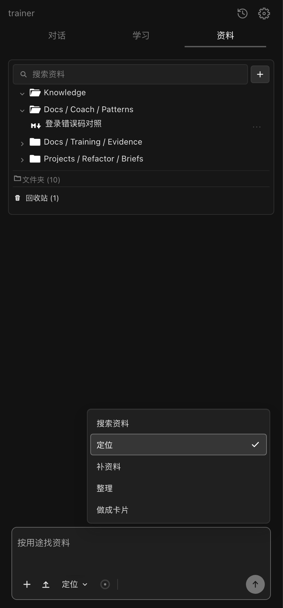
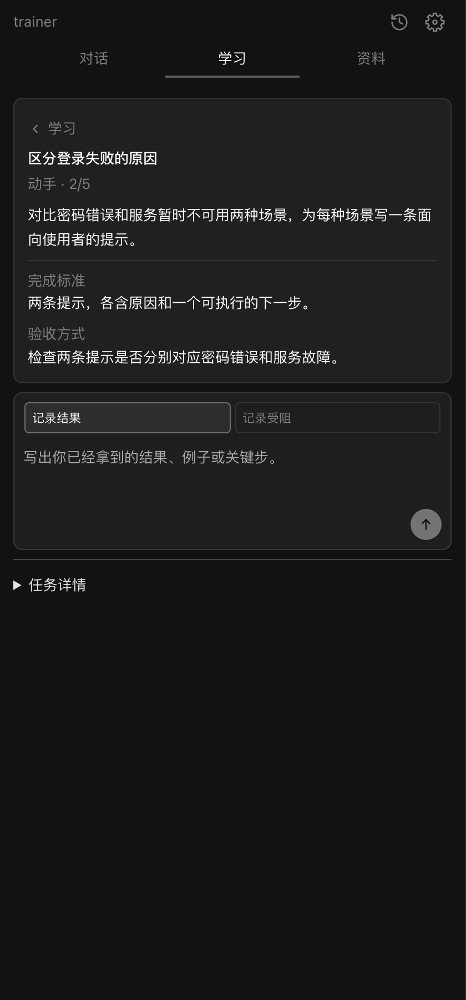

# Trainer 界面截图

对话、学习、资料、训练、成长和设置的主视图使用中文浏览器预览和演示数据。原生图来自隔离的 VS Code 窗口，浏览器采集图来自独立 Chromium 配置。

## 工作台

| 对话 | 学习 | 资料 | 独立训练 |
| --- | --- | --- | --- |
|  |  |  |  |

| 界面 | 截图 |
| --- | --- |
| 对话 | [首次打开](chat-first-run.png) · [窄侧栏](coach-narrow.png) · [浏览器选段草稿](coach-browser-selection.png) · [消息操作](message-actions.png) · [会话历史](history.png) |
| 学习 | [学习首页](plan.png) · [输入框操作](plan-modes.png) · [阶段关联资料](learning-linked-resource.png) · [原生学习首页](native/learning.png) · [原生窄侧栏](native/learning-narrow.png) |
| 资料 | [资料库](resources.png) · [输入框操作](resources-modes.png) · [资料阅读](resource-reader.png) · [原生资料库](native/resources.png) · [搜索结果](native/resources-search.png) · [打开资料](native/resources-editor.png) |
| 训练 | [独立训练卡](training.png) · [作答输入框](training-answer.png) · [基于资料的独立练习](training-from-resource.png) · [验证结果待确认](training-verification.png) · [到期复习队列](review-queue.png) · [复习作答](native/recall-question.png) · [作答结果](native/recall-recorded.png) |
| 成长 | [能力与证据](progress.png) |
| 设置 | [设置首页](settings-index.png) · [连接](settings-connected.png) · [快速配置](settings-quick-setup.png) · [教练与技能](skill-manager.png) · [工作区](settings-workspace.png) · [偏好](settings-preferences.png) · [教练习惯](native/coach-habit.png) |
| 技能 | [对话技能面板](skill-deck.png) |
| 浏览器采集 | [采集弹窗](browser-capture.png) · [离线等待投递](browser-capture-offline.png) · [失败恢复](browser-capture-retry.png) |

## 原生运行记录

| 场景 | 截图 |
| --- | --- |
| 浏览器选段到 VS Code 项目验证 | [草稿预填](native/source-learning/source-coach-prefill.png) · [阅读并加入学习](native/source-learning/source-reader-joined.png) · [独立训练](native/source-learning/source-training.png) · [现有测试通过](native/source-learning/source-verification.png) |
| 双窗口草稿切换 | [原工作区](native/source-learning/source-focus-first.png) · [第二工作区](native/source-learning/source-focus-second.png) |
| 来源版本更新 | [旧练习的验证结果待确认](native/source-learning/source-verification-stale.png) |
| MiniMax 中文公式回复 | [VS Code 对话](native/coach-minimax.png) |
| 流式 Markdown | [代码、公式和表格](native/streaming-markdown.png) |
| 取消、断线、恢复 | [主动取消](native/stream-cancelled.png) · [连接中断](native/stream-disconnected.png) · [重新发送](native/stream-recovered.png) |

MiniMax 对话与复习截图来自 `5b59af1` 安装包。取消、断线及资料截图来自 `d9de193` 安装包。取消与断线由本地测试服务控制，便于复现相同的中断条件。

浏览器选段旅程使用 `9ab9d7d` 的 macOS ARM64 安装包、隔离的 Chromium 和确定性测试 Provider。训练验证读取的是测试脚本提供的学习者文件。

双窗口和来源更新截图来自后续 macOS ARM64 安装验收，使用隔离工作区。旧版本用例在通过项目测试后更新测试资料的版本，再核对卡片状态和证据记录。
